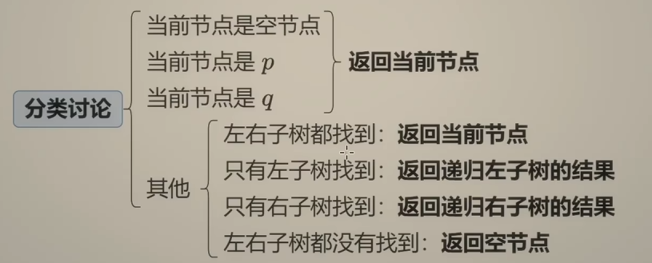
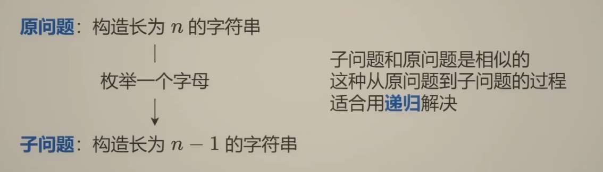
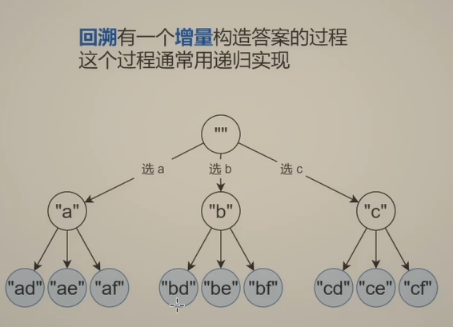
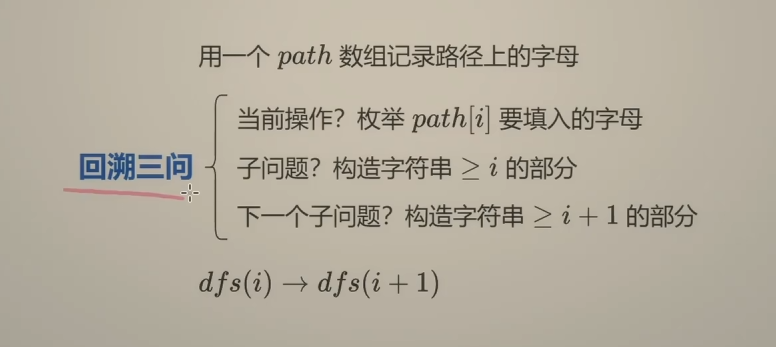
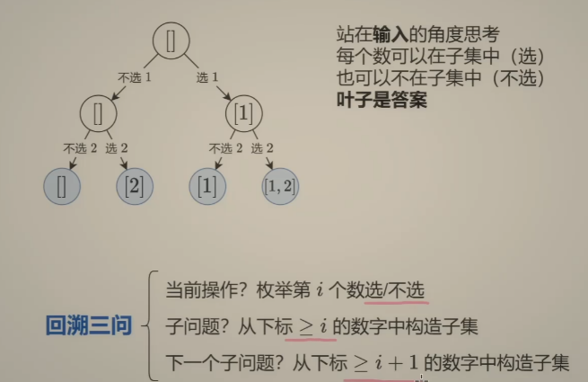
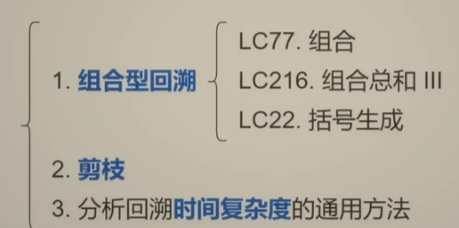
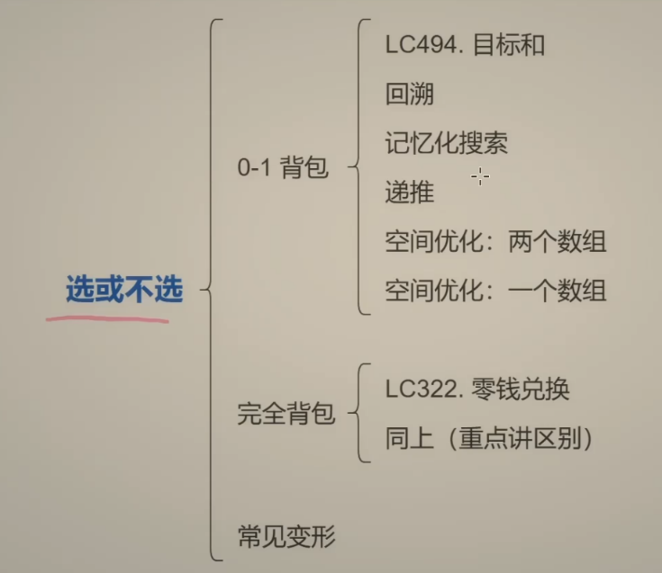
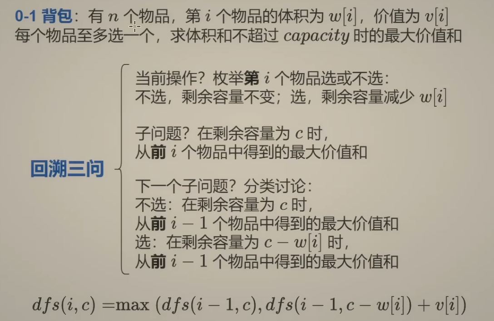
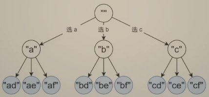

### No. 240

```c++
class Solution {
public:
    bool searchMatrix(vector<vector<int>>& matrix, int target) {
        int m = matrix.size();      // m是行数
        int n = matrix[0].size();   // n是列数
        int row = 0;
        int col = 0;

        for(int i = 0; i<m ; i++){
            if(matrix[i][0] <= target) {
                row = i;
            }else{
                break;
            }
        }

        for(int  i = 0; i<n; i++){
            if(matrix[0][i] <= target) {
                col = i;
            }else{
                break;
            }
        }

        while(row>=0 && col>=0){
            if(matrix[row][col] == target) return true;
            for(int i = col; i>=0; i--){
                if(matrix[row][i] == target) return true;
                if(matrix[row][i] < target) break;
            }
            row--;
            for(int i = row; i>=0; i--){
                if(matrix[i][col] == target) return true;
                if(matrix[i][col] < target) break;
            }
            col--;
        }
        return false;
    }
};
```


二分查找：

No.34 [在排序数组中查找元素的第一个和最后一个位置](https://leetcode.cn/problems/find-first-and-last-position-of-element-in-sorted-array/)

```python
def lower_bound(nums: List[int], target:int)  -> int:
    # 最终结束的时候，right + 1及其后边一定指向的是比target大的数的区间
    left = 0
    right = len(nums) - 1  # 闭区间
    while left <= right:
        mid = (left + right)//2  # mid = left + (right-left)//2 ，这样写不会溢出
        if nums[mid] < target:
            left = mid + 1
        else:
            right = mid - 1
    
    return right + 1

class Solution:
    def searchRange(self, nums: list[int], target: int) -> list[int]:

        start = lower_bound(nums, target)
        if start == len(nums) or nums[start] != target:
            return [-1, -1]
        
        end = lower_bound(nums, target + 1) - 1  # 因为start存在，所以end一定存在
        return [start, end]
```


NO. 162 [寻找峰值](https://leetcode.cn/problems/find-peak-element/)  (红蓝染色法)

```python
class Solution:
    def findPeakElement(self, nums: list[int]) -> int:
         # 定义rihgt为峰顶或者峰顶右侧元素所在位置
         left = 0
         right = len(nums) - 2
         while left <= right:
            mid = (left + right) // 2
            if nums[mid] > nums[mid + 1]:
                right = mid - 1
            else:
                left = mid + 1

         return left
```


NO.153 [寻找旋转排序数组中的最小值](https://leetcode.cn/problems/find-minimum-in-rotated-sorted-array/)

```python
class Solution:
    def findMin(self, nums: list[int]) -> int:
        left = 0
        right = len(nums) - 2
        while left <= right:
            mid = (left + right) // 2
            if nums[mid] < nums[-1]:
                right = mid - 1
            else:
                left = mid + 1
        
        return nums[left]
```


No.33 [搜索旋转排序数组](https://leetcode.cn/problems/search-in-rotated-sorted-array/)  (注意判断什么时候需要取等)

```python
class Solution:
    def search(self, nums: List[int], target: int) -> int:
        n = len(nums)
        left = 0
        right = n - 2
        while left<=right:
            mid = (left + right) // 2
            # 在同一段，且都在第一段
            if nums[mid] > nums[-1] and target > nums[-1]:
                if nums[mid] >= target:
                    right = mid - 1
                else:
                    left = mid + 1
            # 在同一段，且都在第二段
            if nums[mid] < nums[-1] and target <= nums[-1]:
                if nums[mid] >= target:
                    right = mid - 1
                else:
                    left = mid + 1
            # 不在同一段，
            if nums[mid] > nums[-1] and target <= nums[-1]:
                left =  mid + 1
            if nums[mid] < nums[-1] and target > nums[-1]:
                right =  mid -1

        if nums[left] == target:
            return left
        else:
            return -1
```


No.142 [环形链表 II](https://leetcode.cn/problems/linked-list-cycle-ii/)

```python
class Solution:
    def detectCycle(self, head: Optional[ListNode]) -> Optional[ListNode]: 
        fast = head
        slow = head
        while fast and fast.next:
            fast = fast.next.next
            slow = slow.next
            if fast is slow:
                while slow is not head: 
                    slow = slow.next
                    head = head.next
                return slow
        return None
```

慢指针移动的距离是小于环长的，可以以最坏的情况为例，这个时候slow刚好在环的入口，fast在slow的下一个节点，用相对速度分析（慢指针不动，快指针每次走一步），则快指针需要走环长-1步才能与满指针相遇，所以对于其余任何情况，相遇的时候，慢指针的移动距离是小于环长的


No.236 [二叉树的最近公共祖先](https://leetcode.cn/problems/lowest-common-ancestor-of-a-binary-tree/)

```python
class Solution:
    def lowestCommonAncestor(self, root: 'TreeNode', p: 'TreeNode', q: 'TreeNode') -> 'TreeNode':
        if root is None or root is p or root is q:
            return root
        left = self.lowestCommonAncestor(root.left, p, q)
        right = self.lowestCommonAncestor(root.right, p, q)

        if left and right:
            return root
        elif left:
            return left
        else: 
            return right
```

【二叉树的最近公共祖先【基础算法精讲 12】】https://www.bilibili.com/video/BV1W44y1Z7AR?vd_source=2a1d982a7191df1d29fee38ee7081e6f




No.235 [二叉搜索树的最近公共祖先](https://leetcode.cn/problems/lowest-common-ancestor-of-a-binary-search-tree/)

```python

```


NO.513 [找树左下角的值](https://leetcode.cn/problems/find-bottom-left-tree-value/)

```python
# Definition for a binary tree node.
# class TreeNode:
#     def __init__(self, val=0, left=None, right=None):
#         self.val = val
#         self.left = left
#         self.right = right
class Solution:
    def findBottomLeftValue(self, root: TreeNode | None) -> int:
        # 方法1：用层序遍历，返回最后一层的第一个节点
        
        # 方法2：层序遍历改变方向，从右到左遍历，这个时候就是层序遍历的最后一个节点
        q = deque([root])
        while q:
            node = q.popleft()
            if node.right:
                q.append(node.right)
            if node.left:
                q.append(node.left)
            if not q:
                return node.val
```


### 回溯问题

回溯问题的基本动作：做出选择 → 继续向下探索 → 撤销选择 → 尝试下一个选择

用两个数组来描述当前状态：

`path:` 当前已经选择的元素。例如：`path = [1, 2]`表示当前选出的子集是`[1,2]`

`start:` 接下来允许从哪个下标开始选择。例如：path = [1]， start = 1，已经选择了 `1`，接下来只能从下标 `1` 开始继续选择。

因此可以定义：`def backtrack(start):` 在当前 `path` 的基础上，从下标 `start` 开始，尝试继续加入元素，找出所有可能的子集。

```python
def backtrack(状态):
    if 当前状态满足答案要求:
        保存当前答案的副本

    if 当前状态无法继续:
        return

    for 选择 in 当前可选范围:
        做出选择
        backtrack(更新后的状态)
        撤销选择
```







注意，这里的 $i$ 的含义不是第 $i$ 个，而是 >=i 的这些部分还需要枚举。

然后，枚举了一个字母后，下一个子问题是什么，枚举了第i个过后，剩下的就是 >= i+1的这些部分了。

`子集型回溯：`每个元素都可以选或者不选。

题目，求 [1，2] 的子集：




NO.131 [分割回文串](https://leetcode.cn/problems/palindrome-partitioning/description/)

```python
class Solution:
    def partition(self, s: str) -> list[list[str]]:
        n = len(s)
        ans = []
        path = []

        def dfs(i):
            # 所有字符都已分割完成
            if i == n:
                ans.append(path.copy())
                return

            # 下一段从 i 开始，枚举它的结束位置 j
            for j in range(i, n):
                t = s[i:j + 1]

                # 只有回文片段，才可以作为当前选择
                if t == t[::-1]:
                    path.append(t)  # 选择这一段
                    dfs(j + 1)      # 继续分割剩下的字符串
                    path.pop()      # 撤销这一段，尝试其他结束位置

        dfs(0)
        return ans
```

- `dfs(i)` 的含义：`s[:i]` 已经分割完成，接下来要找出 `s[i:]` 的所有合法分割方式。  
- `path` 保存前边已经分割好的字符串
- `i` 是剩余字符串的起点，不是已经选了多少段。


`组合型回溯:`




NO.77 [组合](https://leetcode.cn/problems/combinations/description/)

如果用之前的思路做：


用组合剪枝的思路做：

```python
class Solution:
    def combine(self, n: int, k: int) -> list[list[int]]:
        ans = []
        path = []

        def dfs(i):
            # 剪枝部分
            d = k - len(path)
            if i < d:
                return
            # 主体部分
            if len(path) == k:
                ans.append(path.copy())
                return 
            for j in range(i,0,-1):  # 向下枚举
                path.append(j)
                dfs(j-1)
                path.pop()
        dfs(n)
        return ans	
```

- 如果剩下能选的数字数量，比还需要的数量少，那么这条路一定凑不够 `k` 个数，可以直接返回。
- 

### 动态规划

No.198 [打家劫舍](https://leetcode.cn/problems/house-robber/description/)

```python
class Solution:
    def rob(self, nums: List[int]) -> int:
        # 动态规划版本
        # n = len(nums)
        # if n == 1:
        #     return nums[0]
        # dp = [''] * n
        # dp[0] = nums[0]
        # dp[1] = max(dp[0], nums[1])
        # for i in range(2,n):
        #     dp[i] = max(dp[i-1], dp[i-2] + nums[i])
        # return dp[n-1]
        
        # 动态规划的优化
        n = len(nums)
        if n==1:
            return nums[0]
        f1 = nums[0]
        f2 = max(nums[0],nums[1])
        for i in range(2, n):
            f = max(f2, f1 + nums[i])
            f1 = f2
            f2 = f
        return f2

        # 回溯版本（时间是指数级别的，这样写会超市）
        # n = len(nums)
        # def dfs(i):
        #     if i<0:
        #         return 0
        #     res = max(dfs(i-1), dfs(i-2) + nums[i])
        #     return res
        # return dfs(n-1)

        # 回溯版本的优化（可以把重复的步骤存下来，下次就不用重复计算了）
        n = len(nums)
        cache = [-1] * n

        def dfs(i):
            if i<0:
                return 0
            if cache[i] != -1:  # 说明之前计算过了，可以直接拿出来用
                return cache[i]
            cache[i] = max(dfs(i-1), dfs(i-2) + nums[i])
            return cache[i]

        return dfs(n-1)
    
        # 递推（自底向上计算）
        n = len(nums)
        f = [0] * (n+2) # 因为这里多用了两个数组空间，因此，不用特殊处理前两个数值
        for i,x in enumerate(nums):
            f[i+2] = max(f[i+1], f[i]+x)
        return f[n+2]
```

0-1背包问题和完全背包问题，是 “选或不选” 这类题目的重要代表





0-1背包问题：有n个物体，每个物体只有一个

```python
# 0-1背包问题
# capacity: 背包容量
# w[i]: 第i个物品的体积
# v[i]: 第i个物品的价值
# 返回：所选物品体积和不超过capacity的前提下，所能得到的最大价值和
def zero_one_knapsack(capacity: int, w: List[int], v:List[int]) -> int:
    n = len(w)

    @cache # 加上这个装饰器，改成记忆化搜索，这样可以节省内存开销
    def dfs(i,c):
        # 此时一个物品都没有了，可以直接返回0
        if i<0:  
            return  0
        
        # 如果这个物品的体积已经超过了最大容量了，只能不选
        if c<w[i]: 
            return dfs(i-1,c)  
        
        # 背包还有容量放下当前物品，可以进行讨论
        a = dfs(i-1, c)  # 情况1，我不选当前物品，那么容量不变，在剩余i-1个物品中进行选择
        b = dfs(i-1, c-w[i]) + v[i]  # 情况2，我选择当前物品，那么当前的价值加上v[i], 当前背包的容量减去w[i], 然后在剩余的i-1个物品中继续选择
        return max(a,b)  # 返回两种情况的最大值，这样才能保证所选价值是最大的
    
    return dfs(n-1, capacity) # 从最后一个物品开始选择，这个时候容量就是初始容量
```

0-1背包问题的常见变形：

- 至多装capacity，求方案数/最大价值和
- 恰好装capacity，求方案数/最大/最小价值和
- 至少装capacity，求方案数/最小价值和

```
dp[i][j]: 下标为[0,i]之间的物体，任取放在剩余容量为j的背包里， 此时背包的最大价值
dp[i][j]可以从哪几个方向推导出来：
	1. 不放下标为i的物体，它的最大价值是dp[i-1][j]
	2. 放下标为i的物体，它的最大价值是dp[i-1][j-weight[i]] + value[i]
对于上述讨论的两种情况，应该取其中的最大值 
根据上述讨论的两种情况，来确定dp[i][j]应该初始化哪些（对于这里，任何一个数值，由它上方或者左上角推导出来，所以应该初始化第一行第一列）
遍历顺序：
	for（）物品
		for() 背包
对于二维数组实现的01背包，顺序可以改变，先遍历物品或先遍历背包结果是一样的
可以画一个dp[i][j]的二维表格来进行理解
```

NO.494 [目标和](https://leetcode.cn/problems/target-sum/description/)

法1：用二维数组

```python
dp[i][j]： 前 i 个数字中，选出和为 j 的方案数

class Solution:
    def findTargetSumWays(self, nums: list[int], target: int) -> int:
        n = len(nums)
        s = sum(nums)
        p = s + target
        if p<0 or p%2!=0:
            return 0
        p = p // 2

        f = [[0] * (p + 1) for _ in range(n+1)]
        f[0][0] = 1
        
        for i,x in enumerate(nums):
            for c in range(p + 1):
                if c < x: # 如果当前背包容量放不下了，就只能继续看剩下的i个数
                    f[i+1][c] = f[i][c]
                else: # 还放的下，分情况讨论
                    f[i+1][c] = f[i][c] + f[i][c-x]
        
        return f[n][p]
```

法2：使用0-1背包

```python
class Solution:
    def findTargetSumWays(self, nums: list[int], target: int) -> int:
        n = len(nums)
        s = sum(nums)
        p = s + target
        if p<0 or p%2!=0:
            return 0
        p = p // 2

        @cache
        def dfs(i,c):
            if i<0:
                return 1 if c==0 else 0  # c=0的时候，这个才是一个合法的方案，也就是刚好等于target
            if c<nums[i]:
                return dfs(i-1, c)
            return dfs(i-1,c) + dfs(i-1,c-nums[i])  # 因为求的是方案数
        
        return dfs(n-1, p)  # 下标从 0 到 n-1
```


完全背包：

有n种物品，每种物品可以选无数次，第 i 种物品的体积为 w[i], 价值为 v[i], 求体积和不超过 capacity 的最大价值和

##### No.322 [零钱兑换](https://leetcode.cn/problems/coin-change/description/)

方法1，完全背包做法

```python
class Solution:
    def coinChange(self, coins: list[int], amount: int) -> int:
        n = len(coins)

        @cache
        def dfs(i, c):
            # 此时没有硬币了，可以返回0
            if i<0:
                return 0 if c==0 else inf
            # 当前容量已经不够放下coins[i], 那么就看剩余的i-1个硬币
            if c < coins[i]:
                return dfs(i-1, c) 
            # 当前容量可以放下 coins[i], 分情况讨论
            a = dfs(i-1, c)  # 不选 coins[i], 那么容量不变，继续在剩余的 i-1 个选
            b = dfs(i, c-coins[i])  # 选 coins[i], 容量减少coins[i], 使用的硬币个数 + 1，同时继续在剩余的i个中选，因为可以无限选，所以是 i， 不是 i-1
            return min(dfs(i-1, c), dfs(i, c-coins[i]) + 1)

        ans = dfs(n-1, amount)
        return ans if ans<inf else -1
```

方法2， 二维DP数组

```python
class Solution:
    def coinChange(self, coins: list[int], amount: int) -> int:
        n = len(coins)

        f = [[inf] * (amount + 1) for _ in range(n + 1)]
        f[0][0] = 0

        for i, x in enumerate(coins):
            for c in range(amount + 1):  # c表示剩余容量
                if c < x:
                    f[i+1][c] = f[i][c]
                else:
                    f[i+1][c] = min(f[i][c], f[i+1][c-x] + 1)
        
        ans = f[n][amount]
        return ans if ans < inf else -1
```


### No.1143 [最长公共子序列（LCS）](https://leetcode.cn/problems/longest-common-subsequence/)

在算法题中，子数组和子串是连续的，但是子序列是可以不连续的

```python
class Solution:
    def longestCommonSubsequence(self, text1: str, text2: str) -> int:
        n = len(text1)
        m = len(text2)

        @cache
        def dfs(i, j):
            # 其中一个字符串为空
            if i<0 or j<0:
                return 0
            
            # 如果此时两个字符相等，可以继续看两者剩余的
            if text1[i] == text2[j]:
                 return dfs(i-1, j-1) + 1
            # 如果不等，分别移动各自的指针, 因为是求最长，所以是取最大值
            else:
                return max(dfs(i-1,j), dfs(i, j-1))
        
        return dfs(n-1, m-1)

```

法2：改用递推的形式来做

```python
class Solution:
    def longestCommonSubsequence(self, text1: str, text2: str) -> int:
        n = len(text1)
        m = len(text2)

        f = [[0] * (m+1) for _ in range(n+1)]  # m+1列，n+1行

        for i,x in enumerate(text1):
            for j,y in enumerate(text2):
                if x == y:
                    f[i+1][j+1] = f[i][j] + 1
                else:
                    f[i+1][j+1] = max(f[i][j+1], f[i+1][j])

        
        return f[n][m]
```

### NO.72 [编辑距离](https://leetcode.cn/problems/edit-distance/)

```
class Solution:
    def minDistance(self, word1: str, word2: str) -> int:
        n = len(word1)
        m = len(word2)

        @cache
        def dfs(i, j):
            # 一个字符串为空，
            # i<0, 比如 word1 = ""  而 word2 = "abc"  比如插入三次，即 j+1
            if i<0:
                return j+1
            # 比如  word1 = "abc" ,而word2 = "" ，比如删除三次, 即 i+1
            if j<0:
                return i+1

            # 相等的时候   
            if word1[i] == word2[j]:
                return dfs(i-1,j-1)
            else:
                # 三种方法
                # 1， 插入（需要区分，容易搞混）
                # dfs(i,j-1) + 1

                # 2. 删除
                # dfs(i-1, j) + 1

                # 3. 替换
                # dfs(i-1, j-1) + 1
                return min(dfs(i-1,j-1), dfs(i-1,j),dfs(i,j-1)) + 1
        
        return dfs(n-1,m-1)
```

法1：`dfs(i, j)` 表示：将 `word1` 的前 `i+1` 个字符转换为 `word2` 的前 `j+1` 个字符，所需要的最少操作次数。

三种情况：

`1. 替换：dfs(i-1, j-1) + 1`

这个操作比较容易理解。

例如：

```python
word1 = "abc"
word2 = "abd"
```

当前：`dfs(2, 2)`

因为：

```python
word1[2] = "c"
word2[2] = "d"
```

两个字符不同。

我们可以把 `word1` 最后一个字符 `"c"` 替换为 `"d"`。

abc

abd

将 c 替换为 d


替换最后一个字符后，剩下的问题是：

```
ab` → `ab
```

对应 `dfs(1, 1)`。

因此：替换对应 `dfs(i-1, j-1) + 1`

为什么两个下标都减一？

因为我们已经通过替换，让 `word1[i]` 与 `word2[j]` 对应上了，所以接下来只需要考虑两个字符串各自前面的部分。

`2. 删除：dfs(i-1, j) + 1`

假设：

```
word1 = "abc"
word2 = "ab"
```

我们想把 `"abc"` 转换成 `"ab"`。

最容易想到的操作就是删除 `"c"`。

```
abc
ab
```

删除 `c` 后，剩下的问题是：

```
ab` → `ab
```

对应 `dfs(1, 1)`。

因此：删除对应 `dfs(i-1, j) + 1`


为什么只有 `i` 减一？

因为删除的是 `word1` 的最后一个字符。

- `word1` 少了一个需要处理的字符，所以 `i-1`。
- `word2` 没有发生任何变化，仍然需要匹配它的全部目标前缀，所以 `j` 不变。

特别注意：这里的 `j` 不变，不是因为我们允许修改 `word2`，而是因为 `word2` 本来就不需要修改。

`3. 插入：dfs(i, j-1) + 1`

这是你代码中理解有误的地方，也是三种操作中最容易搞混的。

假设：

```
word1 = "ab"
word2 = "abc"
```

我们需要将 `"ab"` 转换成 `"abc"`。

显然，只需要在 `word1` 的末尾插入 `"c"`。

```
ab
abc
```

插入 c


在 `word1` 末尾插入 `c` 之前，原来的 `ab` 需要匹配目标字符串的 `ab`。

所以剩下的问题是：

```
ab` → `ab
```

对应 `dfs(1, 1)`。

而当前原始问题为：

```
dfs(1, 2)
```


因此，插入操作的状态转移应该是： `dfs(i, j-1) + 1`


为什么这里是 `j-1`，而不是 `i-1`？

因为新插入的字符负责匹配 `word2[j]`，而 `word1` 原本的字符一个都没有被删除或者消耗。

也就是说：

- `word1` 原来的前 `i+1` 个字符仍然需要处理，因此 `i` 不变。
- `word2[j]` 已经由我们新插入的字符来匹配，因此只需要考虑 `word2` 的前 `j` 个字符，即 `j-1`。

注意，`j-1` 并不是删除 `word2` 的字符，而是将 `word2[j]` 这个目标字符交给插入操作处理，因此剩下的子问题不再需要考虑它。


法2，递推

```python
class Solution:
    def minDistance(self, word1: str, word2: str) -> int:
        n = len(word1)
        m = len(word2)

        f = [[inf] * (m+1) for _ in range(n+1)]
        # 注意初始化
        # f[0][j] 都应该为 j
        # f[i][0] 都应该为 i
        f[0] = list(range(m+1))
        for i,x in enumerate(word1):
            f[i+1][0] = i+1 # 这是初始化（因为这里下标是加了1）
            for j,y in enumerate(word2):
                if x == y:
                    f[i+1][j+1] = f[i][j]
                else:
                    f[i+1][j+1] = min(f[i+1][j],f[i][j+1],f[i][j]) + 1
        return f[n][m]        
```


### No. 300 [最长递增子序列](https://leetcode.cn/problems/longest-increasing-subsequence/)

用递推的思想来解决：

```python
class Solution:
    def lengthOfLIS(self, nums: list[int]) -> int:
        n = len(nums)

        # dfs(i) 表示以 nums[i] 结尾的最长递增子序列的长度
        @cache
        def dfs(i):
            res = 0
            for j in range(i):
                if nums[j] < nums[i]:
                    res = max(res, dfs(j))
            return res + 1 # 这里的 1 就表示nums[i]
        
        ans = 0

        for i in range(n):
            ans = max(ans, dfs(i))

        return ans

```

使用动态规划进行优化:

```python
class Solution:
    def lengthOfLIS(self, nums: list[int]) -> int:
        n = len(nums)

        f = [0] * n
        
        for i in range(n):
            for j in range(i):
                if nums[j] < nums[i]:
                    f[i] = max(f[i], f[j])
            f[i] += 1
    
        return max(f)

```


# 定长滑动窗口

### NO.1456 [定长子串中元音的最大数目](https://leetcode.cn/problems/maximum-number-of-vowels-in-a-substring-of-given-length/)

【分析】子串要求字符在原字符串中连续出现，并且保持原来的顺序。

```python

```


### 相向双指针

双指针的引用场景：

1. 单调性：left移动时，子数组的和不断减小；right移动时，子数组的和不断扩大
2. 在移动指针的时候，while从满足要求到不满足要求

##### NO.167 两数之和（Ⅱ）

【解析】数组是已经有序的，右指针往里缩，只会让和更小；左指针往里缩，只会让和更大

时间复杂度 O(n)   空间复杂度 O(1)

```python
class Solution:
    def twoSum(self, numbers: List[int], target: int) -> List[int]:
        n = len(numbers)
        left = 0
        right = n - 1
        while left < right:
            s = numbers[left] + numbers[rgiht]
            if s==target:
                return [left + 1, right + 1]
            elif s>target:
                right -= 1
            else:
                left += 1
        return []
```

##### NO.15 三数之和

【解析】如果数组有序，就可以用相向双指针了，所以这里可以先直接对数组进行一次排序

题目还说，三元组的顺序不重要(不能重复)，因此相当于要求 i<j<k。

然后这个题就可以枚举 nums[i], 然后让其和等于 -num[i], 这样就转换成了上一个题目

时间复杂度 O(n^2); 空间复杂度 O(1)

```python
class Soultion:
    def threeSum(self, nums: List[int]) -> List[List[int]]:
        nums.sort()  # 先直接对原来的数组进行排序，在数组有序的情况下，可以使用双向双指针
        ans = []
        n = len(nums)
        for i in range(n-2): # 遍历nums[i], 后边最后要留两个数 n-1 和 n-2, 所以遍历到 n-3. range是左闭右开
            x = nums[i]

            if x + nums[i+1] + nums[i+2] > 0: #如果和最小的两个数加起来都大于0，因为后边的数都比这两个数大，所以不可能再有等于 0 的情况了
                break
            
            if x + nums[-2] + nums[-1] <0:  # 如果和最大的两个数加起来都小于0， 前边的数都比这个数小，就不会再有等于 0 的情况了，可以继续看下一个数
                continue
            
            if i>0 and x == nums[i-1]:  # 如果和上一个相同（因为已经排好序了，不能有重复的三元组，所以需要直接跳过）
                continue
            j = i + 1
            k = n - 1
            while j < k:
                s = nums[j] + nums[k] + x
                if s == 0:
                    ans.append([x,nums[j],nums[k]])
                    
                    # 注意，这里还需要把重复的 j 和重复的 k 跳过
                    j += 1
                  	while j<k and nums[j] == nums[j-1]:
                        j += 1
                    k -= 1
                    while j<k and nums[k] == nums[k+1]:
                        k -= 1
                elif s < 0:
                    j += 1
                else:
                    k -= 1
        
        return ans  
```

##### NO.11 盛最多水的容器

【解析】依然使用相向双指针的思想，以最短的为基准，进行移动；容器的高度取决于最短的那方，容器的宽度取决于两边的距离

时间复杂度：O(n) ; 空间复杂度 O(1)

```python
class Solution:
    def maxArea(self, height: list[int]) -> int:
        left = 0
        right = len(height) - 1
        ans = 0
        while left < right:
            area = (right - left) * min(height[left], height[right])
            ans = max(ans,area)
            
            if height[left] < height[right]:
                left += 1
            else:
                right -= 1
        return ans
```

##### NO.42 接雨水

【解析】假设每个位置都有一个宽度是 1 的桶，但是高度不确定，高度需要计算该位置左边的木板的高度和右边的木板的高度，然后取最小值。而左边木板的高度就等于该位置左边所有木板的最大高度，右边也同理，取决于右边所有木板的最大高度。然后把每个位置的节水量加起来就是最终的答案。

```python
# 方法 1 ： 用两个额外的数组来存储 该位置对应的前缀最大值和后缀最大值
# 时间复杂度：O(n)
# 空间复杂度：O(n)
class Solution:
    def trap(self, height:List[int]) -> int:
        n = len(height)
        pre_max = [0] * n  # 前缀最大值
        pre_max[0] = height[0]  # 初始化第 0 项
        for i in range(n - 1):
            pre_max[i+1] = max(pre_max[i], height[i+1])
            
        suf_max = [0] * n  # 后缀最大值
        suf_max[-1] = height[-1] # 初始化最后一项
        for i in range(n-2,-1,-1): # 从 n-2 一直枚举到 0
            suf_max[i] = max(suf_max[i+1], height[i])
        
        ans = 0
        for i in range(n):
            h = min(suf_max[i],pre_max[i])  # 两侧木板的高度
            vol = h - height[i] if h>height[i] else 0  # 其实不用判断，因为两侧木板的高度不会低于自己的高度
            ans += vol
	
        return ans
```

```python
# 方法 2 ： 使用相向双指针来优化 前缀最大值 和 后缀最大值 ， 不需要完整记录数组
# 时间复杂度：O(n)
# 空间复杂度：O(1)
class Solution:
    def trap(self, height:List[int]) -> int:
        n = len(height)
        left = 0
        right = n - 1
        pre_max = 0
        suf_max = 0
        ans = 0
        while left <= right: # 注意这里取等，因为两者相等的时候，是可以算这个位置可以接的雨水的容量的
            # 先分别更新 前缀最大值 和 后缀最大值
            pre_max = max(pre_max, height[left])
            suf_max = max(suf_max, height[right])
            
            if pre_max < suf_max: # 如果前缀最大值更小，那么左边 left 位置的容量就确定了
                ans += pre_max - height[left] # 还是和方法 1 一个道理，这里不用判断会不会比当前木板高度更低，这是不可能的，
                left += 1
            else:		# 如果后缀最大值更小，那么右边 right 位置的容量就确定了
                ans += suf_max - height[right]  
                right -=1

        return ans
```

### 滑动窗口

判定可以使用滑动窗口的条件：

1. 题目要求的研究对象是连续区间：连续子数组，子串，长度为 K 的连续区间，满足某些条件的连续判断。 （注意，子序列是允许不连续，不能直接使用普通的滑动窗口）
2. 窗口信息可以随着指针移动而更新
3. 左指针能够一直向右移动，而不需要回退

##### NO. 209 长度最小的子数组（也是双指针）

【解析】数组元素有个性质是，数组的元素都是正数；可以通过枚举右断点，右移左端点的方式进行计算

时间复杂度：O(n)

空间复杂度：O(1)

```python
class Solution:
    def minSubArrayLen(self, target:int, nums:List[int]) -> int:
        n = len(nums)
        left = 0
        right = 0
        ans = n + 1	# 由于这个题的答案最大是 n， 所以可以初始化成 n + 1； 或者直接初始化成 inf
        s = 0  # 记录子区间的和
        for right, x in enumerate(nums):  # 枚举子数组的右端点
            s += x
            
            # 开始移动左端点
            # 不用判断 left<=right 的原因：
            # 假设 left == rgiht, s-nums[left]的值为0， 而题目的 target是正整数，所以这个条件不会成立，这个条件就足够了
            while s-nums[left] >= target:  # 判断能够继续缩小窗口
                s -= nums[left]
                left += 1
                
            if s >= target:  # 判断当前窗口是否满足要求
                ans = min(ans, right - left + 1)
        return ans if ans<=n else 0
```

##### NO.713 乘积小于 k 的子数组

【解析】子数组必须连续，数组中的元素都是正整数，所以可以使用滑动窗口解题

以 right 为右端点，满足要求的连续子数组；假设此时左端点为 left， 此时left到right区间内，满足要求的子数组的个数为：right - left + 1

另外，题目的数组元素都是正数，所以 k<=1 是不可能的；k=1时，数组元素最少是1，不存在严格小于 k =1 的情况

时间复杂度：O(n)

空间复杂度：O(1)

```python
class Solution:
    def numSubarrayProductLessThanK(self, nums:List[int], k:int) -> int:
        if k<=1:
            return 0
        
        n = len(nums)
        left = 0
        ans = 0
        prod = 1
        for right,x in enumerate(nums):
            # 第一步：扩大窗口
            prod *= x
			
            # 第二步：缩小窗口，直到乘积合法
            while prod >= k:
                prod //= nums[left]
                left += 1
            # 第三步：统计以 right 为结尾的合法子数组    
            ans += right - left + 1    
        return ans
```

NO.3 无重复字符的最长子串

【解析】关键是怎么判断是否有重复字符，可以用一个hash表来记录字符出现的次数

时间复杂度：O(n)

空间复杂度：O(1)  # 因为题目的字符由英文字母，数字，符号和空格组成，这是有限的，O(128)

```python
class Solution(object):
    def lengthOfLongestSubstring(self, s):
        """
        :type s: str
        :rtype: int
        """
        ans = 0
        cnt = Counter()  # hashmap key:char value:int
        left = 0
        for right,c in enumerate(s):  # 找到以 right 为右端点的最长无重复子串
            cnt[c] += 1
            while cnt[c]>1:  # 如果有重复的，左端点右移(保证以 right 为右端点的都是无重复的，这一步是去重)
                cnt[s[left]] -= 1
                left += 1
        	ans = max(ans, right - left + 1)
        return ans 
```

##### NO.3090 每个字符最多出现两次的最长子字符串

【解析】和上一个题目的解题思路完全相同

```python
class Solution:
    def maximumLengthSubstring(self, s: str) -> int:
        ans = 0
        cnt = Counter()
        left = 0
        for right, c in enumerate(s):
            cnt[c] += 1
            
            while cnt[c] > 2:
                cnt[s[left]] -= 1
                left += 1
            
            ans = max(ans, right - left + 1)
            
        return ans
```

##### NO.1493 删掉一个元素以后全为 1 的最长子数组

【解析】 本题的关键是对题目信息进行转换：寻找一个最多包含 1 个 `0` 的最长连续子数组

```python
class Solution:
    def longestSubarray(self, nums: list[int]) -> int:
        ans = 0
        left = 0
        cnt = 0
        for right, x in enumerate(nums):
            if x == 0:
                cnt += 1
            while cnt > 1:
                if nums[left] == 0:
                    cnt -= 1
                left += 1
            ans = max(ans, right-left + 1) 
        
        return ans-1 # 必须删除一个元素，因此减 1 (删除那个0)
```

##### No.3643 使数组平衡的最少移除数目

【解析】本题的关键是对题目信息进行转换：删除最少的元素，让数组平衡。可以转换成：寻找最多能够保留多少个元素，使得最大值不超过最小值的 k 倍。

同时，因为涉及最大最小值，可以先对原数组进行一个排序，排序后，最小值一定是nums[left], 最大值一定是nums[right]

```python
class Solution:
    def minRemoval(self, nums: List[int], k: int) -> int:
        nums.sort()
        n = len(nums)
        if n<=1:
            return 0
        
        left = 0
        ans = 0  # 这里存储的是最多能够保留的元素，题目问的是最少删除的元素，需要用 n-ans
        
        for right, x in enumerate(nums):

            while x > nums[left] * k:
                left += 1
            
            ans = max(ans, right-left+1)
        
        return n - ans
```

### 回溯问题

回溯算法适用的典型场景：一个答案由多个决策组成，每个决策有若干选择，需要枚举全部合法答案。

```python
原问题：构造长为n的字符串
			|
		枚举一个字母
			↓
子问题：构造长为 n-1 的字符串

子问题和原问题是相似的，这种从原问题到子过程的过程适合用递归解决
```

而，回溯问题，是有一个增量构造答案的过程（这个过程用递归实现），如图所示：



这里就是，第一次可以选 'a' ，'b' ，'c' 三种， 然后第二次又可以选 'd' ，'e' ，'f'，不断增加，构造答案

用一个全局 path 数组记录递归路径上枚举的字母，那么就有回溯三问 

​	a. 当前操作是什么？枚举 path[i] 要填入的字母

​	b. 子问题是什么？构造字符串 ≥ i 的部分

​	c. 枚举完了第 `i` 个字母后，下一个子问题是什么？构造字符串 ≥ i + 1 的部分

`dfs(i) → dfs(i + 1)` 对于递归参数中的 `i` , 它的含义不是第 `i` 个，而是大于等于 `i` 的这部分还需要枚举


回溯问题的基本动作：做出选择 → 继续向下探索 → 撤销选择 → 尝试下一个选择

用两个数组来描述当前状态：

`path:` 当前已经选择的元素。例如：`path = [1, 2]`表示当前选出的子集是`[1,2]`

`start:` 接下来允许从哪个下标开始选择。例如：path = [1]， start = 1，已经选择了 `1`，接下来只能从下标 `1` 开始继续选择。

因此可以定义：`def backtrack(start):` 在当前 `path` 的基础上，从下标 `start` 开始，尝试继续加入元素，找出所有可能的子集。

#### 按位置枚举的构造型回溯

##### NO.17 电话号码的字母组合

【分析】答案有两个特点 1. 答案的长度是固定的，输入有几个数字，输出就只能有几个字母； 2. 答案中每个位置有哪些选择，是由输入对应位置的数字决定的。

`dfs(i)`： 前面 `i` 个位置已经确定，现在需要填第 `i` 个位置。

| 函数     | 已经确定的内容    | 接下来做什么       |
| -------- | ----------------- | ------------------ |
| `dfs(0)` | 什么都没有        | 填第 0 个字母      |
| `dfs(1)` | 已确定第 0 个字母 | 填第 1 个字母      |
| `dfs(2)` | 两个字母全部确定  | 保存答案，结束递归 |

`path` ：用来记录当前正在构造的答案。

`ans` ：保存所有已经完成的答案

`return`：这里的 `return` 只是结束当前这一次 dfs 调用，并不是结束整个程序。它会返回上一层，继续尝试其他字母。

递归函数执行完后，会返回到调用它的位置，继续执行后面的代码

`''.join(path)` 这行代码的含义是：将列表（或可迭代对象）path 中的所有元素连接成一个单一的字符串。 `''`（空字符串）：这是连接符。表示将列表中的元素直接拼接在一起，元素与元素之间**不会添加任何分隔符**（如空格、逗号或斜杠）。`.join(...)`：这是字符串的方法，专门用来把序列（如列表、元组）中的多个字符串拼接成一个长字符串。

```python
# 枚举，让下标和数字对应起来
MAPPING = ["","","abc","def","ghi","jkl","mno","pqrs","tuv","wxyz"]
class Solution:
    def letterCombinations(self, digits: str) -> list[str]:
        n = len(digits)
        ans = []
        path = [''] * n  # 每个path都是一个长度为n的数组
        def dfs(i): # dfs（i） 表示下标大于等于i的，还需要枚举，所以是从dfs(i)递归到dfs(i+1);;
            if i==n:  # 已经达到最后一个数字，可以结束了(因为要求生成的字符串的长度和输入的字符串长度一致)
                ans.append(''.join(path))
                return
            for c in MAPPING[int(digits[i])]:  # 需要枚举第 i个位置 数字有哪些字母
                path[i] = c # 这里每选择好一个位置上的字母后，就立刻去下一个位置
                dfs(i+1)  # 继续去下一个位置判断
        dfs(0)  # 从第 0 个位置开始枚举
        return ans        
```

这里没有 pop(), 这是另外一种写法，

写法1：固定长度，可以直接覆盖

```python
path = [''] * n

def dfs(i):
    if i == n:
        ans.append(''.join(path))
        return

    for c in MAPPING[int(digits[i])]:
        path[i] = c
        dfs(i + 1)
```

虽然 `path` 中会暂时保留上一条路径的字符，但它们在形成下一条完整答案之前都会被覆盖。所以不需要恢复现场。


写法2：动态增加长度，必须撤销选择

```python
path = []

def dfs(i):
    if i == n:
        ans.append(''.join(path))
        return

    for c in MAPPING[int(digits[i])]:
        path.append(c)
        dfs(i + 1)
        path.pop()
```

这里 `path` 的长度会不断变化。如果不写 `pop()`，上一个选择会留在 `path` 中，导致后续答案错误。

因此：固定长度的路径可以直接覆盖；动态增长的路径通常需要 append 和 pop 配套。两种方法都是回溯，只是维护路径的方式不同。

```
1>初始：
path = ['', '']

2>选择 a：
path = ['a', '']

3>选择 d：
path = ['a', 'd']

得到答案 "ad"

退回到 2>
4>选择 e：
path = ['a', 'e']

得到答案 "ae"

...
```

##### 通用模板

模板 A：从答案的角度枚举（固定长度）

适用于：答案有固定的 n 个位置，每个位置都需要从候选集合中选择一个元素。

```python
def solve():
    n = ...  # 答案的长度
    ans = []
    path = [None] * n

    def dfs(i):
        # 1. 递归边界
        if i == n:
            ans.append(path.copy())
            return

        # 2. 枚举当前位置的所有选择
        for x in choices(i):

            # 3. 作出选择
            path[i] = x

            # 4. 递归下一个位置
            dfs(i + 1)

    dfs(0)
    return ans
```

其中 `choices(i)` 代表第 `i` 个位置的所有合法选择，需要根据具体题目实现。

这套模板最重要的四个问题是：

| 需要思考的问题         | 对应代码                        |
| ---------------------- | ------------------------------- |
| 递归函数的参数是什么？ | `dfs(i)`，表示当前填第 i 个位置 |
| 什么时候得到一个答案？ | `if i == n`                     |
| 当前位置有哪些选择？   | `for x in choices(i)`           |
| 作出选择后如何处理？   | `path[i] = x`，然后 `dfs(i+1)`  |


模板 B：动态路径回溯（更通用）

有些题目的答案长度并不固定，例如求一个数组的所有子集。比如 NO.78， 答案不定长，就必须用这种方式来完成

注意：`ans.append(path.copy())` 的作用是保存当前 `path` 的一个独立副本，避免后续回溯修改 `path` 时，已经保存的答案也跟着发生变化。

```python
def solve():
    ans = []
    path = []

    def dfs(i):
        if 满足结束条件:
            ans.append(path.copy())  #这里用copy是
            return

        for x in 当前所有合法选择:
            path.append(x)   # 作出选择
            dfs(下一个状态)   # 递归
            path.pop()       # 恢复现场

    dfs(初始状态)
    return ans
```

这个模板表达的是回溯算法最通用的思想：

枚举选择 → 作出选择 → 递归探索 → 撤销选择 → 枚举下一个选择。

##### No.784 [字母大小写全排列](https://leetcode.cn/problems/letter-case-permutation/)

```python
class Solution:
    def letterCasePermutation(self, s: str) -> list[str]:
        n = len(s)
        ans = []
        path = [''] * n
        

        def dfs(i):
            if i == n:
                ans.append(''.join(path))
                return
            if s[i].isdigit():
                path[i] = s[i]
                dfs(i+1)
            else:            
                # 选择转变
                path[i] = s[i].swapcase()  # 转换大小写
                dfs(i+1)

                # 选择不变
                path[i] = s[i]
                dfs(i+1)

            
        dfs(0)
        return ans
```

##### NO.3211 [生成不含相邻零的二进制字符串](https://leetcode.cn/problems/generate-binary-strings-without-adjacent-zeros/)

【解析】题目的要求可以转换为，生成的子字符串中，不能出现两个连续的 0 

```python
class Solution:
    def validStrings(self, n: int) -> List[str]:
        ans = []
        path = [''] * n

        def dfs(i):
            # 终止条件
            if i == n:
                ans.append(''.join(path))
                return
            
            # 这种情况下，只能选0
            if i-1>=0 and path[i-1] == '0':  
                path[i] = '1'
                dfs(i+1)
            else:  # 前一个位置是1 不是0， 这个位置可以选择0或者选择1
                path[i] = '0'
                dfs(i+1)

                path[i] = '1'
                dfs(i+1)
        
        dfs(0)
        return ans
```


#### 子集型回溯

【解析】子集型回溯的特点就是：每个元素都可以**选或者不选**。比如 0-1背包问题。

**从输入的角度思考**，每个数可以在子集中（选），也可以不在子集中（不选），这里叶子是答案，这里的回溯三问是：
a. 当前操作是什么？从输入的角度看，应该是枚举的第 i 个数选不选

b. 子问题是什么？从下标 >=i 的数字中构造子集

c. 下一个子问题是什么？从下标 >=i+1 的数字中构造子集

dfs(i) --> dfs(i+1)  这种方法相当于是递归

**从答案的角度思考，**枚举第一个数选谁，枚举第二个数选谁..., 这里每个节点都是答案，这里的回溯三问是：

a. 当前操作是什么？枚举一个下标 j>=i 的数字，加入path

b. 子问题是什么？从下标 >=i 的数字中构造子集

c. 下一个子问题是什么？从下标 >=j+1 的数字中构造子集

dfs(i) --> dfs(i+1)

​		---> dfs(i+2)

​		---> ...

​		---> dfs(n)  这种方法相当于是广度优先搜索

##### NO.78 [子集](https://leetcode.cn/problems/subsets/)

【解析】这里的答案不定长，只能用 模板 B：动态路径回溯

注意：这里使用的是`path.copy(),`保存当前 `path` 的一个独立副本，避免后续回溯修改 `path` 时，已经保存的答案也跟着发生变化。

如果使用的是 `ans.append(path)`,  保存的是对 `path` 这个列表对象的引用，而不是当时列表内容的独立快照。

- 这里需要理解关键：`i` 表示当前要决定哪个元素，`path` 保存此前决定选入的元素。每个元素都做一次“选或不选”的决定，全部决定完，就得到一个子集。
- `i` 表示已经处理了多少个元素，不表示已经选了多少个元素。
- `def dfs(i):` 表示下标 `0` 到 `i - 1` 的元素已经决定完了，现在开始决定 `nums[i]` 以及后面元素选不选。
- 为什么“不选”后面没有 `pop()`？因为不选，就没有往 `path` 里面添加当前元素，因此也不需要删除当前元素。

```python
class Solution:
    def subsets(self, nums: list[int]) -> list[list[int]]:
        n = len(nums)
        ans = []
        path = []  # 这里的答案不定长，所以必须用动态路径回溯

        def dfs(i):
            # 终止条件，这里 i==n, 不是说path必须是n这么长，而是已经看完了n个数了，每个数都做了判断
            if i==n:
                ans.append(path.copy())
                return
            
            # 分支一：如果不选，path不变，当前这个数就直接跳过
            dfs(i+1)

            # 分支二：选择当前数，就直接加入到路径中，然后看下一个数
            path.append(nums[i])
            dfs(i+1)
            path.pop()  # 因为这个分支修改了path, 所以需要恢复现场，（撤销本次选择，继续看下一个数）
        dfs(0)
        
        return ans
```

```python
# 方法二 ，从答案的角度去考虑
class Solution:
    def subsets(self, nums: list[int]) -> list[list[int]]:
        n = len(nums)
        ans = []
        path = []  # 这里的答案不定长，所以必须用动态路径回溯

        def dfs(i):
            ans.append(path.copy())  # 递归到的每个节点都是答案
            if i==n:
                return
            for j in range(i,n):
            	path.append(nums[j])
            	dfs(j+1)
            	path.pop()  
        dfs(0)
        return ans
```


##### NO.131 分割回文串

【解析】题目要求的是子串，它必须是原字符串中连续的一段字符，绝不能中间断开或跳过某些字符。

`dfs(i)` 表示：下标 `0` 到 `i-1` 的字符已经完成合法分割，现在需要从下标 `i` 开始，决定下一段回文子串的结束位置。

注意：必须在i==n时才能结束，因为这样才是一个完成的字符串，题目要求时分割字符串成子串，必须每个字母都要在

```python
# 采用方法2， 从答案的角度思考
class Solution:
    def partition(self, s: str) -> list[list[str]]:
        # t == t[::-1]:
        n = len(s)
        ans = []
        path = []

        def dfs(i):
            # 终止条件，已经看完了所有数
            if i==n: # 
                ans.append(path.copy())
                return

            # 枚举当前子串的结束位置 j
            for j in range(i,n):
                t = s[i:j+1]  # 取出从 i 到 j 的子串
                if t == t[::-1]: 
                    path.append(t)
                    dfs(j+1)
                    path.pop()
        
        dfs(0)

        return ans
```

采用方法1， 从输入的角度思考

`dfs(i, start)`：

- `i`：当前正在决定第 `i-1` 和第 `i` 个字符之间是否切开。
- `start`：当前尚未完成的这一段子串的起始下标。

情况A不切：`dfs(i + 1, start)`， 那么这一段的起点不变，继续看下一个字符是否切开

情况B切：`t = s[start:i]` ，`t` 就是被切出来的子串

```python
class Solution:
    def partition(self, s: str) -> list[list[str]]:
        n = len(s)
       	ans = []
        path = []
        
        # i: 正在确定 s[i-1] 和 s[i] 之间是否切开
        # start: 当前正在处理的这一段子串的起始位置
        def dfs(i,start):
            # 所有分割线都处理完了
            if i==n:
                t = s[start:n]
                
                # 检查最后一段是否是回文串
                if t = t[::-1]:
                    path.append(t)
                    ans.append(path.copy())
                    path.pop()
                return
            # 情况 1 不切：档期那这一段继续往右延伸
            dfs(i+1, start)
            
            # 情况 2 切：先判断切出来的一段是否合法
            t = s[start:i]

            if t == t[::-1]:
                path.append(t)
                dfs(i + 1, i)
                path.pop()

        # 从第一条可选分割线开始
        dfs(1, 0)
        return ans
```

注意：当 `i == n` 时，所有可选分割线都决定完了，但最后一段字符串还没有加入 `path`，所以必须单独检查并保存。只有当一段字符串已经完成时，才需要检查它是否合法。

#### 组合型回溯

##### NO.77 组合

方法1：用之前 选 或者 不选的思路进行求解：（参考 NO.78）

这里的  dfs(i)：表示当前正在处理第 i 个位置上的数字

```python
class Solution:
    def combine(self, n: int, k: int) -> list[list[int]]:
        ans = []
        path = []

        def dfs(i):
            # 已经选够 k 个数字
            if len(path) == k:
                ans.append(path.copy())
                return

            # 所有数字已经处理完
            if i > n:
                return

            # 不选择当前数字
            dfs(i + 1)

            # 选择当前数字
            path.append(i)
            dfs(i + 1)
            path.pop()

        dfs(1)
        return ans
```

方法2：从答案的角度进行思考：

```python
class Solution:
    def combine(self, n: int, k: int) -> list[list[int]]:
        ans = []
        path = []

        def dfs(i):
            if len(path) == k:
                ans.append(path.copy())
                return 
            for j in range(i,n+1):
                path.append(j)
                dfs(j+1)
                path.pop()
        dfs(1)
        return ans
```

方法3：进行优化，提前做出递归

设 `path` 长为 `m`  ，那么还需要选 `d = k - m` 个数；假设从大到小进行枚举，（倒叙枚举，这里的不等式更简单）
设当前需要从 [1, i] 这 i 个数中选数，如果 i < d，最后必然无法选出 k 个数，不需要继续递归，这是一种剪枝技巧。

```python
class Solution:
    def combine(self, n: int, k: int) -> list[list[int]]:
        ans = []
        path = []  # 长度是固定的，也可以把path写成固定的 path = [0]*k

        def dfs(i):
            # 剪枝部分
            d = k - len(path)
            if i < d:
                return
            # 主体部分
            if len(path) == k:
                ans.append(path.copy())
                return 
            for j in range(i,0,-1):   # 从 i 开始往下枚举，左闭右开，步长 -1， 所以不包含 0 
                path.append(j)
                dfs(j-1)
                path.pop()
        dfs(n)
        return ans	
```

##### NO.216 组合总和Ⅲ

【分析】参考NO.77, 可以剪枝优化的地方，

设已经选了 `m` 个数字，还需要选 `d = k - m` 个数字
设还需要选和为 `t` 的数字 (初始为 `n`，每选一个数字 `j`，就把 `t` 减小 `j`)

剪枝  1. 剩余数字数目不够 i < d
        2. t < 0
                3. 剩余数字即使全部选最大的，和也不够 t
                    例如 i = 5，还需要选 d = 3 个数
                    那么如果 t > 5 + 4 + 3，可以直接返回
                    t > i + ... + (i - d + 1) = (i + i - d + 1) * d / 2

```python
# 不用剪枝，直接用原来的方法
class Solution:
    def combinationSum3(self, k: int, n: int) -> List[List[int]]:
        ans = []
        path = []

        def dfs(i):
            if len(path) == k and sum(path) == n:
                ans.append(path.copy())
                return 
            
            for j in range(i,0,-1):
                path.append(j)
                dfs(j-1)
                path.pop()
        
        dfs(9)
        return ans
```

加上剪枝后，这里有一个等差数列求和递推式子：

```python
class Solution:
    def combinationSum3(self, k: int, n: int) -> List[List[int]]:
        ans = []
        path = []

        def dfs(i , t):
            d = k-len(path)
            if t<0 or t> (i*2 - d + 1) * d // 2:  #等差数列之和
                return

            if len(path) == k and sum(path) == n:
                ans.append(path.copy())
                return 
            
            for j in range(i,0, -1):
                path.append(j)
                dfs(j-1, t-j) # 选了 j 之后，剩余的和为 t - j
                path.pop()
        
        dfs(9, n) # 表示可以从9倒着选，需要选的数的和为n
        return ans
```

##### NO.22 括号生成

【分析】和NO.3211类似，不过这里对左括号和右括号的数量有限制，左括号的数量必须小于n，右括号的数量不能超过左括号，所以需要修改dfs

`dfs(left, right)：`当前已经放置了 `left` 个左括号和 `right` 个右括号，在此前构造的括号序列合法的前提下，继续生成剩余所有合法的括号组合。

- `left`：已经选择的左括号数量。
- `right`：已经选择的右括号数量。
- `path`：当前正在构造的括号字符串。
- 每次递归有两个分支。

```python
class Solution:
    def generateParenthesis(self, n: int) -> list[str]:
        ans = []
        path = []

        def dfs(left, right):
            if len(path)==2*n:
                ans.append(''.join(path))
                return
            
            if left < n: # 左括号个数小于n，可以继续选左括号
                path.append('(')
                dfs(left + 1, right)
                path.pop()
            if right < left: #  
                path.append(')')
                dfs(left, right + 1)
                path.pop()
        dfs(0,0)
        return ans
```

【方法2】回溯三问 

a. 当前操作是什么？枚举 path[i] 是左括号还是右括号
b. 子问题是什么？构造字符串 ≥ i 的部分
c. 下一个子问题是什么？构造字符串 ≥ i + 1 的部分

还需要记录左括号的个数 open，从而方便判断

需要选 n 个左括号：只要 open < n 就可以选左括号

右括号的个数为 i - open，如果右括号的个数小于左括号的个数，即 i - open < open，就可以选右括号

#### 排列型回溯

NO.46

【分析】数组元素互不相同，那么全排列的个数就是数组元素的阶乘


### 背包问题

#### 0-1背包

NO.416 分割等和子集

【解析】