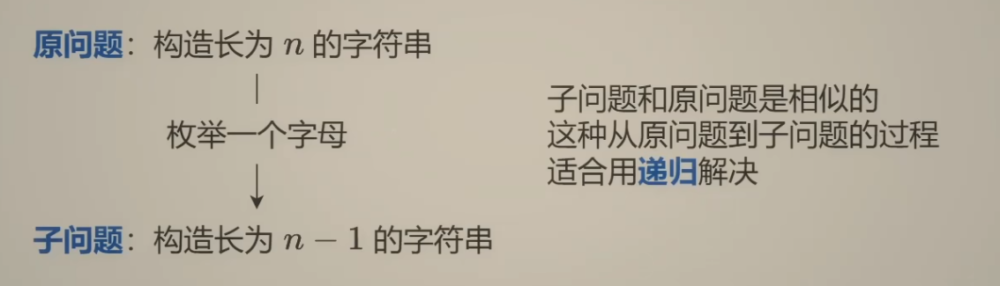
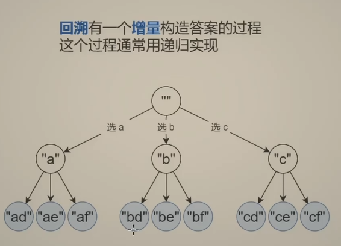
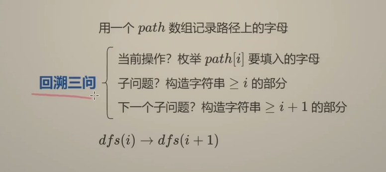
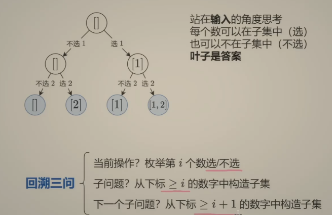
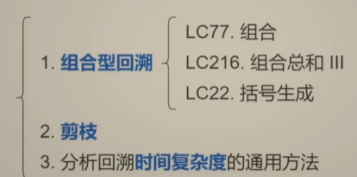
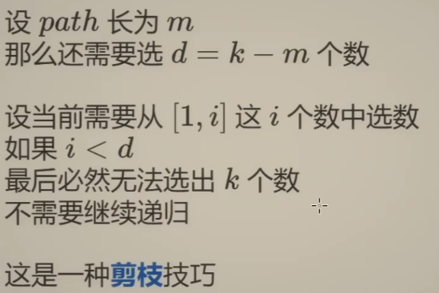
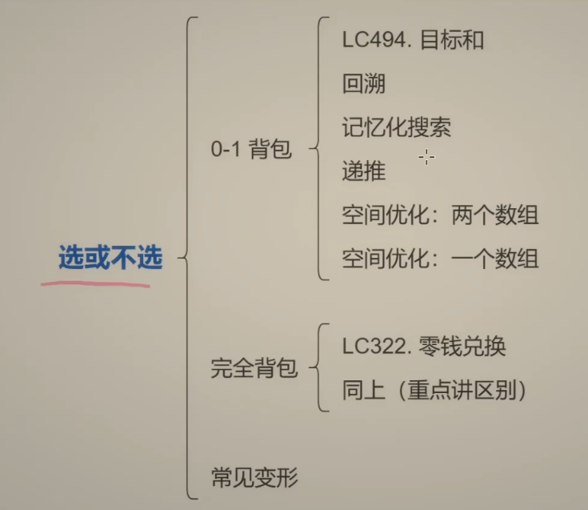
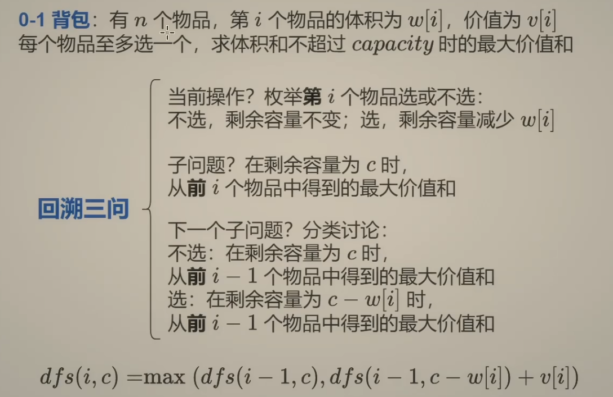

### No. 240

```c++
class Solution {
public:
    bool searchMatrix(vector<vector<int>>& matrix, int target) {
        int m = matrix.size();      // m是行数
        int n = matrix[0].size();   // n是列数
        int row = 0;
        int col = 0;

        for(int i = 0; i<m ; i++){
            if(matrix[i][0] <= target) {
                row = i;
            }else{
                break;
            }
        }

        for(int  i = 0; i<n; i++){
            if(matrix[0][i] <= target) {
                col = i;
            }else{
                break;
            }
        }

        while(row>=0 && col>=0){
            if(matrix[row][col] == target) return true;
            for(int i = col; i>=0; i--){
                if(matrix[row][i] == target) return true;
                if(matrix[row][i] < target) break;
            }
            row--;
            for(int i = row; i>=0; i--){
                if(matrix[i][col] == target) return true;
                if(matrix[i][col] < target) break;
            }
            col--;
        }
        return false;
    }
};
```


二分查找：

No.34 [在排序数组中查找元素的第一个和最后一个位置](https://leetcode.cn/problems/find-first-and-last-position-of-element-in-sorted-array/)

```python
def lower_bound(nums: List[int], target:int)  -> int:
    # 最终结束的时候，right + 1及其后边一定指向的是比target大的数的区间
    left = 0
    right = len(nums) - 1  # 闭区间
    while left <= right:
        mid = (left + right)//2  # mid = left + (right-left)//2 ，这样写不会溢出
        if nums[mid] < target:
            left = mid + 1
        else:
            right = mid - 1
    
    return right + 1

class Solution:
    def searchRange(self, nums: list[int], target: int) -> list[int]:

        start = lower_bound(nums, target)
        if start == len(nums) or nums[start] != target:
            return [-1, -1]
        
        end = lower_bound(nums, target + 1) - 1  # 因为start存在，所以end一定存在
        return [start, end]
```


NO. 162 [寻找峰值](https://leetcode.cn/problems/find-peak-element/)  (红蓝染色法)

```python
class Solution:
    def findPeakElement(self, nums: list[int]) -> int:
         # 定义rihgt为峰顶或者峰顶右侧元素所在位置
         left = 0
         right = len(nums) - 2
         while left <= right:
            mid = (left + right) // 2
            if nums[mid] > nums[mid + 1]:
                right = mid - 1
            else:
                left = mid + 1

         return left
```


NO.153 [寻找旋转排序数组中的最小值](https://leetcode.cn/problems/find-minimum-in-rotated-sorted-array/)

```python
class Solution:
    def findMin(self, nums: list[int]) -> int:
        left = 0
        right = len(nums) - 2
        while left <= right:
            mid = (left + right) // 2
            if nums[mid] < nums[-1]:
                right = mid - 1
            else:
                left = mid + 1
        
        return nums[left]
```


No.33 [搜索旋转排序数组](https://leetcode.cn/problems/search-in-rotated-sorted-array/)  (注意判断什么时候需要取等)

```python
class Solution:
    def search(self, nums: List[int], target: int) -> int:
        n = len(nums)
        left = 0
        right = n - 2
        while left<=right:
            mid = (left + right) // 2
            # 在同一段，且都在第一段
            if nums[mid] > nums[-1] and target > nums[-1]:
                if nums[mid] >= target:
                    right = mid - 1
                else:
                    left = mid + 1
            # 在同一段，且都在第二段
            if nums[mid] < nums[-1] and target <= nums[-1]:
                if nums[mid] >= target:
                    right = mid - 1
                else:
                    left = mid + 1
            # 不在同一段，
            if nums[mid] > nums[-1] and target <= nums[-1]:
                left =  mid + 1
            if nums[mid] < nums[-1] and target > nums[-1]:
                right =  mid -1

        if nums[left] == target:
            return left
        else:
            return -1
```


No.142 [环形链表 II](https://leetcode.cn/problems/linked-list-cycle-ii/)

```python
class Solution:
    def detectCycle(self, head: Optional[ListNode]) -> Optional[ListNode]: 
        fast = head
        slow = head
        while fast and fast.next:
            fast = fast.next.next
            slow = slow.next
            if fast is slow:
                while slow is not head: 
                    slow = slow.next
                    head = head.next
                return slow
        return None
```

慢指针移动的距离是小于环长的，可以以最坏的情况为例，这个时候slow刚好在环的入口，fast在slow的下一个节点，用相对速度分析（慢指针不动，快指针每次走一步），则快指针需要走环长-1步才能与满指针相遇，所以对于其余任何情况，相遇的时候，慢指针的移动距离是小于环长的


No.236 [二叉树的最近公共祖先](https://leetcode.cn/problems/lowest-common-ancestor-of-a-binary-tree/)

```python
class Solution:
    def lowestCommonAncestor(self, root: 'TreeNode', p: 'TreeNode', q: 'TreeNode') -> 'TreeNode':
        if root is None or root is p or root is q:
            return root
        left = self.lowestCommonAncestor(root.left, p, q)
        right = self.lowestCommonAncestor(root.right, p, q)

        if left and right:
            return root
        elif left:
            return left
        else: 
            return right
```

【二叉树的最近公共祖先【基础算法精讲 12】】https://www.bilibili.com/video/BV1W44y1Z7AR?vd_source=2a1d982a7191df1d29fee38ee7081e6f


No.235 [二叉搜索树的最近公共祖先](https://leetcode.cn/problems/lowest-common-ancestor-of-a-binary-search-tree/)

```python

```


NO.513 [找树左下角的值](https://leetcode.cn/problems/find-bottom-left-tree-value/)

```python
# Definition for a binary tree node.
# class TreeNode:
#     def __init__(self, val=0, left=None, right=None):
#         self.val = val
#         self.left = left
#         self.right = right
class Solution:
    def findBottomLeftValue(self, root: TreeNode | None) -> int:
        # 方法1：用层序遍历，返回最后一层的第一个节点
        
        # 方法2：层序遍历改变方向，从右到左遍历，这个时候就是层序遍历的最后一个节点
        q = deque([root])
        while q:
            node = q.popleft()
            if node.right:
                q.append(node.right)
            if node.left:
                q.append(node.left)
            if not q:
                return node.val
```


### 回溯问题

回溯问题的基本动作：做出选择 → 继续向下探索 → 撤销选择 → 尝试下一个选择

用两个数组来描述当前状态：

`path:` 当前已经选择的元素。例如：`path = [1, 2]`表示当前选出的子集是`[1,2]`

`start:` 接下来允许从哪个下标开始选择。例如：path = [1]， start = 1，已经选择了 `1`，接下来只能从下标 `1` 开始继续选择。

因此可以定义：`def backtrack(start):` 在当前 `path` 的基础上，从下标 `start` 开始，尝试继续加入元素，找出所有可能的子集。

```python
def backtrack(状态):
    if 当前状态满足答案要求:
        保存当前答案的副本

    if 当前状态无法继续:
        return

    for 选择 in 当前可选范围:
        做出选择
        backtrack(更新后的状态)
        撤销选择
```







注意，这里的 $i$ 的含义不是第 $i$ 个，而是 >=i 的这些部分还需要枚举。

然后，枚举了一个字母后，下一个子问题是什么，枚举了第i个过后，剩下的就是 >= i+1的这些部分了。

`子集型回溯：`每个元素都可以选或者不选。

题目，求 [1，2] 的子集：



NO.78 [子集](https://leetcode.cn/problems/subsets/)

```python
class Solution:
    def subsets(self, nums: list[int]) -> list[list[int]]:
        n = len(nums)
        ans = []
        path = []

        def dfs(i):
            # 所有元素都已经决定完：得到一个完整方案
            if i == n:
                ans.append(path.copy())
                return

            # 分支一：不选 nums[i]
            # path 不变，直接决定下一个元素
            dfs(i + 1)

            # 分支二：选 nums[i]
            path.append(nums[i])

            # 在已经选入 nums[i] 的基础上，
            # 继续决定后面的元素
            dfs(i + 1)

            # 这一分支探索结束，撤销本层的选择
            path.pop()

        dfs(0)
        return ans
```

- 这里需要理解关键：`i` 表示当前要决定哪个元素，`path` 保存此前决定选入的元素。每个元素都做一次“选或不选”的决定，全部决定完，就得到一个子集。
- `i` 表示已经处理了多少个元素，不表示已经选了多少个元素。
- `def dfs(i):` 表示下标 `0` 到 `i - 1` 的元素已经决定完了，现在开始决定 `nums[i]` 以及后面元素选不选。
- 为什么“不选”后面没有 `pop()`？因为不选，就没有往 `path` 里面添加当前元素，因此也不需要删除当前元素。


NO.17: [电话号码的字母组合](https://leetcode.cn/problems/letter-combinations-of-a-phone-number/description/)

```python
# 枚举，让下标和数字对应起来
MAPPING = ["","","abc","def","ghi","jkl","mno","pqrs","tuv","wxyz"]
class Solution:
    def letterCombinations(self, digits: str) -> list[str]:
        n = len(digits)
        ans = []
        path = [''] * n  # 每个path都是一个长度为n的数组
        def dfs(i): # dfs（i） 表示下标大于等于i的，还需要枚举，所以是从dfs(i)递归到dfs(i+1)
            if i==n:  # 已经达到最后一个数字，可以结束了(因为要求生成的字符串的长度和输入的字符串长度一致)
                ans.append(''.join(path))
                return
            for c in MAPPING[int(digits[i])]:  # 需要枚举第i个数字有哪些字母
                path[i] = c
                dfs(i+1)  # 这里递归
        dfs(0)
        return ans        
```


NO.131 [分割回文串](https://leetcode.cn/problems/palindrome-partitioning/description/)

```python
class Solution:
    def partition(self, s: str) -> list[list[str]]:
        n = len(s)
        ans = []
        path = []

        def dfs(i):
            # 所有字符都已分割完成
            if i == n:
                ans.append(path.copy())
                return

            # 下一段从 i 开始，枚举它的结束位置 j
            for j in range(i, n):
                t = s[i:j + 1]

                # 只有回文片段，才可以作为当前选择
                if t == t[::-1]:
                    path.append(t)  # 选择这一段
                    dfs(j + 1)      # 继续分割剩下的字符串
                    path.pop()      # 撤销这一段，尝试其他结束位置

        dfs(0)
        return ans
```

- `dfs(i)` 的含义：`s[:i]` 已经分割完成，接下来要找出 `s[i:]` 的所有合法分割方式。  
- `path` 保存前边已经分割好的字符串
- `i` 是剩余字符串的起点，不是已经选了多少段。


`组合型回溯:`





NO.77 [组合](https://leetcode.cn/problems/combinations/description/)

如果用之前的思路做：

```python
class Solution:
    def combine(self, n: int, k: int) -> list[list[int]]:
        ans = []
        path = []

        def dfs(i):
            if len(path) == k:
                ans.append(path.copy())
                return 
            for j in range(i,n+1):
                path.append(j)
                dfs(j+1)
                path.pop()
        dfs(1)
        return ans
```

用组合剪枝的思路做：

```python

```

- 如果剩下能选的数字数量，比还需要的数量少，那么这条路一定凑不够 `k` 个数，可以直接返回。
- 

### 动态规划

No.198 [打家劫舍](https://leetcode.cn/problems/house-robber/description/)

```python
class Solution:
    def rob(self, nums: List[int]) -> int:
        # 动态规划版本
        # n = len(nums)
        # if n == 1:
        #     return nums[0]
        # dp = [''] * n
        # dp[0] = nums[0]
        # dp[1] = max(dp[0], nums[1])
        # for i in range(2,n):
        #     dp[i] = max(dp[i-1], dp[i-2] + nums[i])
        # return dp[n-1]
        
        # 动态规划的优化
        n = len(nums)
        if n==1:
            return nums[0]
        f1 = nums[0]
        f2 = max(nums[0],nums[1])
        for i in range(2, n):
            f = max(f2, f1 + nums[i])
            f1 = f2
            f2 = f
        return f2

        # 回溯版本（时间是指数级别的，这样写会超市）
        # n = len(nums)
        # def dfs(i):
        #     if i<0:
        #         return 0
        #     res = max(dfs(i-1), dfs(i-2) + nums[i])
        #     return res
        # return dfs(n-1)

        # 回溯版本的优化（可以把重复的步骤存下来，下次就不用重复计算了）
        n = len(nums)
        cache = [-1] * n

        def dfs(i):
            if i<0:
                return 0
            if cache[i] != -1:  # 说明之前计算过了，可以直接拿出来用
                return cache[i]
            cache[i] = max(dfs(i-1), dfs(i-2) + nums[i])
            return cache[i]

        return dfs(n-1)
    
        # 递推（自底向上计算）
        n = len(nums)
        f = [0] * (n+2) # 因为这里多用了两个数组空间，因此，不用特殊处理前两个数值
        for i,x in enumerate(nums):
            f[i+2] = max(f[i+1], f[i]+x)
        return f[n+2]
```

0-1背包问题和完全背包问题，是 “选或不选” 这类题目的重要代表





0-1背包问题：有n个物体，每个物体只有一个

```python
# 0-1背包问题
# capacity: 背包容量
# w[i]: 第i个物品的体积
# v[i]: 第i个物品的价值
# 返回：所选物品体积和不超过capacity的前提下，所能得到的最大价值和
def zero_one_knapsack(capacity: int, w: List[int], v:List[int]) -> int:
    n = len(w)

    @cache # 加上这个装饰器，改成记忆化搜索，这样可以节省内存开销
    def dfs(i,c):
        # 此时一个物品都没有了，可以直接返回0
        if i<0:  
            return  0
        
        # 如果这个物品的体积已经超过了最大容量了，只能不选
        if c<w[i]: 
            return dfs(i-1,c)  
        
        # 背包还有容量放下当前物品，可以进行讨论
        a = dfs(i-1, c)  # 情况1，我不选当前物品，那么容量不变，在剩余i-1个物品中进行选择
        b = dfs(i-1, c-w[i]) + v[i]  # 情况2，我选择当前物品，那么当前的价值加上v[i], 当前背包的容量减去w[i], 然后在剩余的i-1个物品中继续选择
        return max(a,b)  # 返回两种情况的最大值，这样才能保证所选价值是最大的
    
    return dfs(n-1, capacity) # 从最后一个物品开始选择，这个时候容量就是初始容量
```

0-1背包问题的常见变形：

- 至多装capacity，求方案数/最大价值和
- 恰好装capacity，求方案数/最大/最小价值和
- 至少装capacity，求方案数/最小价值和

```
dp[i][j]: 下标为[0,i]之间的物体，任取放在剩余容量为j的背包里， 此时背包的最大价值
dp[i][j]可以从哪几个方向推导出来：
	1. 不放下标为i的物体，它的最大价值是dp[i-1][j]
	2. 放下标为i的物体，它的最大价值是dp[i-1][j-weight[i]] + value[i]
对于上述讨论的两种情况，应该取其中的最大值 
根据上述讨论的两种情况，来确定dp[i][j]应该初始化哪些（对于这里，任何一个数值，由它上方或者左上角推导出来，所以应该初始化第一行第一列）
遍历顺序：
	for（）物品
		for() 背包
对于二维数组实现的01背包，顺序可以改变，先遍历物品或先遍历背包结果是一样的
可以画一个dp[i][j]的二维表格来进行理解
```

NO.494 [目标和](https://leetcode.cn/problems/target-sum/description/)

法1：用二维数组

```python
dp[i][j]： 前 i 个数字中，选出和为 j 的方案数

class Solution:
    def findTargetSumWays(self, nums: list[int], target: int) -> int:
        n = len(nums)
        s = sum(nums)
        p = s + target
        if p<0 or p%2!=0:
            return 0
        p = p // 2

        f = [[0] * (p + 1) for _ in range(n+1)]
        f[0][0] = 1
        
        for i,x in enumerate(nums):
            for c in range(p + 1):
                if c < x: # 如果当前背包容量放不下了，就只能继续看剩下的i个数
                    f[i+1][c] = f[i][c]
                else: # 还放的下，分情况讨论
                    f[i+1][c] = f[i][c] + f[i][c-x]
        
        return f[n][p]
```

法2：使用0-1背包

```python
class Solution:
    def findTargetSumWays(self, nums: list[int], target: int) -> int:
        n = len(nums)
        s = sum(nums)
        p = s + target
        if p<0 or p%2!=0:
            return 0
        p = p // 2

        @cache
        def dfs(i,c):
            if i<0:
                return 1 if c==0 else 0  # c=0的时候，这个才是一个合法的方案，也就是刚好等于target
            if c<nums[i]:
                return dfs(i-1, c)
            return dfs(i-1,c) + dfs(i-1,c-nums[i])  # 因为求的是方案数
        
        return dfs(n-1, p)  # 下标从 0 到 n-1
```


完全背包：

有n种物品，每种物品可以选无数次，第 i 种物品的体积为 w[i], 价值为 v[i], 求体积和不超过 capacity 的最大价值和

No.322 [零钱兑换](https://leetcode.cn/problems/coin-change/description/)

方法1，完全背包做法

```python
class Solution:
    def coinChange(self, coins: list[int], amount: int) -> int:
        n = len(coins)

        @cache
        def dfs(i, c):
            # 此时没有硬币了，可以返回0
            if i<0:
                return 0 if c==0 else inf
            # 当前容量已经不够放下coins[i], 那么就看剩余的i-1个硬币
            if c < coins[i]:
                return dfs(i-1, c) 
            # 当前容量可以放下 coins[i], 分情况讨论
            a = dfs(i-1, c)  # 不选 coins[i], 那么容量不变，继续在剩余的 i-1 个选
            b = dfs(i, c-coins[i])  # 选 coins[i], 容量减少coins[i], 使用的硬币个数 + 1，同时继续在剩余的i个中选，因为可以无限选，所以是 i， 不是 i-1
            return min(dfs(i-1, c), dfs(i, c-coins[i]) + 1)

        ans = dfs(n-1, amount)
        return ans if ans<inf else -1
```

方法2， 二维DP数组

```python
class Solution:
    def coinChange(self, coins: list[int], amount: int) -> int:
        n = len(coins)

        f = [[inf] * (amount + 1) for _ in range(n + 1)]
        f[0][0] = 0

        for i, x in enumerate(coins):
            for c in range(amount + 1):  # c表示剩余容量
                if c < x:
                    f[i+1][c] = f[i][c]
                else:
                    f[i+1][c] = min(f[i][c], f[i+1][c-x] + 1)
        
        ans = f[n][amount]
        return ans if ans < inf else -1
```


### 最长公共子序列（LCS）

在算法题中，子数组和子串是连续的，但是子序列是可以不连续的