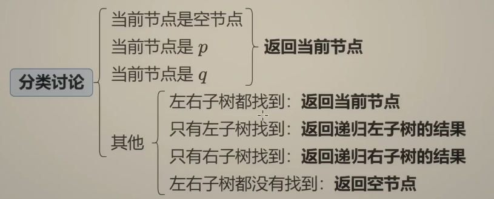

### No. 240

```c++
class Solution {
public:
    bool searchMatrix(vector<vector<int>>& matrix, int target) {
        int m = matrix.size();      // m是行数
        int n = matrix[0].size();   // n是列数
        int row = 0;
        int col = 0;

        for(int i = 0; i<m ; i++){
            if(matrix[i][0] <= target) {
                row = i;
            }else{
                break;
            }
        }

        for(int  i = 0; i<n; i++){
            if(matrix[0][i] <= target) {
                col = i;
            }else{
                break;
            }
        }

        while(row>=0 && col>=0){
            if(matrix[row][col] == target) return true;
            for(int i = col; i>=0; i--){
                if(matrix[row][i] == target) return true;
                if(matrix[row][i] < target) break;
            }
            row--;
            for(int i = row; i>=0; i--){
                if(matrix[i][col] == target) return true;
                if(matrix[i][col] < target) break;
            }
            col--;
        }
        return false;
    }
};
```


二分查找：

No.34 [在排序数组中查找元素的第一个和最后一个位置](https://leetcode.cn/problems/find-first-and-last-position-of-element-in-sorted-array/)

```python
def lower_bound(nums: List[int], target:int)  -> int:
    # 最终结束的时候，right + 1及其后边一定指向的是比target大的数的区间
    left = 0
    right = len(nums) - 1  # 闭区间
    while left <= right:
        mid = (left + right)//2  # mid = left + (right-left)//2 ，这样写不会溢出
        if nums[mid] < target:
            left = mid + 1
        else:
            right = mid - 1
    
    return right + 1

class Solution:
    def searchRange(self, nums: list[int], target: int) -> list[int]:

        start = lower_bound(nums, target)
        if start == len(nums) or nums[start] != target:
            return [-1, -1]
        
        end = lower_bound(nums, target + 1) - 1  # 因为start存在，所以end一定存在
        return [start, end]
```


NO. 162 [寻找峰值](https://leetcode.cn/problems/find-peak-element/)  (红蓝染色法)

```python
class Solution:
    def findPeakElement(self, nums: list[int]) -> int:
         # 定义rihgt为峰顶或者峰顶右侧元素所在位置
         left = 0
         right = len(nums) - 2
         while left <= right:
            mid = (left + right) // 2
            if nums[mid] > nums[mid + 1]:
                right = mid - 1
            else:
                left = mid + 1

         return left
```


NO.153 [寻找旋转排序数组中的最小值](https://leetcode.cn/problems/find-minimum-in-rotated-sorted-array/)

```python
class Solution:
    def findMin(self, nums: list[int]) -> int:
        left = 0
        right = len(nums) - 2
        while left <= right:
            mid = (left + right) // 2
            if nums[mid] < nums[-1]:
                right = mid - 1
            else:
                left = mid + 1
        
        return nums[left]
```


No.33 [搜索旋转排序数组](https://leetcode.cn/problems/search-in-rotated-sorted-array/)  (注意判断什么时候需要取等)

```python
class Solution:
    def search(self, nums: List[int], target: int) -> int:
        n = len(nums)
        left = 0
        right = n - 2
        while left<=right:
            mid = (left + right) // 2
            # 在同一段，且都在第一段
            if nums[mid] > nums[-1] and target > nums[-1]:
                if nums[mid] >= target:
                    right = mid - 1
                else:
                    left = mid + 1
            # 在同一段，且都在第二段
            if nums[mid] < nums[-1] and target <= nums[-1]:
                if nums[mid] >= target:
                    right = mid - 1
                else:
                    left = mid + 1
            # 不在同一段，
            if nums[mid] > nums[-1] and target <= nums[-1]:
                left =  mid + 1
            if nums[mid] < nums[-1] and target > nums[-1]:
                right =  mid -1

        if nums[left] == target:
            return left
        else:
            return -1
```


No.142 [环形链表 II](https://leetcode.cn/problems/linked-list-cycle-ii/)

```python
class Solution:
    def detectCycle(self, head: Optional[ListNode]) -> Optional[ListNode]: 
        fast = head
        slow = head
        while fast and fast.next:
            fast = fast.next.next
            slow = slow.next
            if fast is slow:
                while slow is not head: 
                    slow = slow.next
                    head = head.next
                return slow
        return None
```

慢指针移动的距离是小于环长的，可以以最坏的情况为例，这个时候slow刚好在环的入口，fast在slow的下一个节点，用相对速度分析（慢指针不动，快指针每次走一步），则快指针需要走环长-1步才能与满指针相遇，所以对于其余任何情况，相遇的时候，慢指针的移动距离是小于环长的


No.236 [二叉树的最近公共祖先](https://leetcode.cn/problems/lowest-common-ancestor-of-a-binary-tree/)

```python
class Solution:
    def lowestCommonAncestor(self, root: 'TreeNode', p: 'TreeNode', q: 'TreeNode') -> 'TreeNode':
        if root is None or root is p or root is q:
            return root
        left = self.lowestCommonAncestor(root.left, p, q)
        right = self.lowestCommonAncestor(root.right, p, q)

        if left and right:
            return root
        elif left:
            return left
        else: 
            return right
```

【二叉树的最近公共祖先【基础算法精讲 12】】https://www.bilibili.com/video/BV1W44y1Z7AR?vd_source=2a1d982a7191df1d29fee38ee7081e6f




No.235 [二叉搜索树的最近公共祖先](https://leetcode.cn/problems/lowest-common-ancestor-of-a-binary-search-tree/)

```python

```

