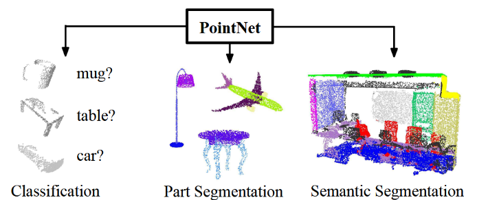
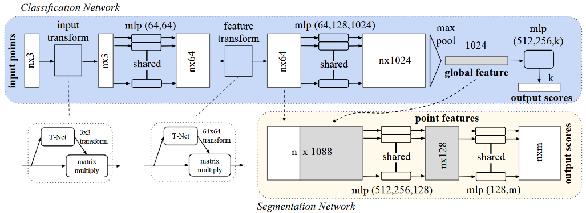
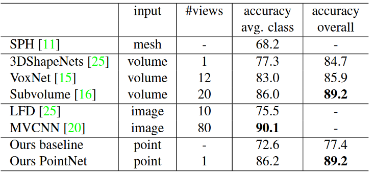
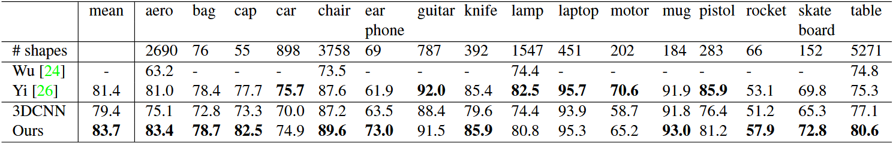
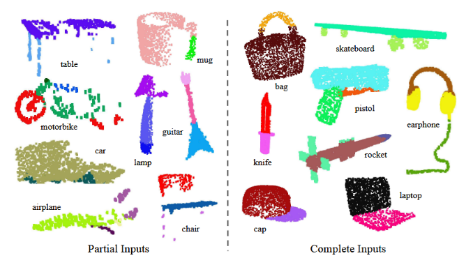

# PointNet：用于三维分类与分割的点集深度学习

## Abstract

　　点云是一类重要的几何数据结构。由于其格式不规则，现有研究大多将此类数据转换为规则的三维体素网格或图像集合。然而，这种处理会不必要地扩大数据规模，并带来额外问题。本文设计了一种可**直接处理点云**的新型神经网络，并使其满足输入点的**排列不变性**。该网络称为 **PointNet**，为对象分类、部件分割和场景语义解析等任务提供了统一架构。尽管结构简洁，PointNet 仍具有较高的效率和有效性：在实验中，其性能达到或超过现有最优方法；在理论上，本文分析了网络所学习的内容，并解释了其为何对输入点扰动与数据损坏具有鲁棒性。

## 1 Introduction

　　本文研究能够对点云、网格等三维几何数据进行推理的深度学习架构。典型卷积网络为了实现权重共享与高效卷积运算，通常要求输入采用规则格式，例如二维图像网格或三维体素网格。由于点云和网格本身不具备规则结构，研究者通常会先将它们转换为规则三维体素或多视角图像，再输入深度网络。然而，该表示转换不仅会显著增大数据体积，还会引入量化伪影，从而掩盖数据原本具有的自然不变性。

　　因此，本文直接以点云作为三维几何数据的输入表示，并将所提出的深度网络称为 **PointNet**。点云是一种简单统一的数据结构，避免了网格的组合不规则性与复杂拓扑，因此更易于学习。但点云本质上是一个无序点集，网络必须对点的输入顺序保持不变；同时还应考虑刚体变换等几何不变性。

`图 1. PointNet 的应用。所提出的深度网络可直接处理原始点云（点集），无需体素化或渲染。该统一架构能够学习全局与局部点特征，可为多种三维识别任务提供简洁、高效且有效的解决方案。`

　　PointNet 以点云为直接输入，可输出整个输入对象的类别标签，也可为每个输入点输出分割或部件标签。其基本结构非常简洁：在初始阶段，每个点以完全相同且相互独立的方式处理。基本情况下，每个点仅由三维坐标 $(x,y,z)$ 表示；也可额外加入法向量、局部特征或全局特征等维度。

　　该方法的关键在于使用单一的**对称函数**——最大池化（max pooling）。网络可学习一组优化函数或判别准则，以选择点云中有意义或信息量高的点，并编码其被选中的原因。最终的全连接层将这些最优响应聚合为整个形状的全局描述符，用于形状分类；或进一步用于逐点标签预测，以完成形状分割。

　　由于每个点均可独立施加刚体或仿射变换，本文进一步引入数据依赖的空间变换网络，在 PointNet 处理之前尝试将输入规范化至统一的标准空间，从而进一步提高性能。

　　本文同时给出理论分析与实验验证。理论上，PointNet 可以逼近任意连续集合函数；网络会通过一个稀疏的关键点集合概括输入点云，从可视化结果看，这一集合大致对应于对象骨架。该分析也解释了 PointNet 对小幅点位置扰动、离群点插入和点缺失的鲁棒性。

　　在形状分类、部件分割与场景分割等多个基准数据集上，本文将 PointNet 与基于多视角和体素表示的先进方法进行比较。结果表明，在统一架构下，PointNet 不仅推理速度更快，而且性能可达到或超过当时先进水平。

　　本文的主要贡献如下：

- 设计了一种适用于三维无序点集输入的新型深度网络架构；
- 说明了该网络可用于三维形状分类、形状部件分割和场景语义解析；
- 从实验和理论两方面系统分析了方法的稳定性与效率；
- 对网络中被选择神经元计算的三维特征进行可视化，并给出直观的性能解释。

## 2 Related Work

　　`点云特征。`现有多数点云特征均针对特定任务人工设计。点特征通常编码点的统计性质，并被设计为对某些变换保持不变。根据所依赖的几何信息，可将其分为内在特征（intrinsic features）和外在特征（extrinsic features）；也可分为局部特征与全局特征。对于给定任务，如何选择最佳特征组合并不容易。

　　`三维数据上的深度学习。`三维数据可采用多种表示，因此相应地产生了多条技术路线。**体素卷积网络**最早将三维卷积应用于体素化形状，但受限于点云稀疏性和三维卷积的高计算开销，体素分辨率通常难以提高。已有方法尝试专门应对稀疏性问题，但其运算本质上仍基于稀疏体素，难以高效处理大规模点云。**多视角卷积网络**将三维点云或形状渲染为二维图像后进行分类，借助成熟的二维 CNN，在形状分类与检索任务上取得了较强性能；但它难以自然扩展到场景理解、逐点分类和形状补全等三维任务。**谱域卷积网络**则尝试在网格上执行谱卷积，但通常受限于流形网格，例如有机体表面，且难以推广至家具等非等距形状。另有**特征驱动的深度网络**先提取传统形状特征并转换为向量，再输入全连接网络进行分类，其性能上限通常受制于人工特征的表达能力。

　　`无序集合上的深度学习。`从数据结构角度看，点云是一个无序向量集合。深度学习研究通常处理序列、图像或体数据等规则输入，而对点集的研究相对较少。已有工作曾利用带注意力机制的 read-process-write 网络处理无序集合并实现数字排序，但其主要面向通用集合与自然语言处理，未显式利用集合中的几何关系。

## 3 Problem Statement

　　本文设计一个能够直接处理无序点集的深度学习框架。点云表示为三维点集合 $\{P_i\mid i=1,\ldots,n\}$，其中每个点 $P_i$ 包含坐标 $(x,y,z)$，还可带有颜色、法向量等额外特征通道。为便于说明，除非特别指出，本文默认仅使用点的 $(x,y,z)$ 坐标。

　　对于对象分类任务，输入点云可以直接从单个形状中采样，或从场景点云中预先分割获得。所提出网络针对 $k$ 个候选类别输出 $k$ 个类别得分。对于语义分割任务，输入可以是一个单独对象，用于部件区域分割；也可以是三维场景中的子体积，用于对象区域分割。模型针对 $n$ 个输入点中的每一个点输出 $m$ 个语义子类别得分，即输出大小为 $n\times m$。

## 4 Deep Learning on Point Sets

　　网络架构由欧氏空间中点集的性质所启发。首先介绍点集的基本特性，随后说明 PointNet 的网络设计与理论分析。

### 4.1. Properties of Point Sets in $\mathbb{R}^n$

　　输入是欧氏空间中的一个点集子集，具有以下三个主要性质：

- **无序性（Unordered）**：不同于图像像素阵列或体素网格，点云是没有固定顺序的点集合。因此，一个处理 $N$ 个三维点的网络应对输入点排列顺序的 $N!$ 种置换保持不变。
- **点间交互（Interaction among points）**：点来自定义了距离度量的空间，点并非彼此独立；相邻点会形成具有意义的局部子集。因此，模型应能够从邻域中提取局部结构，并建模局部结构之间的组合关系。
- **变换不变性（Invariance under transformations）**：作为几何对象，点集学习得到的表示应当对某些变换保持不变。例如，对所有点施加相同的旋转与平移，不应改变点云的全局类别或逐点分割结果。

### 4.2. PointNet Architecture

`图 2. PointNet 架构。分类网络以 n 个点为输入，依次施加输入变换与特征变换，并通过最大池化聚合点特征，最终输出 k 个类别得分。分割网络是在分类网络基础上的扩展：它拼接全局特征与局部点特征，再输出逐点得分。mlp 表示多层感知机，括号内数字表示各层通道数。所有层均使用 BatchNorm 与 ReLU；分类网络最后的 MLP 使用 Dropout。`

　　分类网络与分割网络共享大部分结构。整体网络由三个关键模块组成：用于聚合所有点信息的最大池化层、局部与全局信息融合结构，以及分别对输入点与点特征进行对齐的两个联合变换网络。

#### 对称函数：处理无序输入

　　为了使模型对输入点排列保持不变，通常有三种策略：其一，将输入排序到某种规范顺序；其二，将点集视为序列输入循环神经网络，并在训练时使用各种排列增强；其三，对每个点进行变换后，以简单的对称函数聚合其信息。对称函数接收 $n$ 个向量并输出一个对输入顺序不敏感的新向量，例如加法与乘法均为对称二元函数。

　　排序看似直观，但在高维空间中，不存在对点扰动普遍稳定的排序方式。将高维空间映射为一维实数并要求保持空间邻近性，在一般情况下不可实现。因此，即使对点云排序，排序不稳定性仍会导致网络难以学习一致映射。实验表明，直接在排序后的点集上施加 MLP 的效果仍然较差，仅略优于直接处理无序输入。

　　将点集视为序列并借助随机排列训练 RNN，也无法彻底解决顺序影响问题。RNN 对短序列的输入顺序具有一定鲁棒性，但当输入元素数量扩展至点云常见的数千规模时，训练与建模都较为困难，实验性能也不如 PointNet。

　　本文采用如下形式近似定义在点集上的一般函数：

$$
f({x_1,l,\dots,x_n}) \approx g(h(x_1),\dots,h(x_n))\tag{1}
$$

　　其中，$f:2^{\mathbb{R}^N}\rightarrow\mathbb{R}$ 为目标集合函数，$h:\mathbb{R}^N\rightarrow\mathbb{R}^K$ 为逐点变换，$g$ 为关于输入顺序对称的聚合函数。具体实现中，使用多层感知机近似 $h$，使用“一元函数与最大池化函数的组合”近似 $g$。通过学习多个 $h$，网络可以提取点集的多种不同属性。

#### 局部与全局信息聚合

　　上述过程会得到向量 $[f_1,\ldots,f_K]$，它是输入点集的全局特征描述。该全局描述可直接供 SVM 或 MLP 用于形状分类。但逐点分割同时需要局部几何信息和全局语义信息。

　　因此，在分割网络中，先计算全局点云特征向量，再将其复制并与每个点的局部特征进行拼接。基于该融合表示继续提取逐点特征，使每个点同时感知本地几何和整体语义。该设计可用于预测依赖局部几何与全局语义的逐点属性，例如逐点法向量、对象部件标签或场景语义标签。

#### 联合对齐网络

　　点云经历刚体变换等几何变换后，其语义标签应保持不变。因此，学习表示也应具有相应的变换不变性。一个自然方案是在特征提取之前，将输入点集对齐到规范空间。

　　PointNet 通过一个小型网络（图 2 中的 T-Net）预测仿射变换矩阵，并直接将其施加于输入点坐标。该网络自身也由逐点特征提取、最大池化与全连接层构成。由于点云中各点可独立变换，无需为此设计额外采样层，也不会引入图像变换中的混叠问题。

　　同样的思想可推广到特征空间对齐：网络可在点特征上插入另一个对齐网络，并预测特征变换矩阵以对齐不同点云的特征。不过，特征变换矩阵的维度通常较高，优化更困难。因此，本文在 softmax 训练损失中加入正则项，约束特征变换矩阵接近正交矩阵：

$$
L_{reg}=\lVert I-AA^{\top}\rVert_F^2, \tag{2}
$$

　　其中，$A$ 是由小型网络预测的特征对齐矩阵。正交变换不会损失输入信息，因此符合预期。实验表明，加入该正则项后，训练更稳定，性能也更高。

### 4.3. Theoretical Analysis

#### 通用逼近能力

　　首先，本文证明该网络能够逼近任意连续集合函数。若集合函数连续，则直观上，输入点集发生轻微变化时，函数值（例如分类或分割得分）不应出现剧烈变化。

　　形式化地，令 $X={S\mid S\subseteq[0,1]^m,\ |S|=n\\}$，$f:X\rightarrow\mathbb{R}$ 是关于 Hausdorff 距离 $d_H(\cdot,\cdot)$ 的连续集合函数。对任意 $\epsilon>0$，存在 $\delta>0$，使得任意 $S,S'\in X$ 满足 $d_H(S,S')<\delta$ 时，都有 $|f(S)-f(S')|<\epsilon$。本文定理指出：只要最大池化层的神经元数量足够大，即式 (1) 中的 $K$ 足够大，则 PointNet 可任意逼近该函数。

$$
\textbf{定理 1.}\ \text{若 }f:X\rightarrow\mathbb{R}\text{ 是关于 }d_H\text{ 的连续集合函数，则对任意 }\epsilon>0,\\
\exists\ h\text{ 与 }g(x_1,\ldots,x_n)=\gamma\circ\mathrm{MAX},\ \text{使得对任意 }S\in X,\\
\left|f(S)-\gamma\left(\mathrm{MAX}_{x_i\in S}\{h(x_i)\}\right)\right|<\epsilon.
$$

　　其中，$x_1,\ldots,x_n$ 是集合 $S$ 的任意排列，$\gamma$ 为连续函数，$\mathrm{MAX}$ 表示逐通道最大值运算。其证明的核心思想是：在最坏情况下，网络可将点云映射为体素表示；但在实际中，网络会学习更高效的空间探测策略。

#### 瓶颈维度与稳定性

　　最大池化层的维度 $K$ 对模型表达能力具有重要影响。令

$$
u=\mathrm{MAX}_{x_i\in S}\{h(x_i)\},
$$

　　其表示将 $[0,1]^m$ 中的点集映射到 $K$ 维向量的子网络。本文进一步证明，小范围数据损坏或额外噪声点通常不会改变网络输出：

$$
\textbf{定理 2.}\ \text{设 }u:X\rightarrow\mathbb{R}^K,\ u=\mathrm{MAX}_{x_i\in S}\{h(x_i)\},\ f=\gamma\circ u.\\
\text{则}\quad (a)\ \forall S,\ \exists C_S,N_S\subseteq X,\ \text{当 }C_S\subseteq T\subseteq N_S\text{ 时，}f(T)=f(S);\\
(b)\ |C_S|\le K.
$$

　　定理说明，只要保留 $C_S$ 中的点，或额外插入位于 $N_S$ 范围内的噪声点，网络输出都不会改变；并且 $C_S$ 的点数不超过最大池化层维度 $K$。因此，$C_S$ 被称为点集 $S$ 的**关键点集**（critical point set），$K$ 被称为 $f$ 的**瓶颈维度**（bottleneck dimension）。结合 $h$ 的连续性，这一结论解释了 PointNet 对点扰动、点缺失和离群点的鲁棒性。

## 5 Experiment

　　实验包括四部分：首先验证 PointNet 可用于多种三维识别任务；其次通过对照实验分析架构设计；随后可视化网络学习到的内容；最后分析时间与空间复杂度。

### 5.1. Applications

#### 3D Object Classification

　　PointNet 学习得到的全局点云特征可用于对象分类。本文在 ModelNet40 形状分类基准上进行评估。该数据集包含 40 类人造对象的 12,311 个 CAD 模型，其中 9,843 个用于训练，2,468 个用于测试。训练时，根据面面积从网格表面均匀采样 1,024 个点，并将其归一化至单位球；同时，对象会绕竖直轴随机旋转，并在每个点坐标上加入均值为 0、标准差为 0.02 的高斯抖动。

`表 1. ModelNet40 上的分类结果。PointNet 在以三维输入为基础的深度网络中达到先进水平。`

　　与采用传统点云特征（点密度、D2、形状轮廓等）后输入 MLP 的基线相比，PointNet 在使用全连接层和最大池化的条件下取得了显著提升。它在基于三维输入的体素和点云方法中达到当时先进性能，并具备更快的推理速度与更好的并行能力。相比多视角方法 MVCNN，PointNet 仍存在小幅差距，作者认为主要原因是渲染图像能够保留某些更细微的几何细节。

#### 3D Object Part Segmentation

　　部件分割是一项细粒度三维识别任务：给定三维扫描或网格模型，需要为每个点或面赋予部件类别标签，例如椅腿、杯把等。本文在 ShapeNet Part 数据集上评估，该数据集包含 16 类、16,881 个形状，共标注了 50 类部件；每个对象类别通常包含 2 至 5 种部件。

　　作者将部件分割表述为逐点分类问题，并以点级 mIoU 作为评价指标。对于类别 $C$ 中的每个形状，先针对该类别的每类部件计算预测与真值之间的 IoU；若二者并集为空，则该部件 IoU 计为 1。随后平均该形状所有部件的 IoU，得到形状 mIoU；再对同类别全部形状的 mIoU 取平均，得到类别 mIoU。

`表 2. ShapeNet 部件数据集上的分割结果。评价指标为点级 mIoU（%）。与两种传统方法和本文构建的三维全卷积网络基线相比，PointNet 在平均 mIoU 上达到先进水平。`

　　结果显示，PointNet 相比基线方法获得约 2.3% 的平均 mIoU 提升，并在多数类别上取得更好表现。作者还通过 Blensor Kinect 模拟器为每个 CAD 模型生成 6 个随机视角下的不完整点云，以检验鲁棒性。在完整形状上训练后，测试不完整扫描时平均 mIoU 仅下降 5.3%。

`图 3. 部件分割的定性结果。展示了 16 个对象类别的 CAD 部件分割结果，包括部分模拟 Kinect 扫描（左侧）与完整 ShapeNet CAD 模型（右侧）。`

#### 场景语义分割与对象检测

　　PointNet 的部件分割网络可直接扩展为场景语义分割网络，此时逐点标签从对象部件类别变为场景语义对象类别。作者在 Stanford 三维语义解析数据集上进行实验。该数据集包含来自 Matterport 扫描仪的 6 个区域、271 个房间，每个点被标注为 13 类语义标签之一，例如椅子、桌子、地板、墙体及杂物等。

　　训练时，先按房间划分点集，再将房间采样为 $1\text{m}\times1\text{m}$ 的块。每个点使用 9 维特征表示：XYZ、RGB 和相对于房间归一化后的位置信息。训练阶段从每个块中随机采样 4,096 个点，测试阶段则使用全部点。实验按既有协议采用交叉验证策略。

<!-- 表 3 位置 -->

`表 3. 场景语义分割结果。评价指标包括 13 个类别的平均 IoU，以及在点上计算的分类准确率。`

<!-- 图 4 插图位置 -->

`图 4. 语义分割的定性结果。上行为带颜色的输入点云，下行为在相同观察视角下展示的逐点语义分割结果。`

　　与使用手工局部特征（局部点密度、局部曲率、法向量等）的 MLP 基线相比，PointNet 显著提高了场景分割性能，并能产生平滑的预测，对点缺失和遮挡具有较好鲁棒性。基于语义分割输出，作者进一步使用连通分量生成对象候选框，构建三维对象检测系统。

<!-- 表 4 位置 -->

`表 4. 场景中的三维对象检测结果。评价指标是在三维体积中以 IoU 阈值 0.5 计算的平均精度。`

　　结果表明，PointNet 在表格、椅子、沙发和白板等家具类别上明显优于基于滑动形状、CRF 后处理、局部几何特征与全局房间上下文特征的先前方法。

### 5.2. Architecture Design Analysis

#### 与其他排列不变方法的比较

　　作者在 ModelNet40 分类任务上比较了多种处理无序输入的方式：直接将点以 $n\times3$ 数组输入 MLP、对输入点排序后再输入 MLP、将点集作为序列输入 RNN，以及基于对称函数的模型。对称操作包括最大池化、平均池化和注意力加权求和；其中注意力方法为每个点特征预测标量分数，经 softmax 归一化后进行加权求和。

<!-- 图 5 插图位置 -->

`图 5. 不同处理无序点集策略的比较。比较直接 MLP、排序后 MLP、RNN，以及使用最大池化、平均池化和注意力聚合的对称函数网络。最大池化以明显优势取得最佳分类准确率。`

　　实验结果显示，最大池化在各类聚合方式中表现最好，验证了使用最大池化作为核心对称函数的设计选择。

#### 输入变换与特征变换的有效性

<!-- 表 5 位置 -->

`表 5. 输入与特征变换的影响。评价指标为 ModelNet40 测试集上的总体分类准确率。`

　　最基础的网络已能取得较合理的分类效果。加入 $3\times3$ 输入变换后，准确率提升约 0.8%。高维 $64\times64$ 特征变换需要配合正交正则化才能稳定工作。结合输入变换、特征变换及其正则化项时，模型取得最佳性能。

#### 鲁棒性测试

　　作者进一步测试 PointNet 对不同输入损坏的鲁棒性。输入点均归一化至单位球，并采用与图 5 中最大池化模型相同的架构。实验分别测试点缺失、离群点插入和坐标扰动。

<!-- 图 6 插图位置 -->

`图 6. PointNet 鲁棒性测试。评价指标为 ModelNet40 测试集上的总体分类准确率。左图：删除点，Furthest 表示原始 1,024 点由最远点采样获得；中图：插入均匀散布于单位球中的离群点；右图：独立地对每个点加入高斯噪声。`

　　当 50% 的点缺失时，相对于最远点采样和随机采样，准确率分别仅下降 2.4% 和 3.8%。对离群点插入，使用 XYZ 坐标的模型和额外使用点密度特征的模型都表现出较强鲁棒性；即使 20% 的点为离群点，网络准确率仍可超过 80%。对独立高斯扰动，模型性能下降也较为平缓。

### 5.3. Visualizing PointNet

　　作者可视化了定理 2 中讨论的关键点集 $C_S$ 与上界形状 $N_S$。处于这两个集合之间的任意点集都将产生相同的全局形状特征 $f(S)$。

<!-- 图 7 插图位置 -->

`图 7. 关键点与上界形状。关键点集共同决定给定形状的全局特征；任何处于关键点集与上界形状之间的点云都会得到完全相同的特征。图中通过颜色编码展示深度信息。`

　　可视化表明，对最大池化特征产生贡献的关键点集能够概括形状骨架。上界形状则表示：在不改变全局形状特征 $f(S)$ 的前提下，能够容纳的最大点云范围。该结果进一步说明，删除非关键点不会改变点云的全局特征描述，因此 PointNet 对部分点缺失具有内在鲁棒性。

　　上界形状的构造方式为：将边长为 2 的立方体内所有点前向传播通过网络，选择其点函数值 $(h_1(p),h_2(p),\ldots,h_K(p))$ 不大于全局形状描述符对应值的点。

### 5.4. Time and Space Complexity Analysis

<!-- 表 6 位置 -->

`表 6. 面向三维数据分类的深度架构在时间与空间复杂度上的比较。PointNet（vanilla）指不含输入变换和特征变换的分类 PointNet。FLOP 表示浮点运算次数，M 表示百万。Subvolume 与 MVCNN 均对多种旋转或多视角输入进行了池化；若不采用该策略，其性能会显著降低。`

　　表 6 比较了分类 PointNet 与代表性体素、多视角架构的空间复杂度（网络参数数量）和时间复杂度（每样本浮点运算次数）。尽管 MVCNN 与 Subvolume 三维 CNN 可获得较高性能，PointNet 在计算效率上分别约高 141 倍和 8 倍；与 MVCNN 相比，PointNet 的网络参数量也约少 17 倍。

　　此外，PointNet 的时空复杂度均为 $O(N)$，即随输入点数线性增长。相比之下，多视角网络的计算量会随图像分辨率平方增长，基于体素卷积的方法则会随体素分辨率立方增长。基于 TensorFlow 和 NVIDIA 1080X GPU，PointNet 每秒可处理超过一百万个点：分类约为每秒 1,000 个对象，语义分割约为每秒 2 个房间，显示出实时应用潜力。

## 6 Conclusion

　　本文提出了可直接处理点云的深度神经网络 PointNet。该网络为对象分类、部件分割和语义分割等多种三维识别任务提供了统一方法，并在标准基准上获得与现有先进方法相当或更优的结果。本文还通过理论分析和可视化解释了网络的工作机制与鲁棒性。

