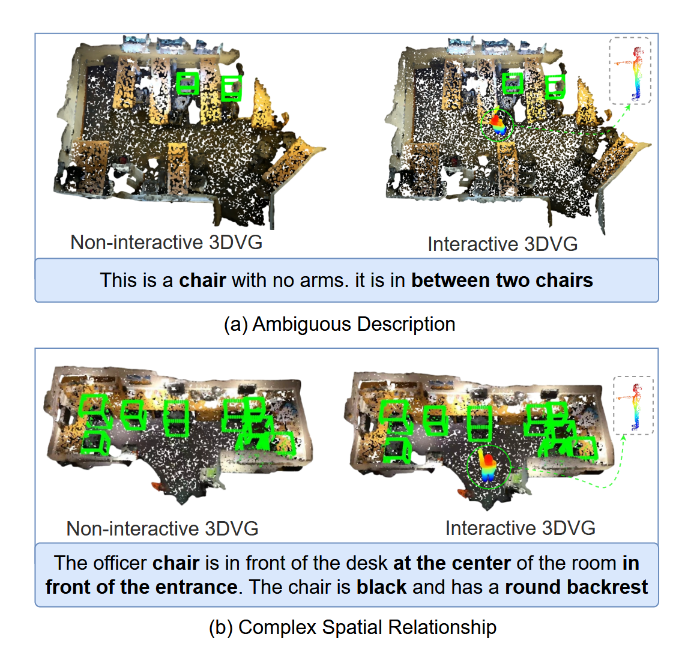
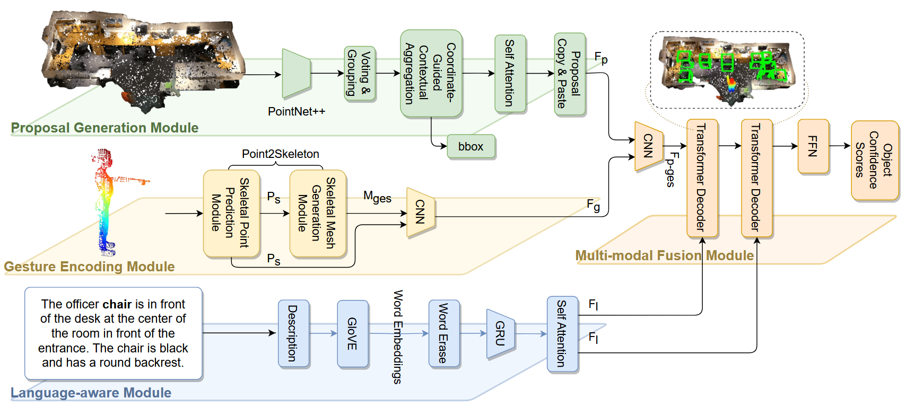

# ScanERU: Interactive 3D Visual Grounding Based on Embodied Reference Understanding

# ScanERU：基于具身指代理解的交互式三维视觉定位

## Abstract

　　三维视觉定位旨在将自然语言描述关联至由三维点云表示的场景中特定区域，是人机交互的一项基础任务。识别错误会显著影响整体准确率，进而削弱人工智能系统的运行效果。尽管现有方法具有一定有效性，但在多个外观相似且彼此相邻的物体同时出现时，仍面临识别准确率较低的问题。为解决该问题，本文直观地将人机交互作为辅助线索，以推动三维视觉定位的发展。具体而言，首先设计了一项名为**具身指代理解**（Embodied Reference Understanding, ERU）的新任务。随后，构建名为 **ScanERU** 的新数据集，以评估该思想的有效性。不同于现有数据集，ScanERU 首次覆盖了融合文本、真实世界视觉信息和合成手势信息的半合成场景。此外，本文基于注意力机制和人体动作构建了一个启发式框架，为 ERU 研究提供参考。实验结果表明，所提出方法具有优越性，特别是在识别多个相同物体时表现突出。代码和数据集已在 ScanERU 项目仓库中公开。

**关键词：**三维视觉定位；具身指代理解；人机交互；点云；手势信息

## 1 Introduction

　　理解自然语言表达并定位相应物体的能力，对于人工智能系统的运行至关重要。为此，二维视觉定位 [Deng et al., 2018, 2021; Yang et al., 2022; Qiao et al., 2020; Wang et al., 2019] 和三维视觉定位 [Huang et al., 2022; Chen et al., 2020; Yang et al., 2021; Huang et al., 2021; Yuan et al., 2021; Zhao et al., 2021] 均研究如何将词语和语言与图像、视频中的视觉信息建立关联，并利用这些信息识别和理解环境中的物体。前者以二维图像或视频帧为输入，受限于二维图像本身的表达形式，无法完整定位物体，也难以捕捉物体真实的三维范围 [Chen et al., 2020]。与二维视觉定位方法相比，三维视觉定位方法能够捕捉物体真实的物理范围和空间关系，更适应三维场景，并能提升对复杂、多样描述的处理性能 [Chen et al., 2020]。因此，基于三维点云数据的三维视觉定位研究逐渐兴起，其目标是根据自然语言描述，在三维场景中定位特定物体或区域。由于三维点云可以更细致地描述环境中物体的形状、尺寸等属性，该任务在机器人、增强现实 [Pei et al., 2023]、虚拟现实以及人机交互 [Yang et al., 2021; Huang et al., 2022] 等领域具有广泛应用；在这些场景中，自然语言可作为与三维环境交互的一种直观、灵活的方式。

`图 1. 非交互式与交互式视觉定位的对比。图中展示了非交互式视觉定位中的两类典型困难情形：描述歧义与复杂空间关系。然而，人类代理所传递的手势信息能够帮助机器人和人工智能系统定位被指代的物体。`

　　已有多项工作从不同角度研究三维视觉定位，包括构建新数据集，如 ScanRefer [Chen et al., 2020] 和 ReferIt3D [Achlioptas et al., 2020]；设计新框架 [Zhao et al., 2021]；提出用于物体识别的方法 [Liu et al., 2021]；以及无需场景重建、直接在 RGB-D 图像中进行三维视觉定位的方法 [Liu et al., 2021]。尽管现有工作已取得进展，但在多个外观相似且彼此相邻的物体中识别被指代物体仍然是该任务的一项重要挑战，而对此问题的探索明显不足。在 ScanRefer [Chen et al., 2020] 中，当描述本身存在歧义或空间关系较为复杂时，区分多个相似物体的准确率相对较低，如图 1 所示。

　　本文从人机交互的新视角出发，解决在视觉相似、彼此相邻物体中识别被指代物体的挑战。人机交互能够提供丰富线索，促进三维空间中视觉相似物体的识别。二维视觉定位领域中也存在类似思想：Chen 等 [Chen et al., 2021] 建模了语言与手势信息之间的协同关系，并构建以视频为主的 YouRefIt 数据集；在该数据集中，人类联合使用语言和手势指代物体，融合手势信息显著提升了二维视觉定位的准确率。受其启发，本文将人类手势引入三维视觉定位，通过消解指代表达歧义，更准确地识别被指代物体，从而提高对多个外观相似相邻物体的三维视觉定位精度。具体而言，本文首次设计了面向三维视觉定位的**具身指代理解**（ERU）任务，该任务基于智能体的具身视角构建。为更好评估该任务，本文在已有数据集基础上构建了 ScanERU 数据集，将文本、真实世界视觉信息和合成手势信息引入半合成场景。最后，基于注意力机制 [Vaswani et al., 2017]、人体动作，以及所构建的真实世界测试集，提出一个启发式框架来验证方法有效性。不同于以往工作，本文将与其他智能体交互的因素纳入考虑，从而提供更自然的人机交互方式和更接近人类的三维世界理解方式。

　　本文的主要贡献如下：

- 设计了面向三维视觉定位的新任务——**具身指代理解**（ERU）。该任务首次联合利用语言与手势，在三维点云中指代物体，可对环境中的三维视觉信息形成更全面、更具语义意义的表达。
- 构建了名为 **ScanERU** 的新数据集，其中包含具有合成手势信息的多样化、高挑战性半合成场景。基于 ScanERU 训练的模型可在真实世界测试场景中接受测试，为研究者开发和评估 ERU 方法提供了有价值的资源。
- 提出一个基于注意力机制和人体动作的启发式框架，用于评估对多个相同物体或复杂空间关系的识别效果。该框架为评估 ERU 模型性能、识别其优势与不足，以及指导后续研究提供了结构化手段。

## 2 Related Work

### 2.1 非交互式视觉定位 (Non-Interactive Visual Grounding)

　　三维视觉定位旨在点云环境中建立语言与三维物体之间的联系，使模型能够捕捉空间特征。其目标是在三维场景中，将自然语言描述与对应的三维物体及其属性对齐。Chen 等 [Chen et al., 2020] 提出了 ScanRefer 数据集和一套用于视觉定位任务的完整端到端框架。ReferIt3D [Achlioptas et al., 2020] 提出了两个与 ScanRefer 类似的数据集，但更侧重于从同一细粒度类别的多个实例中识别被指代物体。多数方法 [Chen et al., 2020; Zhao et al., 2021; Chen et al., 2022; Yuan et al., 2021; Bakr et al., 2022; Huang et al., 2022] 采用 ScanRefer 建立的两阶段框架，而 3D-SPS [Luo et al., 2022] 则设计了该任务的单阶段解决方案。Cai 等 [Cai et al., 2022] 开发了同时兼容视觉定位与描述生成任务的统一联合框架。受 Transformer 启发，3DVG-Transformer [Zhao et al., 2021] 和 SAT [Yang et al., 2021] 等近期工作将注意力机制整合进框架中。最新的 HAM [Chen et al., 2022] 利用空间全局注意力和空间局部注意力定位被指代物体，并在 ScanRefer Challenge 上获得了 Acc@0.5 的最佳结果。

　　然而，相比二维图像，点云具有稀疏、噪声较多且语义信息有限的特点，这使得准确定位被指代物体较为困难 [Yang et al., 2021]。此外，场景中被指代物体与相邻物体距离较近时容易产生定位错误 [Bakr et al., 2022; Achlioptas et al., 2020; Chen et al., 2020; Zhao et al., 2021]；依赖视角的描述也会导致基于空间词汇的指代定位表现较差 [Huang et al., 2022; Yang et al., 2021; Zhao et al., 2021; Huang et al., 2021; He et al., 2021; Yuan et al., 2021; Feng et al., 2021]。在多个视觉相似物体中定位唯一被指代物体时，同样会出现定位错误 [Bakr et al., 2022; Luo et al., 2022; Huang et al., 2022; Yang et al., 2021; Zhao et al., 2021; Huang et al., 2021; He et al., 2021; Yuan et al., 2021; Feng et al., 2021; Liu et al., 2021; Achlioptas et al., 2020; Chen et al., 2020]。本文在基于人类参与的场景中引入一项新的三维视觉定位任务，将人体手势整合到场景中，以减轻由点云稀疏、噪声和语义信息有限、物体邻近、难以从视觉相似物体中区分唯一指代对象，以及视角依赖描述等因素导致的定位误差。

### 2.2 交互式视觉定位 (Interactive Visual Grounding)

　　交互式视觉定位是指使用自然语言和手势，在图像或三维场景中指代物体或区域的任务。为了提高定位准确性，并促进人类与智能体之间更自然的交流方式，Chen 等 [Chen et al., 2021] 提出了 ERU 任务，其中一个智能体在共享物理环境中同时使用语言和手势向另一智能体指代物体，同时发布了 YouRefIt 数据集。该数据集是一个包含文本、视觉和手势信息的二维多模态数据集。基于人类指向手势的心理学研究，Li 等 [Li et al., 2023] 提出使用**虚拟触摸线**（virtual touch line，即连接眼睛与指尖的连线）和 Transformer 的新架构，在 ERU 任务上取得显著提升。本文将 ERU 任务扩展至点云环境，并研究人类手势的歧义消解作用。图 1 给出了非交互式与交互式视觉定位的对比。

## 3 Dataset

　　为研究三维环境中的 ERU 任务，本文提出 ScanERU——一个面向 ERU 任务的半合成数据集。该数据集以 ScanRefer [Chen et al., 2020] 和 ScanNet [Dai et al., 2017] 为基础，包含 706 个独特室内场景、9,929 个被指代物体，以及 46,173 条描述。本文为每个被指代物体合成人体点云数据和指向手势。此外，还构建真实世界 ScanERU 测试集，用于检验所提方法在真实场景中的有效性及其泛化能力。更多 ScanERU 的详细信息请参见补充材料。

### 3.1 数据标注 (Data Annotation)

　　半合成数据集的标注通过可视化用户界面和 LabelImg [Tzutalin, 2015] 完成。该界面同时向标注人员展示点云和场景俯视图，并将未被指代物体（如天花板）进行淡化处理。为保证标注质量和准确性，要求标注人员在俯视图中标注合成智能体的五个可能位置。随后，系统自动检查合成智能体与被指代物体之间的视线是否被任何物体遮挡。检查通过后，将经验证的标注分配给数据集中的每个被指代物体。

　　在数据集生成过程中，本文将手臂运动的角度波动范围设置为 $\pm 3°$，以保证手势发出的射线能够穿过被指代物体，而不是直接指向物体中心。标注过程的输出包括：合成人类智能体点云与被指代物体点云之间的索引关系，以及合成智能体在场景点云中的坐标。

### 3.2 生成流程 (Generation Procedure)

<!-- 图 2 占位：请在此处插入原文图 2 -->

`图 2. 人体点云的生成流程。`

　　为保证合成手势信息的多样性与变化性，本文使用 10 个不同的男性和女性人体模型。所使用的人体三维模型来自 Sketchfab 和 Mixamo 提供的公开开源模型，并通过 Blender 对网格进行批处理。详细流程如图 2 所示。

　　**旋转骨架以生成角色池。**为构建角色池，本文对每个角色的骨架施加旋转变换。具体而言，通过将角色的手部和手臂旋转至指向被指代物体，为每个角色生成“指向”手势。该手势由两部分组成：左手或右手的选择，以及手臂的旋转角度。本文将手臂旋转角度从 $-90°$ 变化至 $+90°$，间隔为 $0.5°$。此外，为增强每个合成智能体的多样性和真实性，引入随机角度扰动。随机旋转的骨架包括左臂或右臂（上臂和前臂）、左手或右手以及头部。扰动角度从 $-3°$ 到 $+3°$ 的高斯分布中采样。这样可使手势更真实、自然，并避免模型过拟合于特定手势。

　　**将人体模型的网格文件转换为点云。**本文将人体模型网格文件高效转换为三维点云，并进行体素下采样，使其与 ScanNet 数据集保持一致。体素尺寸统一设为 $0.25\text{ cm}$。

　　**将点云转换为“单视图”格式。**在真实场景中，人类智能体无法一直保持静止，直至扫描过程结束。因此，代表人类的点云通常并不完整，更可能呈现为“单视图”形式；其原因在于机器智能体无法像扫描整个场景一样充分扫描人类智能体。为此，首先随机选择机器智能体扫描人类智能体的角度；然后计算点云并剔除对机器智能体不可见的点；之后通过随机下采样将点数降低至 3,000。若点数少于 3,000，则使用零填充补足剩余位置。

　　**将角色池中匹配的点云加载到场景中。**由于人体点云文件较大，本文不会在数据预处理阶段将其直接加载进场景点云，而是在训练或评估时加载。依据标注位置，以及合成人类智能体点云与被指代物体之间的索引关系，同时加载带有标签、顶点和法向量信息的数据。每个被指代物体对应 3--5 个来自不同位置、指向该物体的合成智能体。

### 3.3 ScanERU 测试集 (ScanERU Test Set)

　　为评估 ScanERU 方法和数据集的有效性，本文构建了用于三维 ERU 任务的真实世界测试集。本节说明该测试集的创建过程。

　　本文采用 Azure Kinect DK 作为三维传感器，以重建场景。该设备是一种带有惯性测量单元（inertial measurement unit, IMU）的飞行时间（Time-of-Flight, ToF）RGB-D 相机。RGB 传感器的工作分辨率为 $1280\times540$，深度传感器的工作分辨率为 $512\times512$。软件方面，采用 Azure Kinect DK 官方 SDK 和 Open3D [Zhou et al., 2018] 重建系统。数据采集完成后，使用 MeshLab [Cignoni et al., 2008] 手工处理三维网格数据：删除点云中的畸变区域，特别是边缘区域，并进行下采样，使其与原始 ScanNet [Dai et al., 2017] 点云对齐。

　　由于这些数据仅用于测试集，本文未对点云执行完整的语义分割标注。研究者开发了 Blender 脚本来标注被指代物体和人类智能体。对于文本描述，使用与 ScanERU 数据标注相似的工具，帮助标注人员描述被指代物体。整个任务由 4 名标注人员完成，并对每条描述的长度、指代物体的描述方式等提出统一要求。此外，每个被指代物体均由这 4 名标注人员分别描述。需要强调的是，为评估歧义消解能力和对复杂空间信息的理解能力，场景中的所有被指代物体均至少具有一个相似物体。

## 4 Methodology

　　本节详细介绍 ScanERU 方法。第 4.1 节给出方法概览；第 4.2 节说明如何生成候选框、编码手势和编码语言；第 4.3 节介绍多模态特征融合；第 4.4 节定义损失函数。

### 4.1 方法概览 (Overview)

`图 3. 所提出 ScanERU 的架构。该方法以场景点云、人类智能体点云和被指代物体的文本描述为输入；经过候选生成模块、手势编码模块和语言感知模块后，提取不同模态的综合语义特征；随后通过多模态融合模块整合多分支特征，最终生成各边界框的置信度得分。置信度最高的边界框即为最终预测。建议以彩色方式查看。`

　　如图 3 所示，ScanERU 方法包含三个输入：完整三维场景的点云、被指代物体的描述，以及人类智能体的点云。场景点云 $P_p\in\mathbb{R}^{N\times(3+K)}$ 包含 $N$ 个点的坐标和 $K$ 维特征，例如 RGB 信息和法向量。文本描述经过分词后，使用 GloVe [Pennington et al., 2014] 模型转换为词嵌入。人类智能体点云与场景点云相似，但其特征仅包含法向量。该任务的目标是在世界坐标系中定位被指代物体并输出其边界框。

　　ScanERU 包含四个模块：候选生成模块、手势编码模块、语言感知模块和多模态融合模块。为充分利用语言、手势与场景点云之间的特征，本文引入注意力机制 [Vaswani et al., 2017]。候选生成模块与 3DVG-Transformer [Zhao et al., 2021] 中的模块相同，它在生成物体候选边界框的同时提取上下文感知特征。对于 $M$ 个候选框，其候选特征表示为 $F_p\in\mathbb{R}^{M\times H}$，其中 $H$ 为特征维度。手势编码模块使用 Point2Skeleton [Lin et al., 2021] 将人体骨架结构抽象出来，再通过卷积层编码为手势特征 $F_g$。与 ScanRefer [Chen et al., 2020] 和 3DVG-Transformer [Zhao et al., 2021] 类似，语言感知模块使用 GRU [Chung et al., 2014] 单元和自注意力模块，将词嵌入汇聚为语言特征 $F_l\in\mathbb{R}^{L\times H}$ 以及全局语言特征。多模态融合模块利用注意力机制 [Vaswani et al., 2017] 融合候选特征 $F_p$、手势特征 $F_g$ 和词特征 $F_l$，从而生成各边界框的置信度得分。本文重点研究手势信息与候选信息、词语信息的结合，以消解指代表达歧义并准确识别被指代物体。

### 4.2 特征编码模块 (Feature Encoding Modules)

　　**候选生成模块。**所提出方法采用与 ScanRefer [Chen et al., 2020]、3DVG-Transformer [Zhao et al., 2021] 相似的 PointNet++ [Qi et al., 2017] 主干网络，以及投票和分组模块 [Qi et al., 2019] 处理场景点云，并将其分组为独立簇。随后，利用 3DVG-Transformer [Zhao et al., 2021] 中的坐标引导上下文聚合（coordinate-guided contextual aggregation, CCA）模块，生成精炼后的候选特征 $F_p^0$ 和候选边界框。为进一步优化候选特征，使用以 $F_p^0$ 为输入的自注意力模块，学习精炼候选特征之间的上下文关系。此外，采用与 3DVG-Transformer [Zhao et al., 2021] 类似的 Copy & Paste 模块，以缓解过拟合问题，最终输出候选特征 $F_p$。

　　**手势编码模块。**首先使用 Point2Skeleton [Lin et al., 2021] 处理人类智能体对应的点云，得到属于该人类智能体的 $S$ 个骨架点 $P_s$，以及描述这些骨架点之间关系的连接矩阵 $M_{\mathrm{ges}}\in\mathbb{R}^{S\times S}$。随后，将 $P_s$ 与矩阵 $M_{\mathrm{ges}}$ 拼接，并通过卷积层编码，最终获得手势特征 $F_g$。

　　**语言感知模块。**输入文本描述通过 GloVe [Pennington et al., 2014] 和 GRU [Chung et al., 2014] 模块编码，该模块与 ScanRefer [Chen et al., 2020] 中所使用的模块一致。此外，训练过程中采用**词擦除**（word erase）训练策略，该策略已被证明对 3DVG-Transformer [Zhao et al., 2021] 有益。为进一步优化语言特征，本文在 GRU 输出上使用自注意力模块，生成 $F_l$。

### 4.3 多模态融合模块 (Multi-Modal Fusion Module)

　　如图 3 所示，将候选特征 $F_p$ 与手势特征 $F_g$ 拼接后，通过卷积块进行融合，得到特征 $F_{p-\mathrm{ges}}$。随后，使用由两层堆叠而成的 Transformer 解码器，挖掘候选-手势特征 $F_{p-\mathrm{ges}}$ 与语言特征 $F_l$ 之间的关系。其中，候选-手势特征 $F_{p-\mathrm{ges}}$ 作为 Query，语言特征 $F_l$ 作为 Key 和 Value。最后，将堆叠 Transformer 解码器的输出送入前馈网络（feed-forward network, FFN）层和 Softmax 激活层，生成每个边界框的置信度得分。

### 4.4 损失函数 (Loss Function)

　　本文采用与 3DVG-Transformer [Zhao et al., 2021] 和 Point2Skeleton [Lin et al., 2021] 类似的损失函数：

$$
\mathcal{L}=0.3\mathcal{L}_{\mathrm{loc}}+10\mathcal{L}_{\mathrm{det}}+0.1\mathcal{L}_{\mathrm{cls}}+0.3\mathcal{L}_{\mathrm{skel}}.
$$

　　其中，$\mathcal{L}_{\mathrm{loc}}$ 表示定位损失，$\mathcal{L}_{\mathrm{det}}$ 表示目标检测损失，$\mathcal{L}_{\mathrm{cls}}$ 表示语言到物体的分类损失。进一步地，目标检测损失可分解为：

$$
\mathcal{L}_{\mathrm{det}}=\mathcal{L}_{\mathrm{vote-reg}}+0.1\mathcal{L}_{\mathrm{objn-cls}}+0.1\mathcal{L}_{\mathrm{sem-cls}}+\mathcal{L}_{\mathrm{box}},
$$

　　其中，$\mathcal{L}_{\mathrm{vote-reg}}$ 为投票回归损失，$\mathcal{L}_{\mathrm{objn-cls}}$ 和 $\mathcal{L}_{\mathrm{sem-cls}}$ 分别为目标性分类损失和语义分类损失，$\mathcal{L}_{\mathrm{box}}$ 为边界框损失。边界框损失可进一步写为：

$$
\mathcal{L}_{\mathrm{box}}=\mathcal{L}_{\mathrm{center-reg}}+0.1\mathcal{L}_{\mathrm{size-cls}}+\mathcal{L}_{\mathrm{size-reg}},
$$

　　其中，$\mathcal{L}_{\mathrm{center-reg}}$ 和 $\mathcal{L}_{\mathrm{size-reg}}$ 分别为中心位置回归损失和尺寸回归损失，$\mathcal{L}_{\mathrm{size-cls}}$ 为尺寸类别分类损失。$\mathcal{L}_{\mathrm{skel}}$ 表示骨架检测损失，可进一步分解为：

$$
\mathcal{L}_{\mathrm{skel}}=\mathcal{L}_{\mathrm{point}}+\mathcal{L}_{\mathrm{link}},
$$

　　其中，$\mathcal{L}_{\mathrm{point}}$ 为骨架点预测损失，$\mathcal{L}_{\mathrm{link}}$ 为骨架网格生成损失。

## 5 Experiment

### 5.1 数据集划分 (Dataset Split)

　　实验在 ScanERU 数据集上开展。遵循 ScanRefer 数据集的相同协议，将数据划分为训练集和验证集，分别包含 36,665 个和 9,508 个样本。

### 5.2 基线方法 (Baseline)

　　本文通过将所提出方法与三维视觉定位任务中的先进方法进行比较，精心设计实验基线。

### 5.3 评价指标 (Metric)

　　遵循三维视觉定位任务的标准评估方案，本文使用 Acc@0.25IoU 和 Acc@0.5IoU 两项常用指标评价方法性能。此外，按照 ScanRefer [Chen et al., 2020] 的定义，还报告 **unique**、**multiple** 和 **overall** 三类结果。其中，**unique** 用于衡量场景中仅存在一个该类别物体时的性能；**multiple** 用于衡量场景中存在多个同类相似物体时的性能；**overall** 是 **unique** 与 **multiple** 的加权平均值。

### 5.4 定量研究 (Quantitative Study)

<!-- 表 1 占位：请在此处插入原文表 1 -->

`表 1. ScanERU 数据集上的视觉定位性能对比。`

　　表 1 比较了 ScanERU 方法与多个现有三维视觉定位方法的性能。为将本文工作与基于 ScanRefer 的其他三维视觉定位方法进行公平比较，采用与这些方法相同的实验设置。由于 ScanERU 与 ScanRefer 在三维场景和文本描述方面相同，其他方法使用 ScanRefer 或 ScanERU 训练得到的结果是一致的。

　　**ScanERU 验证集实验。**在 **multiple** 子集上，所提出方法相较当时最先进方法（state-of-the-art, SOTA）有显著优势：Acc@0.25 提高 24.88%，Acc@0.5 提高 21.23%。此外，由于具备更强的歧义消解能力和对复杂空间信息的深入理解，本文方法在总体准确率上也明显优于 SOTA 方法：Acc@0.25 提高 20.34%，Acc@0.5 提高 17.11%。这表明，在定位和区分多个相似物体时引入人类手势是有效的，也验证了本文方法能够显著提升复杂室内环境中的定位性能。

　　**ScanERU 测试集实验。**本文比较了 ScanRefer [Chen et al., 2020]、3DVG-Transformer [Zhao et al., 2021] 与 ScanERU 在三维物体定位任务上的表现。由于所有被指代物体均属于 **multiple** 情形，表 1 仅报告 **overall** 结果。本文方法获得了显著高于其他方法的准确率。结果表明，所构建数据集和方法能够泛化至真实世界环境，文本与手势信息的结合对于复杂真实场景中的精确物体定位至关重要。

### 5.5 定性研究 (Qualitative Study)

<!-- 图 4 占位：请在此处插入原文图 4 -->

`图 4. 3DVG-Transformer [Zhao et al., 2021] 与 ScanERU 的定性结果。真实边界框以蓝色标记；若预测边界框与真实边界框的 IoU 大于 0.5，则该预测框标记为绿色，否则标记为红色。`

　　图 4 可视化展示了本文方法与基线 3DVG-Transformer [Zhao et al., 2021] 的性能。真实边界框以蓝色表示；若预测框与真实框的 IoU 超过 50%，则预测框以绿色显示，否则以红色显示。

　　在 ScanERU 验证集上，实验表明，本文方法能够在包含多个相似物体的复杂环境中成功定位被指代物体，而基线方法会出现失败案例。对于 3DVG-Transformer [Zhao et al., 2021]，本文归纳出两项主要失败原因。第一，点云数据中细粒度特征难以区分。如图 4(a) 所示，“没有扶手”和“木制椅子”等描述即使对人类观察者而言，也不足以将目标与其他物体明确区分。第二，描述本身具有歧义或复杂性。图 4(b) 中“在桌子尽头”这一表述不够明确，可能指向多个候选物体。这些结果说明，仅依赖语言模态在挑战性环境中消解正确物体的歧义存在局限。

　　在 ScanERU 测试集上，相比 3DVG-Transformer [Zhao et al., 2021]，本文方法在处理真实环境中的复杂情形时表现出更强优势。图 4(c) 和图 4(d) 突出了三维视觉定位失败的主要原因：空间信息过于复杂，以及描述模糊。加入手势信息能够缓解这些问题，尤其在真实世界场景中更为有效。尽管如此，在候选生成阶段尚未引入手势信息，可能导致候选框生成不够准确。例如，图 4(d) 表明 ScanERU 未能为该植物准确生成候选框，因此在这类情况下手势信息的作用仍受到限制。

### 5.6 消融研究 (Ablation Study)

　　本节对所提方法中语言模态和手势模态的贡献进行详细分析。表 1 结果显示，在 **unique** 子集的 Acc@0.25 指标上，仅使用手势的 $\mathrm{ScanERU}_{\mathrm{ges-only}}$ 性能明显低于仅使用语言的 $\mathrm{ScanERU}_{\mathrm{lang-only}}$ 和完整模型 $\mathrm{ScanERU}_{\mathrm{full}}$。这是因为 $\mathrm{ScanERU}_{\mathrm{ges-only}}$ 只引入了手势细节，却忽略了与被指代物体自身有关的描述，以及场景中所有物体之间的空间信息。因此，当多个物体（如沙发和桌子）处在由人类智能体所指示的同一方向时，手势信息会变得高度模糊，从而导致定位结果不准确。这进一步说明文本信息对于解决与被指代物体有关的潜在歧义非常重要。

　　同时，$\mathrm{ScanERU}_{\mathrm{lang-only}}$ 的结果以及表 1 中 $\mathrm{ScanERU}_{\mathrm{full}}$ 的优越表现表明，将手势线索纳入模型对于 ERU 任务至关重要。手势信息的融入显著增强了模型区分相似物体的能力，并提升了定位性能。

## 6 Conclusion

　　本文在三维点云环境中引入具身指代理解（ERU）任务：智能体在共享物理空间内使用语言和手势指代物体。为支持该方向研究，本文提出 ScanERU 半合成数据集，并在真实世界测试集上验证其有效性。随后，本文提出一种用于三维环境 ERU 的新框架，整合多模态特征与注意力机制。该方法优于现有三维视觉定位方法，尤其在识别多个相同物体方面表现突出。通过将人类手势作为额外模态引入，本文工作能够消解指代表达歧义并准确定位物体，从而显著推动三维视觉定位的发展。此外，研究强调了具身视角、以人为中心的人工智能，以及人类—智能体交互对于实现更自然、更接近人类的三维世界理解的重要性。未来工作将扩展数据集中的场景与手势类型，并探索更多模态以进一步提升 ERU 性能。

## Acknowledgments

　　本研究部分受国家自然科学基金项目 U23B2011、62102069、U20B2063 和 62220106008，四川省科技计划项目 2022YFG0032，以及中国空间技术研究院（CAST）创新计划资助。

## References

- Achlioptas, P.; Abdelreheem, A.; Xia, F.; Elhoseiny, M.; and Guibas, L. 2020. ReferIt3D: Neural listeners for fine-grained 3D object identification in real-world scenes. In *Computer Vision–ECCV 2020*, 422–440.
- Bakr, E. M.; Alsaedy, Y.; and Elhoseiny, M. 2022. Look Around and Refer: 2D Synthetic Semantics Knowledge Distillation for 3D Visual Grounding. *arXiv preprint arXiv:2211.14241*.
- Cai, D.; Zhao, L.; Zhang, J.; Sheng, L.; and Xu, D. 2022. 3DJCG: A unified framework for joint dense captioning and visual grounding on 3D point clouds. In *CVPR*, 16464–16473.
- Chen, D. Z.; Chang, A. X.; and Nießner, M. 2020. ScanRefer: 3D object localization in RGB-D scans using natural language. In *ECCV*, 202–221.
- Chen, J.; Luo, W.; Wei, X.; Ma, L.; and Zhang, W. 2022. HAM: Hierarchical attention model with high performance for 3D visual grounding. *arXiv preprint arXiv:2210.12513*.
- Chen, Y.; Li, Q.; Kong, D.; Kei, Y. L.; Zhu, S.-C.; Gao, T.; Zhu, Y.; and Huang, S. 2021. YouRefIt: Embodied reference understanding with language and gesture. In *ICCV*, 1385–1395.
- Chung, J.; Gulcehre, C.; Cho, K.; and Bengio, Y. 2014. Empirical evaluation of gated recurrent neural networks on sequence modeling. *arXiv preprint arXiv:1412.3555*.
- Cignoni, P.; Callieri, M.; Corsini, M.; Dellepiane, M.; Ganovelli, F.; Ranzuglia, G.; et al. 2008. MeshLab: An open-source mesh processing tool. In *Eurographics Italian Chapter Conference*, 129–136.
- Dai, A.; Chang, A. X.; Savva, M.; Halber, M.; Funkhouser, T.; and Nießner, M. 2017. ScanNet: Richly-annotated 3D reconstructions of indoor scenes. In *CVPR*, 5828–5839.
- Deng, C.; Wu, Q.; Wu, Q.; Hu, F.; Lyu, F.; and Tan, M. 2018. Visual grounding via accumulated attention. In *CVPR*, 7746–7755.
- Deng, J.; Yang, Z.; Chen, T.; Zhou, W.; and Li, H. 2021. TransVG: End-to-end visual grounding with transformers. In *ICCV*, 1769–1779.
- Feng, M.; Li, Z.; Li, Q.; Zhang, L.; Zhang, X.; Zhu, G.; Zhang, H.; Wang, Y.; and Mian, A. 2021. Free-form description guided 3D visual graph network for object grounding in point cloud. In *ICCV*, 3722–3731.
- He, D.; Zhao, Y.; Luo, J.; Hui, T.; Huang, S.; Zhang, A.; and Liu, S. 2021. TransRefer3D: Entity-and-relation aware transformer for fine-grained 3D visual grounding. In *ACM MM*, 2344–2352.
- Huang, P.-H.; Lee, H.-H.; Chen, H.-T.; and Liu, T.-L. 2021. Text-guided graph neural networks for referring 3D instance segmentation. In *AAAI*, 1610–1618.
- Huang, S.; Chen, Y.; Jia, J.; and Wang, L. 2022. Multi-view transformer for 3D visual grounding. In *CVPR*, 15524–15533.
- Li, Y.; Chen, X.; Zhao, H.; Gong, J.; Zhou, G.; Rossano, F.; and Zhu, Y. 2023. Understanding embodied reference with Touch-Line Transformer. In *ICLR*.
- Lin, C.; Li, C.; Liu, Y.; Chen, N.; Choi, Y.-K.; and Wang, W. 2021. Point2Skeleton: Learning skeletal representations from point clouds. In *CVPR*, 4277–4286.
- Liu, H.; Lin, A.; Han, X.; Yang, L.; Yu, Y.; and Cui, S. 2021. Refer-It-in-RGBD: A bottom-up approach for 3D visual grounding in RGB-D images. In *CVPR*, 6032–6041.
- Luo, J.; Fu, J.; Kong, X.; Gao, C.; Ren, H.; Shen, H.; Xia, H.; and Liu, S. 2022. 3D-SPS: Single-stage 3D visual grounding via referred point progressive selection. In *CVPR*, 16454–16463.
- Pei, Y.; Huang, R.; Wang, G.; Yang, Y.; Xie, N.; and Shen, H. T. 2023. Multimodal Apology: Using WebXR to Repair Trust with Virtual Companion. In *IEEE VRW*, 727–728.
- Pennington, J.; Socher, R.; and Manning, C. D. 2014. GloVe: Global vectors for word representation. In *EMNLP*, 1532–1543.
- Qi, C. R.; Litany, O.; He, K.; and Guibas, L. J. 2019. Deep Hough voting for 3D object detection in point clouds. In *ICCV*, 9277–9286.
- Qi, C. R.; Yi, L.; Su, H.; and Guibas, L. J. 2017. PointNet++: Deep hierarchical feature learning on point sets in a metric space. In *NeurIPS*, 30.
- Qiao, Y.; Deng, C.; and Wu, Q. 2020. Referring expression comprehension: A survey of methods and datasets. *IEEE Transactions on Multimedia*, 4426–4440.
- Tzutalin. 2015. LabelImg. https://github.com/tzutalin/labelImg. Accessed: 2023-2-11.
- Vaswani, A.; Shazeer, N.; Parmar, N.; Uszkoreit, J.; Jones, L.; Gomez, A. N.; Kaiser, Ł.; and Polosukhin, I. 2017. Attention Is All You Need. In *NeurIPS*, 30.
- Wang, G.; Sun, C.; and Sowmya, A. 2019. ERL-Net: Entangled representation learning for single image de-raining. In *ICCV*, 5644–5652.
- Wang, G.; Sun, C.; and Sowmya, A. 2021. Context-enhanced representation learning for single image deraining. *International Journal of Computer Vision*, 1650–1674.
- Wang, G.; Yang, Y.; Xu, X.; Li, J.; and Shen, H. 2021. Enhanced context encoding for single image raindrop removal. *Science China Technological Sciences*, 2640–2650.
- Wang, P.; Wu, Q.; Cao, J.; Shen, C.; Gao, L.; and van den Hengel, A. 2019. Neighbourhood Watch: Referring expression comprehension via language-guided graph attention networks. In *CVPR*, 1960–1968.
- Wu, Y.; Pan, C.; Wang, G.; Yang, Y.; Wei, J.; Li, C.; and Shen, H. T. 2023. Learning semantic-aware knowledge guidance for low-light image enhancement. In *CVPR*, 1662–1671.
- Yang, L.; Xu, Y.; Yuan, C.; Liu, W.; Li, B.; and Hu, W. 2022. Improving visual grounding with visual-linguistic verification and iterative reasoning. In *CVPR*, 9499–9508.
- Yang, Z.; Zhang, S.; Wang, L.; and Luo, J. 2021. SAT: 2D semantics assisted training for 3D visual grounding. In *ICCV*, 1856–1866.
- Yuan, Z.; Yan, X.; Liao, Y.; Zhang, R.; Wang, S.; Li, Z.; and Cui, S. 2021. InstanceRefer: Cooperative holistic understanding for visual grounding on point clouds through instance multi-level contextual referring. In *ICCV*, 1791–1800.
- Zhao, L.; Cai, D.; Sheng, L.; and Xu, D. 2021. 3DVG-Transformer: Relation modeling for visual grounding on point clouds. In *ICCV*, 2928–2937.
- Zhou, Q.-Y.; Park, J.; and Koltun, V. 2018. Open3D: A modern library for 3D data processing. *arXiv preprint arXiv:1801.09847*.
