# Transformers in Small Object Detection: A Benchmark and Survey of State-of-the-Art

# 小目标检测中的 Transformer：最先进方法的基准评测与综述

AREF MIRI REKAVANDI，西澳大利亚大学，澳大利亚珀斯

SHIMA RASHIDI，皇家墨尔本理工大学，澳大利亚墨尔本

FARID BOUSSAID，西澳大利亚大学，澳大利亚珀斯

STEPHEN HOEFS，国防科学与技术集团，澳大利亚珀斯

EMRE AKBAS，中东技术大学，土耳其安卡拉；亥姆霍兹慕尼黑德国环境健康研究中心，德国诺伊赫尔贝格

MOHAMMED BENNAMOUN，西澳大利亚大学，澳大利亚珀斯

## 摘要（Abstract）

Transformer 在计算机视觉中迅速普及，尤其是在目标检测领域。通过考察前沿目标检测方法的结果，我们注意到，在几乎每个视频或图像数据集上，Transformer 始终优于成熟的基于 CNN 的检测器。由于可见性低，小目标被认为是检测框架中最具挑战性的目标类型之一。本文旨在探究这类规模庞大的网络所带来的性能优势，并确定其在小目标检测（Small Object Detection，SOD）中表现优越的潜在原因。我们旨在研究能够进一步提升 Transformer 在 SOD 中性能的潜在策略。本综述对 2020 年至 2023 年间为 SOD 任务开发的 Transformer 的 60 多项研究进行了分类。这些研究涵盖多种检测应用，包括通用图像、航拍图像、医学图像、主动毫米波图像、水下图像和视频中的 SOD。我们还汇编并提供了一个包含 12 个适用于 SOD、但在先前研究中被忽略的大规模数据集的列表，并使用平均精度均值（mean Average Precision，mAP）、每秒帧数（Frames Per Second，FPS）和参数数量等常用指标比较所综述研究的性能。研究人员可以通过我们的网页跟踪更新的研究，网址为：<https://github.com/arekavandi/Transformer-SOD>。

**CCS 概念：**计算方法 → 计算机视觉；机器学习；

**其他关键词与短语：**目标识别、小目标检测、视觉 Transformer、目标定位、深度学习、注意力、MS COCO 数据集

本研究得到澳大利亚研究理事会（ARC DP210101682、DP210102674）以及国防科学与技术集团（DSTG）对“海事场景中小目标的低观察者检测”项目的部分支持。Akbas 博士衷心感谢土耳其科学与技术研究理事会 TUBITAK 2219 项目的支持。

**作者联系信息：**Aref Miri Rekavandi，西澳大利亚大学，澳大利亚珀斯；电子邮件：aref.mirirekavandi@uwa.edu.au；Shima Rashidi，皇家墨尔本理工大学，澳大利亚维多利亚州墨尔本；电子邮件：shima.rashidi7@gmail.com；Farid Boussaid，西澳大利亚大学，澳大利亚西澳大利亚州珀斯；电子邮件：farid.boussaid@uwa.edu.au；Stephen Hoefs，国防科学与技术集团，澳大利亚西澳大利亚州珀斯；电子邮件：stephen.hoefs@defence.gov.au；Emre Akbas，中东技术大学，土耳其安卡拉省安卡拉；亥姆霍兹慕尼黑德国环境健康研究中心，德国诺伊赫尔贝格；电子邮件：emre@ceng.metu.edu.tr；Mohammed Bennamoun，西澳大利亚大学，澳大利亚西澳大利亚州珀斯；电子邮件：mohammed.bennamoun@uwa.edu.au。

ACM 0360-0300/2025/09-ART64

<https://doi.org/10.1145/3758090>

ACM Comput. Surv.，第 58 卷，第 3 期，文章 64。出版日期：2025 年 9 月。

**ACM 参考文献格式：**

Aref Miri Rekavandi、Shima Rashidi、Farid Boussaid、Stephen Hoefs、Emre Akbas 和 Mohammed Bennamoun。2025。小目标检测中的 Transformer：最先进方法的基准评测与综述。ACM Comput. Surv. 58，3，文章 64（2025 年 9 月），33 页。<https://doi.org/10.1145/3758090>

## 1 引言（Introduction）

小目标检测（SOD）已被认为是前沿（State-Of-The-Art，SOTA）目标检测方法面临的一项重大挑战 [67]。“小目标”一词指的是在输入图像中占据较小比例的目标。例如，广泛使用的 MS COCO 数据集 [61] 将典型的 $480\times640$ 图像中边界框为 $32\times32$ 像素或更小的目标定义为小目标（图 1）。其他数据集有各自的定义，例如，占据图像面积不超过 10% 的目标。小目标经常被漏检，或以定位不正确的边界框被检测出来，有时还带有错误的标签。SOD 中定位不足的主要原因源于输入图像或视频帧提供的信息有限，以及目标经过深度网络的多个层时所经历的进一步空间退化。由于小目标经常出现在各种应用领域中，例如行人检测 [110]、医学图像分析 [82]、人脸识别 [20]、交通标志检测 [68]、交通信号灯检测 [121]、船舶检测 [101]、基于合成孔径雷达（Synthetic Aperture Radar，SAR）的目标检测 [87]，因此值得考察现代深度学习 SOD 技术的性能。

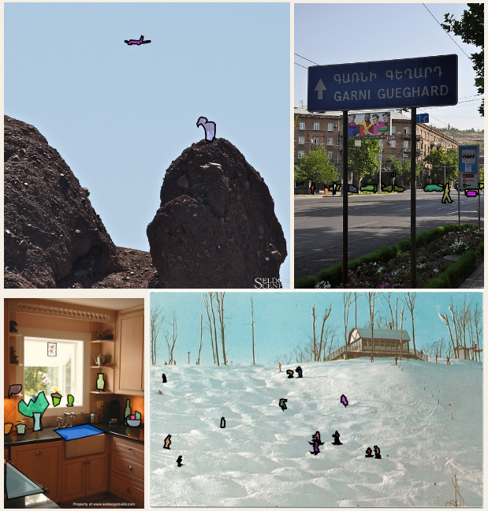

`图 1. MS COCO 数据集 [61] 中小尺寸目标的示例。目标以彩色分割区域突出显示。`

​		目标检测，尤其是 SOD，长期以来一直依赖基于卷积神经网络（Convolutional Neural Network，CNN）的深度学习模型。随着时间的推移，出现了多种单阶段和两阶段检测器，包括 You Only Look Once（YOLO）变体 [3, 46, 49, 84–86, 103]、单次多框检测器（Single Shot multi-box Detector，SSD）[66]、RetinaNet [60]、空间金字塔池化网络（Spatial Pyramid Pooling Network，SPP-Net）[40]、Fast R-CNN [35]、Faster R-CNN [89]、基于区域的全卷积网络（Region-Based Fully Convolutional Networks，R-FCN）[23]、Mask R-CNN [41]、特征金字塔网络（Feature Pyramid Networks，FPN）[59]、Cascade R-CNN [5] 和 Libra R-CNN [79]。各种策略与这些技术结合使用，以改善其在 SOD 中的检测性能，其中`多尺度特征学习`是最常用的方法。在我们先前的工作中，我们综述了截至 2022 年在深度学习中用于提升光学图像和视频中 SOD 性能的众多策略 [88]。我们表明，除了采用 Transformer 等较新的深度学习结构之外，常见的方法还包括数据增强、超分辨率、多尺度特征学习、上下文学习、基于注意力的学习、区域提议、损失函数正则化、利用辅助任务以及时空特征聚合。此外，我们观察到，Transformer 是大多数数据集上小目标定位的领先方法之一。然而，由于 [88] 主要评估了 160 多篇聚焦于基于 CNN 的网络的论文，因此没有深入探讨以 Transformer 为核心的方法。考虑到该领域的快速发展和持续探索，现在正是研究为 SOD 设计的最新 Transformer 模型的适当时机。在本文中，我们旨在全面分析推动 Transformer 在 SOD 中取得出色性能的因素，并强调这些方法与通用目标检测中所用方法的区别。

​		自 2017 年以来，该领域已发表了大量综述文章。关于这些综述的全面讨论和列表可以在我们先前的综述 [88] 中找到。另一篇近期综述 [17] 主要关注基于 CNN 的技术。当前综述的论述与其前作有所不同。本文的关注范围专门收窄至 Transformer——这是此前尚未探索的一个方面——并将其定位为图像和视频 SOD 的主导网络架构。这涉及为这一创新架构量身定制的独特分类体系，并有意将基于 CNN 的方法置于次要位置。由于这一主题相对较新，我们的综述优先考虑主要在 2021 年之后发表的工作，同时为保证完整性，也纳入了 2020 年和 2021 年的一些较早研究。我们还强调了各个应用领域中新引入的与 SOD 相关的数据集。所纳入的研究通过在 Google Scholar、IEEE Xplore、arXiv 等平台上进行关键词检索（例如“小目标检测”“微小目标检测”“用于 SOD 的 Transformer”），以及沿重要工作的参考文献链进行检索来确定。我们优先考虑直接研究 SOD 或提供小目标定量性能细分结果的论文。提到小目标但缺乏针对 SOD 的方法重点，或结果欠佳的研究被排除。在本综述中，我们假设读者已经熟悉通用目标检测技术、其架构以及相关性能度量。如果读者需要这些方面的基础知识，我们建议参考我们先前的工作 [88]。总而言之，本综述的主要贡献如下：

- 我们全面综述了图像和视频领域中近期基于 Transformer 的 SOD 方法（60 多项研究）。我们提出了一种新的分类体系来对这些方法进行分类，并详细描述和深入分析其优势与局限。
- 我们介绍了 12 个新发表或先前关注不足的 SOD 数据集，这些数据集未在早期综述中涵盖，从而扩展了研究人员可用的数据集范围。
- 我们对通用应用和特定领域应用中的现有模型进行了比较分析，包括航拍图像、医学图像、水下图像、主动毫米波图像以及基于视频的检测任务。
- 我们讨论了基于 Transformer 的 SOD 当前面临的挑战和局限，并概述了推动该领域发展的有前景的未来研究方向。

表 1. 本文所用术语及其含义列表。

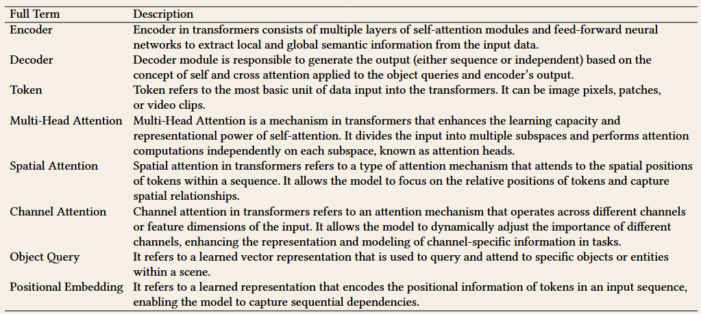

本文的结构如下。第 2 节介绍基础 Transformer 架构，详细说明编码器和解码器等关键组件，并介绍两个开创性的基于 Transformer 的模型，即 `DETR` 和 `ViT-FRCNN`。第 3 节将重点转向专门为 SOD 设计的基于 Transformer 的方法，这些方法结合了专门的设计与技术，以提升小尺度目标上的性能。随后，我们给出这些方法的全面分类，并深入考察每个类别。第 4 节展示用于 SOD 的不同数据集，并在一系列应用中进行评估。在第 5 节中，我们分析这些结果，并将其与早期 CNN 网络得到的结果进行比较。最后，第 6 节给出我们的结论。

## 2 背景（Background）

​	Transformer 是一类以其在自然语言处理任务中的能力而著称的神经网络 [102]。它们能够通过分析文本或时间序列数据等序列数据来掌握和理解上下文关系，因此表现突出。通过自注意力等机制，Transformer 擅长捕捉输入序列中元素之间的相互依赖关系和相关性。Transformer 模型包含两个主要模块：编码器和解码器。各模块内处理块的可视化表示如图 2 所示。表 1 为不熟悉计算机视觉 Transformer 常用术语的读者提供参考。在目标检测中，编码器模块采用各种特征嵌入方法处理输入 Token，输入 Token 可以是图像块或视频片段。这包括利用预训练 CNN 提取合适的表示。位置编码模块以位置信息丰富每个 Token 的特征表示，这种技术已在各种应用中显示出显著的性能提升。随后，编码后的表示在多头注意力模块中进行处理，该模块由三个主要矩阵进行参数化，即 $\mathbf{W}_q\in\mathbb{R}^{d_q\times d}$、$\mathbf{W}_k\in\mathbb{R}^{d_k\times d}$ 和 $\mathbf{W}_v\in\mathbb{R}^{d_v\times d}$，用于获得查询、键和值向量，分别记为 $\mathbf{q}$、$\mathbf{k}$、$\mathbf{v}$。换言之，

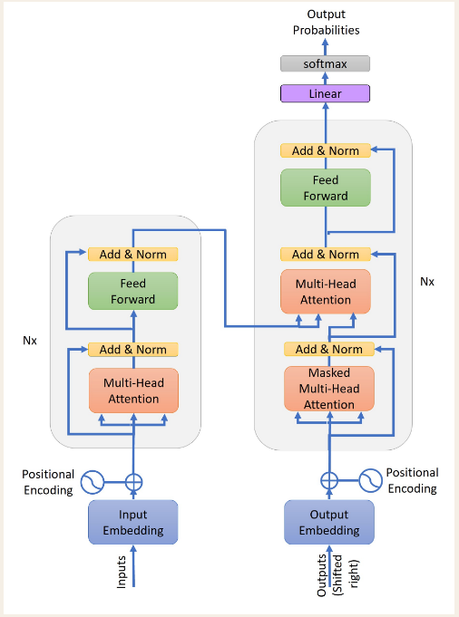

`图 2. 用于序列到序列翻译的 Transformer 架构，包含编码器（左侧模块）和解码器（右侧模块）（图引自 [102]）。`

$$
\mathbf{q}_i=\mathbf{W}_q\mathbf{x}_i,\quad
\mathbf{k}_i=\mathbf{W}_k\mathbf{x}_i,\quad
\mathbf{v}_i=\mathbf{W}_v\mathbf{x}_i,\quad
i=1,\ldots,T,
\tag{1}
$$

其中，$T$ 是 Token 的总数，每个 Token 由 $\mathbf{x}$ 表示。多头注意力模块产生如下输出：

$$
\mathrm{MH\ Attention}(\mathbf{Q},\mathbf{K},\mathbf{V})
=\operatorname{Concat}(\mathrm{head}_1,\ldots,\mathrm{head}_h)\mathbf{W}^{O}.
\tag{2}
$$

其中，$\mathbf{W}^{O}\in\mathbb{R}^{hd_v\times d}$，$d_k=d_q$，并且

$$
\mathrm{head}_h
=\operatorname{Attention}(\mathbf{Q}_h,\mathbf{K}_h,\mathbf{V}_h)
=\operatorname{Softmax}\left(\frac{\mathbf{K}_h^{\top}\mathbf{Q}_h}{\sqrt{d_k}}\right)\mathbf{V}_h^{\top}.
\tag{3}
$$

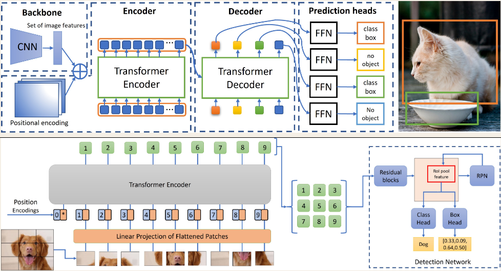

`图 3. 上：DETR（图引自 [7]）。下：ViT-FRCNN（图引自 [2]）。`

随后，这些输出通过跳跃连接和归一化模块进行组合。然后，每个向量通过全连接层独立处理，其中激活函数为网络引入非线性。该模块的参数在所有向量之间共享。这一过程重复 $N$ 次，$N$ 对应深度网络的层数。在解码器模块中，使用编码器生成的向量进行类似的处理。最终，系统计算潜在输出类别的输出概率，注意力通过键矩阵和查询矩阵之间的点积运算实现。Transformer 的另一种表示也可写为

$$
\mathrm{MH\ Attention}^{i}
=\sum_h\mathbf{W}_h^{O}\left[\sum_{k=1}^{T}A_{hik}\mathbf{W}_v\mathbf{x}_k\right],
\quad i=1,\ldots,T,
\tag{4}
$$

其中，$\mathbf{W}_h^{O}$ 是 $\mathbf{W}^{O}$ 中对应第 $h$ 个头的子矩阵，$A_{hik}$ 是第 $h$ 个头中的注意力权重，即矩阵 $\operatorname{Softmax}\left(\frac{\mathbf{K}_h^{\top}\mathbf{Q}_h}{\sqrt{d_k}}\right)$ 中第 $i$ 行（对应第 $i$ 个查询）和第 $k$ 列（对应第 $k$ 个键）的元素。

​		Dosovitskiy 等人首次将 Transformer 架构用于包括图像识别在内的计算机视觉任务 [29]。Transformer 在各种视觉任务中表现出的卓越性能，为其在目标检测研究领域中的应用铺平了道路。该领域的两项开创性工作是检测 Transformer（DEtection TRansformer，DETR）[7]（图 3，上）和 ViT-FRCNN [2]（图 3，下）。

​		DETR 旨在通过采用`基于集合的全局损失，`减少后处理过程中对基于 CNN 的技术的依赖。这一特定损失函数通过二分图匹配帮助合并近乎重复的预测，确保每个预测与其匹配的真实标注边界框唯一配对。作为端到端模型，DETR 受益于全局计算和完美记忆，使其适合处理由视频／图像生成的长序列。DETR 所使用的`二分图匹配损失`定义如下：

$$
\hat{s}=\arg\min_{s\in\mathcal{S}}\sum_i^{N}\mathcal{L}_{match}(y_i,\hat{y}_{s(i)}),
\tag{5}
$$

其中，$\mathcal{L}_{match}(y_i,\hat{y}_{s(i)})$ 衡量大小为 $N$ 的真实标注框 $y_i$ 与索引为 $s(i)$ 的预测之间的成对匹配代价，其中 $s$ 是预测边界框的一种特定顺序。在这一表述中，$N$ 是图像中可能存在的最大目标数量。当预测和真实标注中的目标较少时，$y$ 和 $\hat{y}$ 将用 $\varnothing$（表示无目标）填充。因此，这一损失函数考虑预测与真实标注之间所有可能的匹配策略，并选择产生最小损失值的策略。如 [95] 所示，可以使用匈牙利算法高效地计算最优配对。DETR 使用 CNN 主干网络提取紧凑的特征表示，并使用带有前馈网络的编码器—解码器 Transformer 产生最终预测（见图 3，上）。相比之下，ViT-FRCNN 使用视觉 Transformer（Vision Transformer，ViT）[29] 进行目标检测，并证明在大规模数据集上预训练的 ViT 可以通过快速微调提升检测性能。虽然 ViT-FRCNN 与 DETR 一样在其流程中结合了基于 CNN 的网络，具体是在检测头中，但它与 DETR 的不同之处在于使用 Transformer（仅编码器）来编码视觉属性。此外，使用传统的区域提议网络（Region Proposal Network，RPN）[89] 生成检测结果（如图 3，下所示）。DETR 和 ViT-FRCNN 在小目标检测和分类方面都表现欠佳。ViT-FRCNN 在增大输入图像的 Token 尺寸时，甚至表现出更差的结果。当 Token 尺寸设为 $16\times16$，并将所有中间 Transformer 状态与最后一个变换层拼接时，取得了最佳结果。此外，两种检测器在不同阶段都依赖 CNN，在 DETR 中将其用作特征提取的主干网络，在 ViT-FRCNN 中则用于检测头。为了改善 SOD 的结果，关键是使图像块尽可能保持较小，以保留空间分辨率，但这也会增加计算成本。为解决这些局限和挑战，已经开展了进一步研究，相关内容将在第 3 节，尤其是第 3.4 节中详细讨论。

## 3 用于小目标检测的 Transformer（Transformers for Small Object Detection）

​		本节重点介绍专门为应对 SOD 挑战而设计的基于 Transformer 的方法。在第 2 节介绍的通用 Transformer 架构的基础上，我们现在将注意力转向结合专门设计和技术以改善小尺度目标检测性能的方法。小目标检测器的分类如图 4 所示。我们表明，现有基于新型 Transformer 的检测器可以从以下一个或多个角度进行分析：`目标表示`、`用于高分辨率或多尺度特征图的快速注意力`、`完全基于 Transformer 的检测`、`架构与模块修改`、`辅助技术`、`改进的特征表示以及时空信息`。以下各小节将详细考察这些类别，重点讨论它们如何以各自独特的方式帮助克服小目标检测的局限。

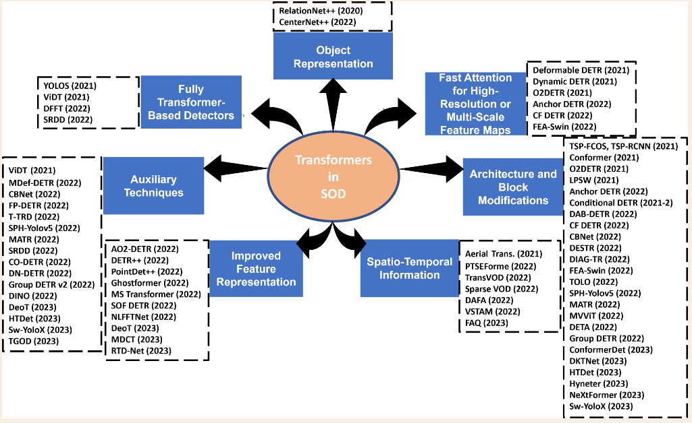

`图 4. 使用 Transformer 的 SOD 分类体系，以及每个类别中的常见目标检测方法。`

### 3.1 目标表示（Object Representation）

​		目标检测技术采用了各种目标表示技术。感兴趣的目标可以用矩形框 [35]、中心点 [129] 和点集 [119] 等点、概率目标 [105] 以及关键点 [48] 表示。在标注格式需求和小目标表示方面，每种目标表示技术都有其自身的优点和缺点。在保留现有表示所有优点的同时寻找最优表示技术的探索，始于 RelationNet++ [19]。该方法通过一个称为`视觉表示桥接（Bridging Visual Representations，BVR）`的模块，桥接各种异构视觉表示并结合它们的优势。BVR 利用新颖的键采样和共享位置嵌入技术，在不干扰主要表示所采用的整体推理过程的情况下高效运行。更重要的是，BVR 依赖一个注意力模块，将一种表示形式指定为“主表示”（或查询），而将其他表示指定为“辅助”表示（或键）。BVR 模块如图 5 所示，它通过将中心点和角点（键）无缝整合到基于锚框的（查询）目标检测方法中，增强锚框的特征表示。图 5 还展示了不同的目标表示。CenterNet++ [30] 被提出为一种新颖的自底向上方法。CenterNet++ 不一次性估计目标的所有参数，而是有策略地分别识别目标的各个组成部分，即左上、左下和中心关键点。随后，采用后处理方法对与同一目标相关的点进行聚类。与将整个目标作为整体进行估计的自顶向下方法相比，这一技术在 SOD 中表现出了更高的召回率。

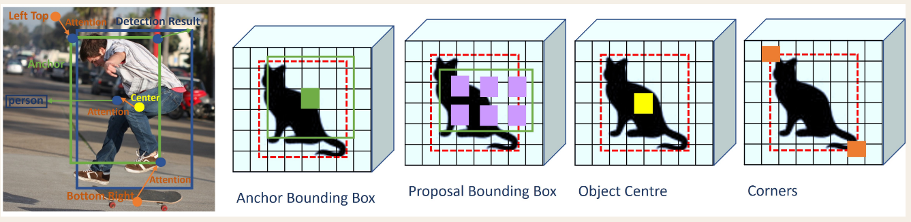

`图 5. BVR 使用不同的表示，即角点和中心点，来增强基于锚框的检测特征（左图）。另一张图像（猫）展示了目标表示，其中红色虚线表示真实标注（图引自 [19]）。`

### 3.2 用于高分辨率或多尺度特征图的快速注意力（Fast Attention for High-Resolution or Multi-Scale Feature Maps）

先前研究表明，保持特征图的高分辨率是保持 SOD 高性能的必要步骤。由于复杂度随 Token 数量（例如像素数量）呈二次增长，Transformer 本身的复杂度明显高于 CNN。这种复杂度源于需要计算所有 Token 之间的成对相关性。因此，训练和推理时间都超出预期，使检测器无法用于高分辨率图像和视频中的 SOD。

Zhu 等人 [130] 在 Deformable DETR 的工作中，解决了这一首次在 DETR 中观察到的问题。他们提出仅关注参考点周围的一小组关键采样点，从而显著降低复杂度。通过采用这一策略，他们使用`多尺度可变形注意力模块`有效地保留了空间分辨率。值得注意的是，这一方法消除了对 FPN 的需求，从而极大地提升了小目标的检测和识别。

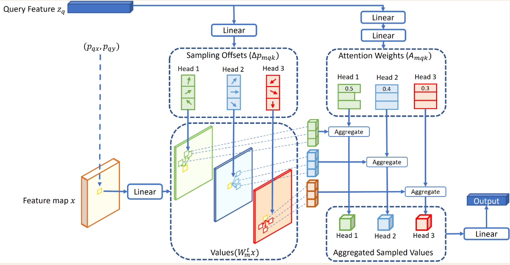

`图 6. 可变形注意力模块的框图。`$\mathbf{z}_q$ 是查询的内容特征，$\mathbf{x}$ 是特征图，$\mathbf{p}_q$ 是二维网格中的参考点。简而言之，可变形注意力模块仅关注参考点周围的一小组关键采样点（各个头中的采样点不同）。这显著降低了复杂度，并进一步改善了收敛（图引自 [130]）。

可变形注意力中多头注意力模块的第 $i$ 个输出为：
$$
\mathrm{MH\ Attention}^{i}
=\sum_h\mathbf{W}_h^{O}\left[\sum_{k=1}^{K}A_{hik}\mathbf{W}_v\mathbf{x}_k(\mathbf{p}_i+\Delta\mathbf{p}_{hik})\right],
\tag{6}
$$

其中，$i=1,\ldots,T$，$\mathbf{p}_i$ 是查询的参考点，$\Delta\mathbf{p}_{hik}$ 是第 $h$ 个头中进行 $K$ 次采样的采样偏移（二维），其中 $K\ll T=HW$。图 6 展示了其多头注意力模块中的计算过程。Deformable DETR 同时受益于编码器和解码器模块，其中编码器内的复杂度阶为 $\mathcal{O}(HWC^2)$，$H$ 和 $W$ 是输入特征图的高度和宽度，$C$ 是通道数。相比之下，DETR 编码器的复杂度阶为 $\mathcal{O}(H^2W^2C)$，随着 $H$ 和 $W$ 的增大呈现二次增长。可变形注意力在各种其他检测器中发挥了重要作用，例如 T-TRD [53]。随后，[25] 提出了 Dynamic DETR，它具有动态编码器和动态解码器，利用从低分辨率到高分辨率表示的特征金字塔，实现高效的从粗到细目标检测和更快的收敛。动态编码器可以视为完整自注意力的顺序分解近似，根据尺度、空间重要性和表示动态调整注意力机制。Deformable DETR 和 Dynamic DETR 都使用可变形卷积进行特征提取。在一种不同的方法中，O2 DETR [71] 表明，对于目标通常密集分布在同一图像区域的航拍图像，自注意力模块所提供的全局推理实际上并非必需。因此，将注意力模块替换为局部卷积并结合多尺度特征图的整合，已被证明可以改善有向目标检测中的检测性能。[108] 的作者提出了行列解耦注意力（Row-Column Decoupled Attention，RCDA）的概念，将键特征的二维注意力分解为两种更简单的形式：一维逐行注意力和逐列注意力。在 CF-DETR [6] 中，提出了一种替代 FPN 的方法，即用第 5 层的编码器特征（E5）替换 C5 特征，从而改善目标表示。这一创新被命名为 Transformer 增强型 FPN（Transformer Enhanced FPN，TEF）模块。在另一项研究中，Xu 等人 [114] 通过将跳跃连接操作与 Swin Transformer 结合，开发了一种`加权双向特征金字塔网络（Bidirectional Feature Pyramid Network，BiFPN`）。这一方法有效地保留了与小目标有关的信息。

### 3.3 完全基于 Transformer 的检测器（Fully Transformer-Based Detectors）

​		Transformer 的出现及其在许多复杂计算机视觉任务中的出色表现，逐渐促使研究人员从基于 CNN 的系统或混合系统转向完全基于 Transformer 的视觉系统。这一系列工作始于 [29] 提出的将纯 Transformer 架构用于图像识别任务的方法，即 ViT。在 [94] 中，ViDT 扩展了 YOLOS 模型 [32]（第一个完全基于 Transformer 的检测器），开发了第一个适用于 SOD 的高效检测器。在 ViDT 中，DETR 用于特征提取的 ResNet 被各种 ViT 变体替代，例如 Swin Transformer [69]、ViTDet [56] 和 DeiT [100]，同时使用`重配置注意力模块（Reconfigured Attention Module，RAM）`。RAM 能够处理 $[\mathrm{PATCH}]\times[\mathrm{PATCH}]$、$[\mathrm{DET}]\times[\mathrm{PATCH}]$ 和 $[\mathrm{DET}]\times[\mathrm{DET}]$ 注意力。这些交叉注意力和自注意力模块是必要的，因为与 YOLOS 类似，ViDT 在输入中附加 $[\mathrm{DET}]$ 和 $[\mathrm{PATCH}]$ Token。ViDT 仅使用一个 Transformer 解码器作为其颈部网络，以利用其主体步骤的每个阶段生成的多尺度特征。图 7 展示了 ViDT 的总体结构，并强调了它与 DETR 和 YOLOS 的区别。

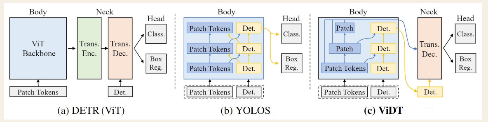

`图 7. ViDT（a）在多尺度特征学习流程中将 DETR（采用 ViT 主干网络或其他完全基于 Transformer 的主干网络）（b）与 YOLOS 架构（c）结合，以取得前沿结果（图引自 [94]）。`

无解码器全 Transformer（Decoder-Free Fully Transformer，DFFT）[11] 认识到解码器模块是基于 Transformer 的目标检测中效率低下的主要来源，因此利用两个编码器，即`尺度聚合编码器（Scale-Aggregated Encoder，SAE）`和`任务对齐编码器（Task-Aligned Encoder，TAE）`，来保持高准确性。SAE 将多尺度特征（四个尺度）聚合为单个特征图，而 TAE 对该单一特征图进行对齐，以用于目标类型和位置的分类与回归。使用面向检测的 Transformer（Detection-Oriented Transformer，DOT）主干网络进行具有强语义的多尺度特征提取。

在基于稀疏 RoI 的可变形 DETR（Sparse RoI-based deformable DETR，SRDD）[131] 中，作者提出了一种带有评分系统的轻量级 Transformer，以最终移除编码器中的冗余 Token。这通过端到端学习方案中的基于 RoI 的检测来实现。

### 3.4 架构与模块修改（Architecture and Block Modifications）

​		DETR 是第一个端到端目标检测方法，但其训练收敛时间较长，并且在小目标上表现不佳。多项研究针对这些问题进行了改进，以提升 SOD 性能。其中一项值得注意的贡献来自 Sun 等人 [97]，他们受到 FCOS [99]（一种全卷积单阶段检测器）和 Faster RCNN 的启发，提出了两个带有特征金字塔、仅包含编码器的 DETR 变体，称为 TSP-FCOS 和 TSP-RCNN。这通过移除解码器中的交叉注意力模块实现。他们的发现表明，解码器中的交叉注意力以及匈牙利损失的不稳定性，是 DETR 收敛较慢的主要原因。这一认识促使他们放弃解码器，并在这些新变体，即 TSP-FCOS 和 TSP-RCNN 中引入一种新的`二分图匹配技术。`

​		在一种结合 CNN 和 Transformer 的方法中，Peng 等人 [80, 81] 提出了一种称为“Conformer”的混合网络结构。该结构在不同分辨率下融合 CNN 提供的局部特征表示与 Transformer 提供的全局特征表示（见图 8）。这通过`特征耦合单元（Feature Coupling Units，FCU）实现`，实验结果表明，与 ResNet50、ResNet101、DeiT 和其他模型相比，该方法是有效的。[70] 提出了一种类似的 CNN 与 Transformer 混合技术。Xu 等人 [115] 认识到局部感知和长距离相关性的重要性，在 Swin Transformer 的 Swin Transformer 模块中加入了局部感知模块（Local Perception Block，LPB）。这一新的主干网络称为局部感知 Swin Transformer（Local Perception Swin Transformer，LPSW），显著改善了`航拍图像`中的小尺寸目标检测。DIAG-TR [116] 在编码器中引入全局—局部特征交织（Global-Local Feature Interweaving，GLFI）模块，以自适应、分层地将局部特征嵌入全局表示。这一技术抵消了小目标的尺度差异。此外，将可学习的锚框坐标加入 Transformer 解码器中的内容查询，为其提供归纳偏置。在一项近期研究中，Chen 等人 [8] 提出了混合网络 Transformer（Hybrid network Transformer，Hyneter），通过将卷积嵌入 Transformer 模块来扩展局部信息的范围。这一改进提升了 MS COCO 数据集上的检测结果。[26] 采用了类似的混合方法。在另一项研究 [118] 中，作者提出了一种称为 NeXtFormer 的新主干网络，结合 CNN 和 Transformer，以增强小目标的局部细节和特征，同时提供全局感受野。

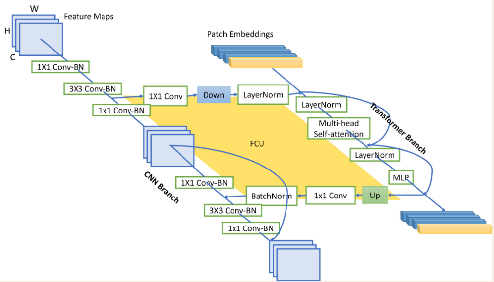

`图 8. Conformer 架构，在 FCU 中同时利用 CNN 提供的局部特征和 Transformer 提供的全局特征（图引自 [80]）。`

​		在各种方法中，O2 DETR [71] 用深度可分离卷积替代 Transformer 中的注意力机制。这一改变不仅减少了与多尺度特征相关的内存使用量和计算成本，也可能提高航拍照片中的检测准确性。

​		Wang 等人 [108] 对先前工作中使用的目标查询提出质疑，提出了 Anchor DETR，它使用锚点作为目标查询。这些锚点增强了目标查询位置的可解释性。`为每个锚点使用多个模式`，可以改善同一区域内多个目标的检测。相比之下，Conditional DETR [74] 强调由解码器内容派生的条件空间查询，从而产生空间注意力预测。后续版本 Conditional DETR v2 [14] 通过将目标查询重新表述为框查询的形式，增强了架构。这一修改涉及嵌入参考点，并相对于参考点变换框。在后续工作中，DAB-DETR [64] 通过使用可动态调整的锚框进一步改进了查询设计的思路。这些锚框同时用作`参考查询点`和`锚框尺寸`（见图 9）。

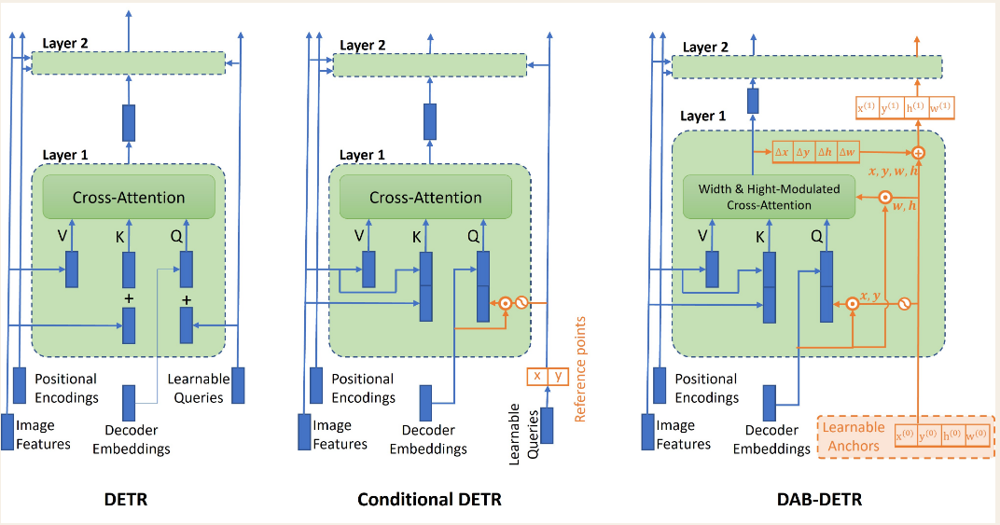

`图 9. DAB-DETR 改进了 Conditional DETR，并利用动态锚框依次提供更好的参考查询点和锚框尺寸（图引自 [64]）。`

​		在另一项工作 [6] 中，作者观察到，虽然 DETR 对小目标的平均精度均值（mAP）无法与前沿技术竞争，但在较小的交并比（intersection-over-union，IoU）阈值下，其性能却出乎意料地优于竞争方法。这表明，虽然 DETR 提供了很强的感知能力，但需要微调以获得更好的定位准确性。作为解决方案，从粗到细检测 Transformer（`Coarse-to-Fine Detection Transformer，CF-DETR`）被提出，通过解码器层中的自适应尺度融合（Adaptive Scale Fusion，ASF）和局部交叉注意力（Local Cross-Attention，LCA）模块进行这一细化。在 [42] 中，作者认为，基于 Transformer 的检测器性能欠佳可以归因于多个因素，例如使用单一交叉注意力模块同时进行分类和回归、内容查询初始化不足，以及未在自注意力模块中利用先验知识。为解决这些问题，他们提出了检测分离 Transformer（Detection Split Transformer，DESTR）。该模型将交叉注意力分为两个分支，一个用于分类，另一个用于回归。此外，DESTR 使用一个小型检测器，确保解码器中的内容查询得到适当初始化，并增强自注意力模块。另一项研究 [114] 引入了 FEA-Swin，它在 Swin Transformer 框架中利用先进的`前景增强注意力`，将上下文信息整合到原始主干网络中。这一工作的动机在于，由于相邻目标之间缺少连接，Swin Transformer 无法充分处理密集目标检测。因此，前景增强突出目标，以供进一步进行相关性分析。TOLO [112] 是近期旨在通过简单颈部模块将归纳偏置（使用 CNN）引入 Transformer 架构的工作之一。该模块结合不同层的特征，以纳入高分辨率和高语义属性。设计了多个轻量级 Transformer 头，以检测不同尺度的目标。在另一种方法中，Liang 等人提出的 CBNet [57] 不修改每种架构中的模块，而是将多个相同的主干网络组合起来，通过复合连接将其相连。

​		在多源聚合 Transformer（Multi-Source Aggregation Transformer，MATR）[96] 中，Transformer 的交叉注意力模块用于利用同一目标在不同视角下的其他支持图像。[45] 采用了类似的方法，其中多视角视觉 Transformer（Multi-View Vision Transformer，MVViT）框架结合包括目标视角在内的多个视角的信息，以改善目标在单一视角中不可见时的检测性能。

​		其他工作倾向于沿用 YOLO 系列架构。例如，SPH-Yolov5 [37] 在 Yolov5 网络的较浅层中加入一个新分支，以融合特征并改善小目标定位。它还首次在 Yolov5 流程中引入 Swin Transformer 预测头。

​		在 [77] 中，作者认为，匈牙利损失直接进行一对一边界框匹配的方式并不总是有利。他们表明，采用一对多分配策略并使用 `NMS（Non-Maximum Suppression，非极大值抑制）模块`，可以得到更好的检测结果。与这一观点相呼应，Group DETR [12] 实现了 $K$ 组采用一对一标签分配的目标查询，从而为每个真实标注目标产生 $K$ 个正样本目标查询，以提升性能。

​		[113] 提出了双键 Transformer 网络（Dual-Key Transformer Network，DKTNet），其中使用两个键——一个键与 Q 流一起使用，另一个键与 V 流一起使用。这增强了 Q 与 V 之间的一致性，从而改善学习。此外，计算通道注意力而非空间注意力，并使用一维卷积加速这一过程。

### 3.5 辅助技术（Auxiliary Techniques）

​		实验结果表明，辅助技术或任务与主任务结合时，可以提升性能。在 Transformer 中，已经采用了多种技术，包括：（i）`辅助解码／编码损失`：这是指将为边界框回归和目标分类设计的前馈网络连接到不同解码层的方法。因此，将不同尺度上的各项损失组合起来训练模型，从而获得更好的检测结果。ViDT [94]、MDef-DETR [72]、CBNet [57] 和 SRDD [131] 使用了这一技术或其变体。（ii）`迭代框细化`：在这一方法中，每个解码层内的边界框根据前一层的预测进行细化。这种反馈机制逐步提高检测准确性。ViDT [94] 使用了这一技术。（iii）`自顶向下监督`：这一方法利用人类可理解的语义来辅助检测小目标或类别无关目标这一复杂任务，例如 MDef-DETR [72] 中对齐的`图像—文本对`，或 TGOD [92] 中由`文本引导`的目标检测器。（iv）`预训练`：这涉及先在大规模数据集上训练，再针对检测任务进行特定微调。CBNet V2-TTA [4]、FP-DETR [107]、T-TRD [53]、SPH-Yolov5 [37] 和 MATR [96] 使用了这一技术，Group DETR v2 [13] 则广泛使用了这一技术。（v）`数据增强`：这一技术通过应用旋转、翻转、放大和缩小、裁剪、平移、添加噪声等各种增强技术来丰富检测数据集。数据增强是解决深度学习数据集中各种不平衡问题 [76] 的常用方法，例如目标尺寸不平衡。数据增强可以视为一种间接缩小训练集与测试集之间差距的方法 [83]。多种方法在其检测任务中使用了增强，包括 T-TRD [53]、SPH-Yolov5 [37]、MATR [96]、NLFFTNet [122]、DeoT [28]、HTDet [9] 和 Sw-YoloX [26]。（vi）`一对多标签分配`：DETR 中的一对一匹配可能导致编码器内的特征判别性不足。因此，其他方法中的一对多分配，例如 Faster-RCNN、RetinaNet 和 FCOS 中的一对多分配，被用作 CO-DETR [132] 等一些研究中的辅助头。（vii）`去噪训练`：这一技术旨在加快 DETR 中解码器的收敛速度，解码器经常因二分图匹配而面临收敛不稳定的问题。在去噪训练中，将带噪声的真实标注标签和框输入解码器。随后训练模型重建原始真实标注（由辅助损失引导）。DINO [125] 和 DN-DETR [50] 等实现已经证明，这一技术能够有效增强解码器的稳定性。

### 3.6 改进的特征表示（Improved Feature Representation）

​		虽然当前目标检测器在针对常规尺寸或大目标的各种应用中表现出色，但某些使用场景需要专门的特征表示，以改善 SOD。例如，在航拍图像中检测有向目标时，由于场景（区域提议）中背景噪声或杂波增加，目标的任何旋转都可能显著改变特征表示。为解决这一问题，Dai 等人 [24] 提出了 AO2-DETR，这是一种旨在对任意目标旋转保持鲁棒的方法。这通过三个关键组件实现：（i）`有向候选区域的生成`，（ii）`提取旋转不变特征的有向候选区域细化模块`，以及（iii）`旋转感知的集合匹配损失`。这些模块有助于消除目标任何旋转的影响。在一种相关方法中，DETR++ [123] 使用多个`双向特征金字塔（BiFPN）层`，以自底向上的方式应用于来自 C3、C4 和 C5 的特征图。然后，只选择一个能够代表所有尺度特征的尺度，输入 DETR 框架进行检测。对于某些特定应用，例如工厂安全监测，感兴趣的目标通常与工作人员有关，利用这种上下文信息可以极大地改善特征表示。PointDet++ [98] 通过结合人体姿态估计技术、整合局部与全局特征来利用这一点，从而提升 SOD 性能。影响特征质量的另一个关键要素是主干网络，以及其同时提取语义特征和高分辨率特征的能力。[54] 引入的 GhostNet 提供了一种精简且更高效的网络，为 Transformer 提供高质量的多尺度特征。该网络中的 Ghost 模块生成输出特征图的一部分，其余部分通过简单的线性操作恢复。这是降低主干网络复杂度的关键步骤。在医学图像分析中，MS Transformer [93] 使用自监督学习方法对输入图像进行`随机掩码`，这有助于重建更丰富、对噪声不那么敏感的特征。该方法与分层 Transformer 相结合，优于采用各种主干网络的 DETR 框架。偏向小目标的 DETR（`Small Object Favoring DETR，SOF-DETR`）[31] 在输入 DETR-Transformer 之前，在归一化归纳偏置模块中`合并第 3 层和第 4 层的卷积特征`，从而专门偏向小目标检测。NLFFTNet [122] 通过引入非局部特征融合 Transformer 卷积网络，捕捉不同特征层之间的长距离语义关系，解决当前融合技术仅考虑局部交互的局限。DeoT [28] 将仅包含编码器的 Transformer 与一种新的特征金字塔融合模块结合起来。该融合通过通道细化模块（Channel Refinement Module，CRM）和空间细化模块（Spatial Refinement Module，SRM）中的通道注意力和空间注意力得到增强，从而能够提取更丰富的特征。HTDet [9] 的作者提出了一种细粒度 FPN，累积融合低层和高层特征，以改善目标检测。同时，在 MDCT [10] 中，作者提出了多核空洞卷积（Multi-kernel Dilated Convolution，MDC）模块，通过同时利用小目标的本体特征和相邻空间特征，改善与小目标相关的特征提取性能。所提出的模块利用深度可分离卷积降低计算成本。最后，[120] 设计了一种与轻量级主干网络配合的特征融合模块，通过扩大感受野来增强小目标的视觉特征。RTD-Net [120] 中的混合注意力模块通过结合小目标周围的上下文信息，使系统能够检测部分被遮挡的目标。

### 3.7 时空信息（Spatio-Temporal Information）

​		在本节中，我们专门关注旨在识别小目标的`基于视频的目标检测器`。虽然许多研究在 ImageNet VID 数据集¹ [91] 上进行了测试，但该数据集最初并非为 SOD 设计。不过，也有少数工作报告了 ImageNet VID 数据集中小目标的结果。使用 Transformer 架构跟踪和检测视频中小目标的主题也已得到探索。尽管针对图像的 SOD 技术可以应用于视频，但它们通常不利用有价值的时间信息，而这些信息对于在杂乱或遮挡帧中识别小目标尤其有益。Transformer 在通用目标检测／跟踪中的应用始于 TrackFormer [73] 和 TransT [15]。这些模型使用帧到帧（将前一帧设为参考）的集合预测，以及模板到帧（将模板帧设为参考）的检测。Liu 等人 [63] 是最早专门将 Transformer 用于基于视频的 SOD 和跟踪的研究者之一。他们的核心思路是更新模板帧，以捕捉由小目标存在所引起的任何微小变化，并提供模板帧与搜索帧之间由全局注意力驱动的关系。

​		随着 [43] 和 [128] 中介绍的端到端目标检测器 TransVOD 的提出，基于 Transformer 的目标检测获得了正式认可。该模型将空间 Transformer 和时间 Transformer 应用于一系列视频帧，从而在这些帧之间识别并关联目标。TransVOD 衍生了多个变体，每个变体都有独特的功能，包括实时检测能力。PTSEFormer [104] 采用渐进策略，同时关注时间信息和目标在帧间的空间变化。它采用多尺度特征提取来实现这一点。与其他模型不同，`PTSEFormer 直接从相邻帧而非整个数据集回归目标查询`，提供了一种更局部化的方法。Sparse VOD [39] 提出了一种端到端可训练的视频目标检测器，结合时间信息来提出候选区域。相比之下，DAFA [90] 强调视频中的全局特征而非局部时间特征的重要性。DEFA 表明先进先出（First In First Out，FIFO）记忆结构效率低下，并提出一种`多样性感知记忆，为注意力模块使用目标级记忆而非帧级记忆`。VSTAM [33] 逐元素改善特征质量，然后在这些增强特征被用于目标候选区域检测之前进行稀疏聚合。该模型还结合外部记忆，以利用长期上下文信息。

​		在 FAQ 工作 [22] 中，提出了一种在解码器模块中使用查询特征聚合的新型视频目标检测器。这不同于关注编码器中特征聚合的方法，也不同于对各帧进行后处理的方法。研究表明，这一技术改善了检测性能，优于前沿方法。

¹ <https://paperswithcode.com/sota/video-object-detection-on-imagenet-vid>

## 4 结果与基准（Results and Benchmarks）

在本节中，我们对先前的 SOD 工作进行定量和定性评估，确定针对特定应用最有效的技术。定量分析涉及直接从原始论文中获取并考察数据。另一方面，定性分析涉及将模型应用于选定的包含众多小目标的图像，随后比较结果。此外，本节还介绍了专门为 SOD 构建的新数据集，包括适用于广泛应用的视频和图像。

### 4.1 数据集（Datasets）

在本小节中，除了广泛使用的 MS COCO 数据集之外，我们还汇编并介绍了 12 个新的 SOD 数据集。这些新数据集主要针对特定应用设计，并有意排除我们先前综述 [88] 已经全面涵盖的数据集，以尽量减少冗余并避免重叠。图 10 展示了这些数据集的时间顺序，以及根据 Google Scholar 统计的截至 2023 年 6 月 15 日的引用次数。

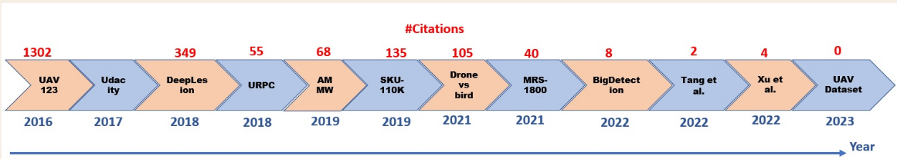

`图 10. SOD 数据集的时间顺序及引用次数（基于 Google Scholar）。`

**UAV123 [75]：**该数据集包含使用无人机获取的 123 段视频，是最大的目标跟踪数据集之一，具有超过 11 万帧。

**MRS-1800 [115]：**该数据集由其他三个遥感数据集的图像组合而成，即 DIOR [52]、NWPU VHR-10 [18] 和 HRRSD [127]。MRD-1800 为检测和实例分割两个目的而创建，包含 1800 张人工标注图像，其中包括三类目标：飞机、船舶和储罐。

**SKU-110K [36]：**该数据集是商品检测的严格测试平台，包含在世界各地超市拍摄的图像。数据集涵盖各种尺度、相机角度、光照条件等。

**BigDetection [4]：**这是一个大规模数据集，通过整合现有数据集、仔细消除重复框并标注被遗漏的目标而构建。它在各种尺寸上拥有均衡的目标数量，使其成为推动目标检测领域发展的重要资源。使用该数据集进行预训练，随后在 MS COCO 上微调，可以显著提升性能结果。

**Tang 等人 [98]：**该数据集源自化工厂现场活动的视频片段，涵盖动火作业、高空作业、受限空间作业等各种工作类型。它包含人员、头盔、灭火器、手套、工作服和其他相关目标等类别标签。

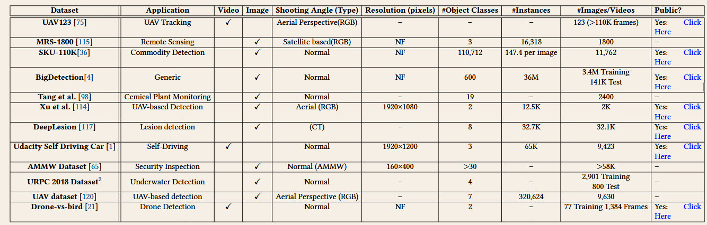

`表 2. SOD 常用数据集。`

NF：不固定。

**Xu 等人 [114]：**这一公开可用的数据集关注无人机（Unmanned Aerial Vehicle，UAV）拍摄的图像，包含 2000 张用于检测行人和车辆的图像。图像使用 DJI 无人机采集，涵盖不同光照水平、车辆密集停放等多种条件。

**DeepLesion [117]：**该数据集包含来自 4427 名患者的 CT 扫描，是同类数据集中最大的之一。它包括各种病灶类型，例如肺结节、骨异常、肾脏病灶和肿大的淋巴结。这些图像中的感兴趣目标通常较小且伴有噪声，使其识别具有挑战性。

**Udacity Self Driving Car [1]：**该数据集专为教育用途设计，包含在 Mountain View 及附近城市以 2 Hz 图像采集频率获取的驾驶场景。该数据集中的类别标签包括汽车、卡车和行人。

**AMMW Dataset [65]：**这一主动毫米波图像数据集为安检应用创建，包含 30 多种目标。其中包括两种打火机（塑料和金属）、模拟枪支、刀、刀片、弹壳、手机、汤、钥匙、磁铁、液体瓶、吸收材料、火柴等。

**URPC 2018 Dataset：**这一水下图像数据集包含四类目标：海参、海胆、扇贝和海星 [62]。

**UAV dataset [120]：**这一图像数据集包含超过 9000 张在不同天气和光照条件以及各种复杂背景下使用无人机拍摄的图像。数据集中的目标包括轿车、人员、摩托车、自行车、卡车、公共汽车和三轮车。

**Drone-vs-bird [21]：**这一视频数据集旨在解决无人机在敏感区域上空飞行所带来的安全问题。它提供标注视频序列，以在不同照明、光照、天气和背景条件下区分鸟类与无人机。

表 2 总结了这些数据集，包括其应用、类型、分辨率、类别／实例／图像／帧数量，以及其网页链接。

² URPC 2018 Dataset: <http://en.cnurpc.org/>

### 4.2 视觉应用中的基准（Benchmarks in Vision Applications）

在本小节中，我们介绍小目标检测性能至关重要的各种视觉应用。对于每种应用，我们选择最常用的数据集之一，报告其性能指标以及实验设置的细节。

#### 4.2.1 通用应用（Generic Applications）

对于通用应用，我们在具有挑战性的 MS COCO 基准 [61] 上评估所有小目标检测器的性能。选择该数据集是基于它在目标检测领域的广泛认可，以及性能结果的可获取性。MS COCO 数据集包含约 16 万张图像，涉及 80 个类别。虽然建议作者使用 COCO 2017 的训练集和验证集来训练算法，但并不限制他们仅使用这些子集。

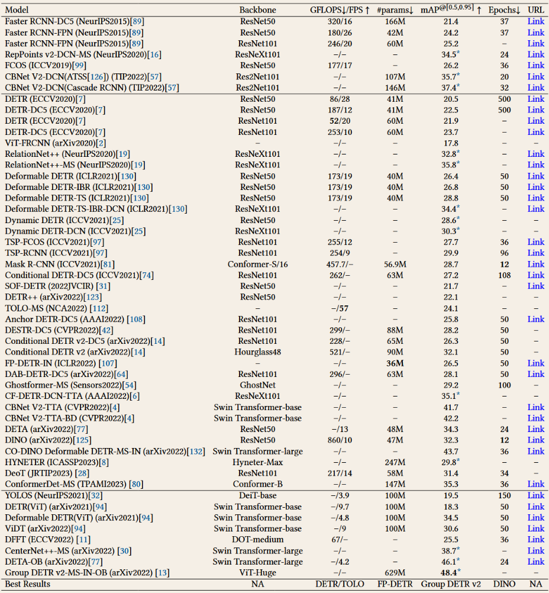

`表 3. MS COCO 图像数据集 [61] 上小尺度目标（面积` $<32^2$ `）的检测性能（%）。` 上部展示基于 CNN 的技术的结果，中部展示混合架构的结果，下部展示纯 Transformer 网络的结果。DC5：空洞 C5 阶段；MS：多尺度网络；IBR：迭代边界框细化；TS(Two-stage detection)：两阶段检测；DCN：可变形卷积网络；TTA：测试时增强；BD：在 BigDetection 数据集上预训练；IN：在 ImageNet 上预训练；OB：在 Object-365 [34] 上预训练。$*$ 表示 COCO test-dev 上的结果，其他数值则在 COCO val 集上报告。

​		在表 3 中，我们考察并评估了所有所综述技术中报告过 MS COCO 结果的方法的性能（由于文献中的报告方式不一致，许多研究没有提供完整的性能指标）。该表提供主干网络架构、GFLOPS／FPS（表示计算开销和执行速度）、参数数量（表示模型规模）、mAP（平均精度均值：一种目标检测性能度量）和训练轮数（表示收敛时间）等信息。此外，还提供了每种方法的网页链接，以获取更多信息。这些方法分为三组：基于 CNN 的方法、混合方法和纯 Transformer 方法。各指标上表现最好的方法显示在表格的最后一行。需要指出的是，这一比较仅适用于报告了各个特定指标数值的方法。如果存在并列，则将 mAP 最高的方法视为最佳。默认 mAP 数值来自“COCO 2017 val”集，而来自“COCO test-dev”集的数值标有星号。请注意，报告的 mAP 仅针对面积 $<32^2$ 的目标。

​		考察表 3 后可以明显看出，大多数技术受益于 CNN 与 Transformer 架构的混合使用，本质上采用了混合策略。值得注意的是，完全依赖基于 Transformer 的架构的 Group DETR v2 达到了 48.4% 的 mAP。然而，实现这样的性能需要采用额外技术，例如在两个大规模数据集上进行预训练以及多尺度学习。在收敛方面，DINO 仅经过 12 个训练轮次就达到稳定结果，同时取得了相当不错的 32.3% mAP，因此表现更优。相反，原始 DETR 模型的 GFLOPS 最低，而 TOLO 的推理速度最快。FP-DETR 则以仅 3600 万个参数成为最轻量的网络。

​		根据这些发现，我们得出结论：`预训练和多尺度学习是目前实现高性能 SOD 最有效的策略`。所有 mAP 超过 40% 的方法，即 Group DETR v2、DETA-OB、CO-DINO Deformable DETR 和 CBNet V2，都共同采用了预训练和多尺度学习策略，这为该结论提供了依据。这可能归因于数据集的不平衡问题，以及小目标缺少信息丰富的特征。

​		跨越两阶段的图 11，以及其更详细的对应图 12，展示了各种 Transformer 方法和基于 CNN 的方法的检测结果。这些方法在选定的 COCO 数据集图像上相互比较，并由我们使用其 GitHub 页面上公开的模型实现。分析表明，Faster RCNN 和 SSD 在准确检测小目标方面存在不足。具体而言，SSD 要么漏掉大多数目标，要么生成大量带有错误标签和定位不佳的边界框。虽然 Faster RCNN 表现更好，但它仍会产生低置信度边界框，并偶尔分配错误标签。

​		相比之下，DETR 倾向于高估目标数量，为单个目标产生多个边界框。人们普遍注意到，DETR 容易产生假阳性。最后，在所评估的方法中，CBNet V2 因其优越性能而突出。可以观察到，虽然它偶尔也会误识别某些目标，但它对检测到的目标产生较高的置信度分数。

#### 4.2.2 航拍图像中的小目标检测（Small Object Detection in Aerial Images）

​		小目标检测的另一个有趣用途是在遥感领域。这一领域尤其具有吸引力，因为许多组织和研究机构希望通过航拍图像定期监测地球表面，以收集用于统计的国家和国际数据。虽然这些图像可以通过各种模态获取，但本综述仅关注非 SAR 图像。这是因为 SAR 图像已经得到广泛研究，值得单独进行研究。不过，本综述讨论的学习技术也可能适用于 SAR 图像。

​		在航拍图像中，由于目标与相机距离很远，它们通常显得很小。俯视视角也增加了目标检测任务的复杂性，因为目标可能位于图像中的任何地方。为了评估为此类应用设计的基于 Transformer 的检测器的性能，我们选择了 `DOTA 图像数据集 [111]`，它已经成为目标检测领域广泛使用的基准。图 13 展示了 DOTA 数据集中包含小目标的一些样例图像。该数据集包括预定义的训练集、验证集和测试集。与通用应用相比，这一特定应用受到 Transformer 专家的关注相对较少。然而，如表 4 所示，ReDet 凭借其`多尺度学习策略`以及在 ImageNet 数据集上的预训练而表现突出，取得了最高的精确率值（80.89%），并且仅需要 12 个训练轮次。这与 COCO 数据集分析所得的认识相一致，表明通过解决下游任务中的不平衡问题，以及纳入小目标的信息丰富特征，可以获得最优性能。

注意：由于原始论文中性能指标的报告方式不一致，表中的某些条目不完整。在一些情况下，只能获取部分结果，而缺少公开发布的代码或详细实现信息——例如预处理步骤、训练配置、超参数设置或评估脚本——使我们无法复现缺失值。为确保准确性，我们严格按照原始来源中的呈现方式报告结果。这一局限凸显了该领域在可复现性和缺少标准化基准评测实践方面存在的更广泛挑战。

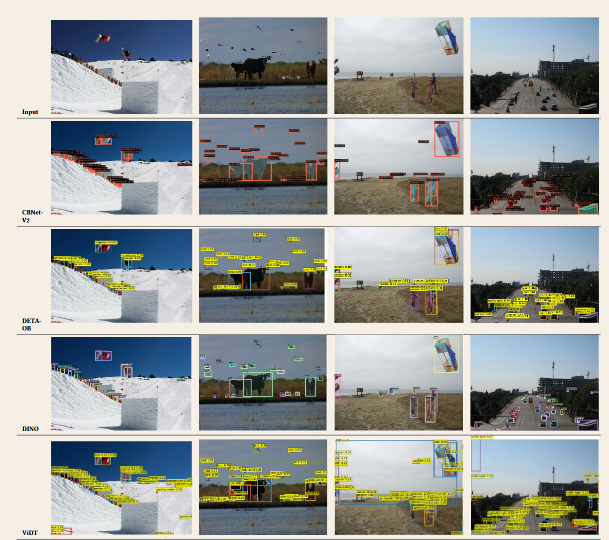

`图 11. COCO 数据集 [61] 上基于 Transformer 的前沿小目标检测器与卷积网络的检测结果示例。`

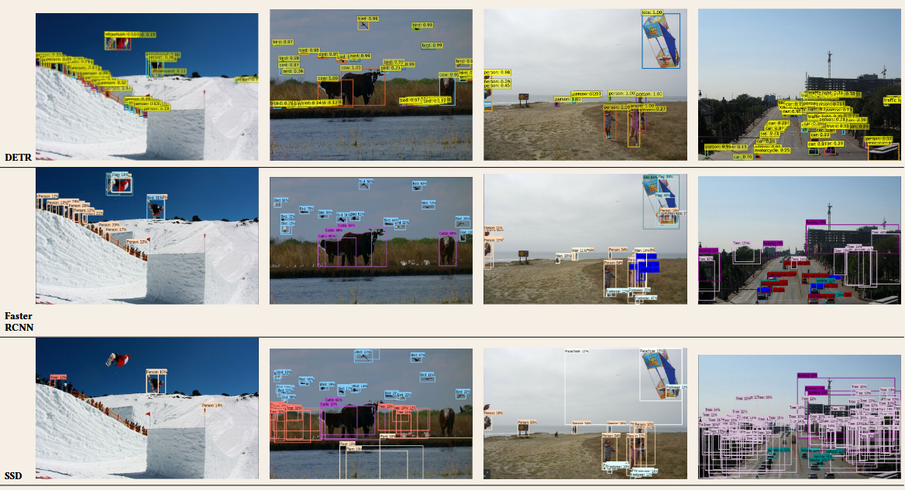

`图 11.（续）`

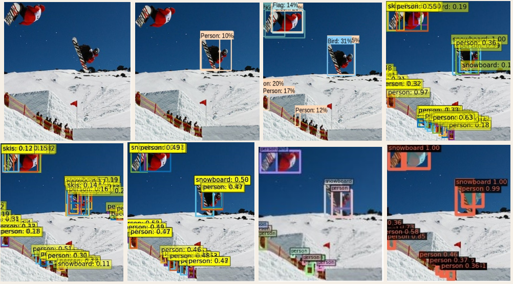

`图 12. 一张样例图像放大后的检测结果。第一行从左到右：输入图像、SSD、Faster RCNN、DETR。第二行从左到右：ViDT、DETA-OB、DINO、CBNet v2。`

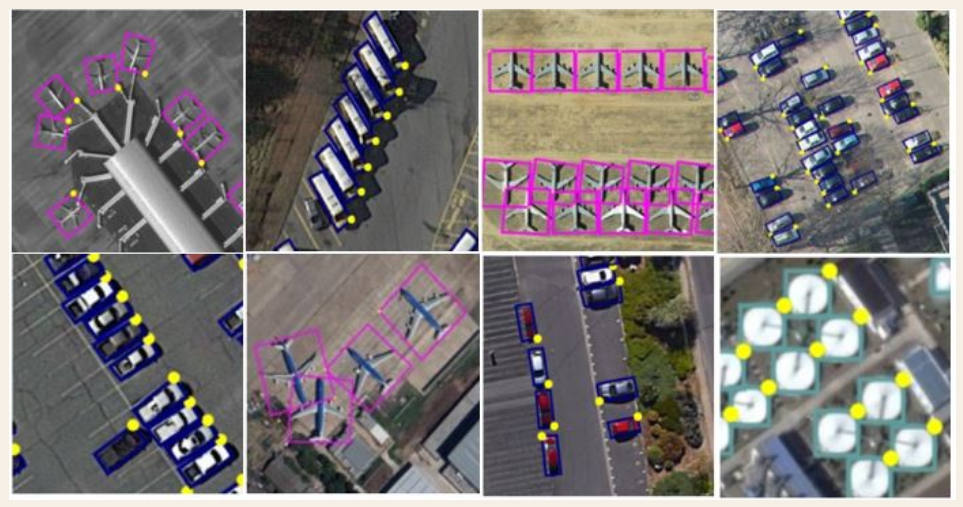

`图 13. DOTA 图像数据集中的小目标示例。`

`表 4. DOTA 图像数据集 [111] 上小尺度目标的检测性能（%）。`

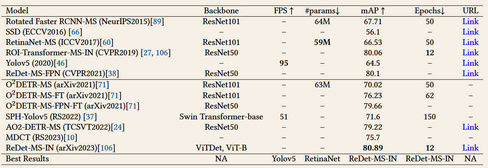

上部展示基于 CNN 的技术的结果，中部展示混合架构的结果。MS：多尺度网络；FT：微调；FPN：特征金字塔网络；IN：在 ImageNet 上预训练。

#### 4.2.3 医学图像中的小目标检测（Small Object Detection in Medical Images）

​		在医学影像领域，专业人员通常负责尽早检测和识别异常。即使漏掉几乎不可见或很小的异常细胞，也可能给患者带来严重后果，包括癌症和危及生命的状况。这些小尺寸目标可能表现为糖尿病患者视网膜中的异常、早期肿瘤、血管斑块等。尽管这一研究领域十分重要，并可能产生危及生命的影响，但只有少量研究应对了这一关键应用中小目标检测相关的挑战。对于对此主题感兴趣的研究者，由于该特定数据集的结果可以获取 [51]，我们选择 `DeepLesion CT 图像数据集` [117] 作为基准。该数据集的样例图像如图 14（左）所示。该数据集分为三个集合：训练集（70%）、验证集（15%）和测试集（15%）[93]。表 5 将三项基于 Transformer 的研究的准确率和 mAP 与两阶段和单阶段检测器进行了比较。MS Transformer 成为该数据集上的最佳技术，尽管竞争有限。其主要创新在于`自监督学习，以及在分层 Transformer 模型中结合掩码机制`。总体而言，该数据集的准确率为 90.3%、mAP 为 89.6%，与其他医学影像任务相比似乎挑战较小，尤其考虑到某些肿瘤检测任务中的目标几乎无法被人眼看见。

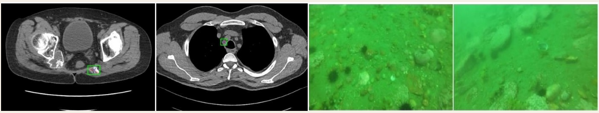

`图 14. DeepLesion 图像数据集 [117] 中的小异常示例（左侧两张图像），以及 URPC2018 图像数据集中低质量图像的示例（右侧两张图像）。`

`表 5. DeepLesion CT 图像数据集 [117] 上的检测性能（%）。`

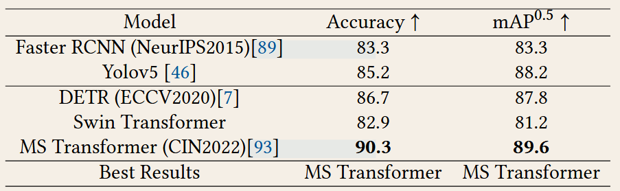

上部展示基于 CNN 的技术的结果，中部展示混合架构的结果。

#### 4.2.4 水下图像中的小目标检测（Small Object Detection in Underwater Images）

​		随着水下活动的增长，为了生态监测、设备维护以及沉船捕捞监测等目的，对浑浊和低光照环境进行监测的需求增加。水中的散射和光吸收等因素使 SOD 任务更具挑战性。这些具有挑战性的环境的样例图像如图 14（右）所示。基于 Transformer 的检测方法不仅应擅长识别小目标，还需要对深水中的低质量图像，以及各通道不同光衰减速率导致的颜色通道变化保持鲁棒性。

`表 6. URPC2018 数据集 [62] 上的检测性能（%）。`

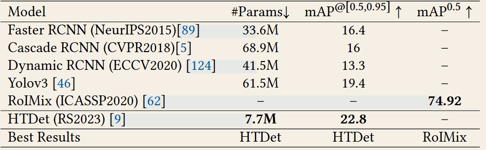

上部展示基于 CNN 的技术的结果，中部展示混合架构的结果。

表 6 展示了现有研究在该数据集上报告的性能指标。`HTDet 是为这一特定应用找到的唯一一种基于 Transformer 的技术。`它以很大的幅度（mAP 提升 3.4%）显著优于前沿 CNN 方法。然而，相对较低的 mAP 分数证实，水下图像中的目标检测仍然是一项困难任务。值得注意的是，URPC 2018 的训练集包含 2901 张标注图像，测试集包含 800 张未标注图像 [9]。

#### 4.2.5 主动毫米波图像中的小目标检测（Small Object Detection in Active Milli-Meter Wave Images）

​		小目标很容易被遮蔽或隐藏，使普通 RGB 相机无法看到，例如机场中藏在人员衣物内的目标。因此，主动成像技术对于安检用途至关重要。在这些场景中，通常从不同角度拍摄多张图像，以提高检测到即使很微小目标的可能性。有趣的是，与医学影像领域非常相似，Transformer 很少用于这一特定应用。

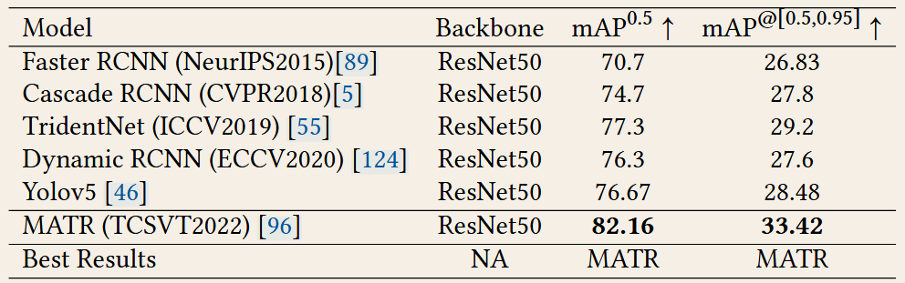

`表 7. AMWW 图像数据集 [65] 上的检测性能（%）。`

上部展示基于 CNN 的技术的结果，中部展示混合架构的结果。

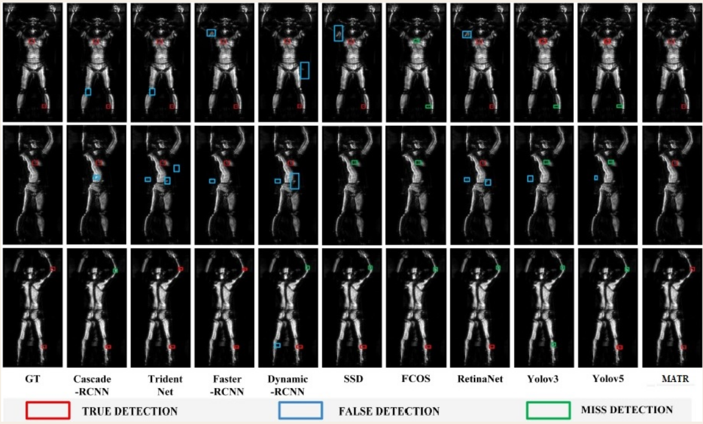

`图 15. AMMW 图像数据集 [65] 上前沿小目标检测器的检测结果示例（图引自 [96]）。`

在我们的研究中，我们关注现有技术在 AMMW 数据集 [65] 上的检测性能，如表 7 所示（结果汇编自各自的论文）。我们发现，`MATR 是该数据集上唯一结合 Transformer 和 CNN 的技术`。尽管它是唯一基于 Transformer 的技术，但在采用相同主干网络（ResNet50）的情况下，它能够显著改善 SOD 性能（相对于 Yolov5，$\mathrm{mAP}_{0.5}$ 提升 5.49%；相对于 TridentNet，$\mathrm{mAP}@[0.5,0.95]$ 提升 4.22%）。图 15 将 MATR 与其他前沿 CNN 技术进行了可视化比较。在这一成像方法中，结合不同角度的图像，极大地有助于识别即使很小的目标。训练和测试分别使用了 35426 张和 4019 张图像 [96]。

#### 4.2.6 视频中的小目标检测（Small Object Detection in Videos）

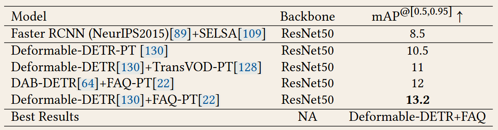

`表 8. ImageNet VID 数据集 [91] 上针对小目标的检测性能（%）。`上部展示基于 CNN 的技术的结果，中部展示混合架构的结果。PT：在 MS COCO 上预训练。

​		视频目标检测领域近期受到相当大的关注，因为视频中的时间信息可以提升检测性能。为了对前沿技术进行基准评测，使用了 `ImageNet VID 数据集`，并将结果专门聚焦于数据集中的小目标。该数据集包含 3862 段训练视频和 555 段验证视频，具有 30 类目标。表 8 报告了几种近期开发的基于 Transformer 的技术的 mAP。尽管 Transformer 在视频目标检测中的应用不断增长，但其在 SOD 中的潜力仍在很大程度上尚未得到探索。在报告了 ImageNet VID 数据集上 SOD 性能的方法中，采用 FAQ 的 Deformable DETR 因取得最高性能而突出——尽管其 $\mathrm{mAP}@[0.5,0.95]$ 仅为 13.2%，明显较低。这突显了基于视频的 SOD 领域存在显著的研究空白。

## 5 讨论（Discussion）

​		在本综述文章中，我们探讨了基于 Transformer 的方法如何应对 SOD 的挑战。我们的分类体系将基于 Transformer 的小目标检测器分为七个主要类别：目标表示、快速注意力（适用于高分辨率和多尺度特征图）、架构与模块修改、时空信息、改进的特征表示、辅助技术以及完全基于 Transformer 的检测器。将这一分类体系与基于 CNN 的技术的分类体系 [88] 并列比较时，我们观察到，其中一些类别重叠，而其他类别则是基于 Transformer 的技术所独有的。某些策略隐含地嵌入 Transformer 中，例如`注意力和上下文学习`，它们通过编码器和解码器中的自注意力与交叉注意力模块执行。另一方面，多尺度学习、辅助任务、架构修改和数据增强在两种范式中都很常见。然而，需要注意的是，`CNN 通过三维 CNN、RNN 或随时间进行的特征聚合来处理时空分析，而 Transformer 则通过连续的空间和时间 Transformer，或在解码器中为连续帧更新目标查询来实现这一点`。另一方面，切片技术通过增大目标在局部图像区域中的相对尺寸，已经显示出改善小目标检测的潜力 [78]。虽然这一策略已经在基于 CNN 的方法中得到探索，但其与基于 Transformer 的检测器的整合仍在很大程度上尚未得到探索。未来研究可以考察空间切片与 Transformer 架构相结合，如何在保持可扩展性和效率的同时改善 SOD 性能。总之，我们的发现强调了预训练和多尺度学习等策略在不同数据集上实现前沿 SOD 性能的有效性。为 SOD 利用数据融合方法也是一条有前景的方向，因为它让检测器能够获取同一目标丰富的叠加信息，与基于单张图像的检测方法相比，可能改善性能。尽管 Transformer 在 SOD 中被广泛采用，并显著改善了各种应用中的性能，但我们的分析仍识别出若干挑战，指明了未来研究的关键领域。

**高效架构／学习：**虽然 Transformer 显著改善了小目标的定位和分类，但认识到相关权衡至关重要。这些权衡包括大量参数（通常达数十亿）、较长训练周期（跨越数百个训练轮次），以及依赖极大规模数据集进行预训练，而没有强大的计算资源，这一过程通常不切实际。这些因素共同限制了那些缺乏必要资源、无法为其特定任务训练和测试这些技术的用户的可及性。因此，迫切需要配备特定领域加速器、采用新型优化方法、高效学习方法以及定制架构的轻量级网络 [47]。此外，在某些情况下，可能可以用更轻量的全局交互方法替代全局注意力机制 [58]。尽管参数数量迅速增加，现已可与人脑相比 [44]，SOD 的性能仍显著低于人类能力。图 16 展示了这种有限的 SOD 性能提升，尽管目标检测器的规模，无论参数数量还是主干网络架构，都大幅增长。

> 【图 16 占位符：此处放置图 16】

`图 16. 前沿基于 Transformer 的小目标检测器的 mAP 与模型参数数量的关系。`

**漏检目标与冗余检测：**我们的定性考察（图 11 和图 12）表明，SOD 中的分类错误可以忽略不计，主要错误来源是不准确的目标定位。对同样图像的分析揭示了 SOD 中的两个主要挑战：（i）假阴性，即漏检目标；（ii）冗余检测。漏检目标的挑战通常源于 Token 所编码的信息有限。一种潜在解决方案是使用更高分辨率的图像，或增强特征金字塔架构。然而，这些策略可能延长处理时间，可以通过采用更精简、高效的网络设计来缓解这一问题，如第一个未来方向所建议。解决冗余检测在 Transformer 框架中呈现出不同的挑战，传统 CNN 检测器通常通过 NMS 等后处理方法处理这一问题。这里，一种更有效的方法可能涉及降低解码器中目标查询之间的相似性。这可以通过辅助损失函数或类似 NMS 的技术实现，在保持计算效率的同时优化检测性能。

**特定应用的小目标检测器：**我们考察了将 Transformer 用于一系列 SOD 任务的研究。这些任务包括通用检测、航拍图像中的检测、医学图像中的异常检测、安检用途的主动毫米波图像中隐藏小目标检测、水下目标检测以及视频中的 SOD。尽管 Transformer 在通用图像和航拍图像任务中有效，但在其他领域仍相对缺乏探索 [88]。考虑到 Transformer 可能对医学影像等关键领域产生的影响，这一观察尤其值得注意。我们的分析表明，通用应用中的前沿技术往往无法在这些专门领域提供一致的性能。为此类任务定制的模型通常需要微调、适应新的目标类别以及利用先验知识。专门模型稀缺的一种潜在解释是，标注小目标的可用数量不足，或数据集中存在带噪声的标注，从而妨碍 Transformer 模型的有效训练。通过合成数据生成进行数据增强，以及弱监督学习方法等策略，可能有助于应对这些挑战。此外，整合额外的数据模态，例如医学影像中常见的元数据（如患者病史、人口统计信息），可以进一步提升 SOD 性能。通过用补充信息丰富数据集，模型可能对感兴趣的目标获得更全面的理解，从而改善检测准确性和鲁棒性。

## 6 结论（Conclusion）

本综述文章回顾了 60 多篇聚焦于为 SOD 任务开发 Transformer 的研究论文，包括纯 Transformer 技术和整合 CNN 的混合技术。我们从七个不同角度考察了这些技术：目标表示、用于高分辨率或多尺度特征图的快速注意力机制、架构与模块修改、时空信息、改进的特征表示、辅助技术以及完全基于 Transformer 的检测。这些类别中的每一类都包括多种前沿技术，每种技术各有优势。我们还将这些基于 Transformer 的方法与基于 CNN 的框架进行了比较，讨论了两者的相似性和差异。此外，对于一系列视觉应用，我们介绍了成熟的数据集，它们可作为未来研究的基准。此外，我们详细讨论了已经用于 SOD 应用的 12 个数据集，为未来研究工作提供便利。在未来研究中，可以探索每种应用中小目标检测所面临的独特挑战，并加以解决。医学影像和水下图像分析等领域有望显著受益于 Transformer 的使用。此外，可以探索提升性能的替代策略，而不是通过更大的模型增加 Transformer 的复杂度。

## 7 致谢（Acknowledgment）

我们感谢 Likun Cai 提供图 11 和图 12 中测试图像上的 CBNet v2 检测结果。

## 参考文献（References）

[1] 2020. Udacity 自动驾驶汽车驾驶数据，2017 Transformer。检索于 2023 年 9 月，来源： <https://github.com/udacity/self-driving-car/tree/master/annotations>

[2] Josh Beal, Eric Kim, Eric Tzeng, Dong Huk Park, Andrew Zhai, and Dmitry Kislyuk. 2020. 迈向基于 Transformer 的目标检测。来源： <https://arxiv.org/abs/2012.09958>

[3] Alexey Bochkovskiy et al. 2020. Yolov4：目标检测的最优速度与准确性。来源： <https://arxiv.org/abs/2004.10934>

[4] Likun Cai, Zhi Zhang, Yi Zhu, Li Zhang, Mu Li, and Xiangyang Xue. 2022. Bigdetection：用于改进目标检测器预训练的大规模基准。In Proceedings of the IEEE/CVF Conference on Computer Vision and Pattern Recognition. 4777–4787.

[5] Zhaowei Cai and Nuno Vasconcelos. 2021. Cascade R-CNN：高质量目标检测与实例分割。TPAMI 43, 5 (2021), 1483–1498.

[6] Xipeng Cao, Peng Yuan, Bailan Feng, and Kun Niu. 2022. CF-DETR：用于端到端目标检测的从粗到细 Transformer。In Proceedings of the AAAI Conference on Artificial Intelligence, Vol. 36. 185–193.

[7] Nicolas Carion, Francisco Massa, Gabriel Synnaeve, Nicolas Usunier, Alexander Kirillov, and Sergey Zagoruyko. 2020. 使用 Transformer 的端到端目标检测。In ECCV 2020: Proceedings of the 16th European Conference on Computer Vision, Part I 16. Springer, 213–229.

[8] Dong Chen, Duoqian Miao, and Xuerong Zhao. 2023. Hyneter：用于目标检测的混合网络 Transformer。In ICASSP 2023-Proceedings of the 2023 IEEE International Conference on Acoustics, Speech and Signal Processing (ICASSP). IEEE, 1–5.

[9] Gangqi Chen, Zhaoyong Mao, Kai Wang, and Junge Shen. 2023. HTDet：一种基于混合 Transformer 的水下小目标检测方法。Remote Sensing 15, 4 (2023), 1076.

[10] Juanjuan Chen, Hansheng Hong, Bin Song, Jie Guo, Chen Chen, and Junjie Xu. 2023. MDCT：用于遥感图像单阶段目标检测的多核空洞卷积与 Transformer。Remote Sensing 15, 2 (2023), 371.

[11] Peixian Chen, Mengdan Zhang, Yunhang Shen, Kekai Sheng, Yuting Gao, Xing Sun, Ke Li, and Chunhua Shen. 2022. 使用 Transformer 的高效无解码器目标检测。In ECCV 2022: Proceedings of the 17th European Conference on Computer Vision, Part X. Springer, 70–86.

[12] Qiang Chen, Xiaokang Chen, Jian Wang, Shan Zhang, Kun Yao, Haocheng Feng, Junyu Han, Errui Ding, Gang Zeng, and Jingdong Wang. 2023. Group DETR：采用分组一对多分配的快速 DETR 训练。In Proceedings of the IEEE/CVF International Conference on Computer Vision. 6633–6642.

[13] Qiang Chen, Jian Wang, Chuchu Han, Shan Zhang, Zexian Li, Xiaokang Chen, Jiahui Chen, Xiaodi Wang, Shuming Han, Gang Zhang, Haocheng Feng, Kun Yao, Junyu Han, Errui Ding, and Jingdong Wang. 2022. Group DETR v2：采用编码器—解码器预训练的强大目标检测器。来源： <https://arxiv.org/abs/2211.03594>

[14] Xiaokang Chen, Fangyun Wei, Gang Zeng, and Jingdong Wang. 2022. Conditional DETR v2：采用框查询的高效检测 Transformer。来源： <https://arxiv.org/abs/2207.08914>

[15] Xin Chen, Bin Yan, Jiawen Zhu, Dong Wang, Xiaoyun Yang, and Huchuan Lu. 2021. Transformer 跟踪。In Proceedings of the IEEE/CVF Conference on Computer Vision and Pattern Recognition. 8126–8135.

[16] Yihong Chen, Zheng Zhang, Yue Cao, Liwei Wang, Stephen Lin, and Han Hu. 2020. Reppoints v2：用于目标检测的验证与回归相结合。Advances in Neural Information Processing Systems 33 (2020), 5621–5631.

[17] Gong Cheng, Xiang Yuan, Xiwen Yao, Kebing Yan, Qinghua Zeng, Xingxing Xie, and Junwei Han. 2023. 迈向大规模小目标检测：综述与基准。IEEE Transactions on Pattern Analysis and Machine Intelligence 45, 11 (2023), 13467–13488.

[18] Gong Cheng, Peicheng Zhou, and Junwei Han. 2016. 学习旋转不变卷积神经网络以检测甚高分辨率光学遥感图像中的目标。IEEE Transactions on Geoscience and Remote Sensing 54, 12 (2016), 7405–7415.

[19] Cheng Chi, Fangyun Wei, and Han Hu. 2020. Relationnet++：通过 Transformer 解码器桥接用于目标检测的视觉表示。Advances in Neural Information Processing Systems 33 (2020), 13564–13574.

[20] Se Woon Cho, Na Rae Baek, Min Cheol Kim, Ja Hyung Koo, Jong Hyun Kim, and Kang Ryoung Park. 2018. 使用可见光相机传感器和两步 Faster 基于区域的卷积神经网络进行夜间图像中的人脸检测。Sensors 18, 9 (2018), 2995.

[21] Angelo Coluccia, Alessio Fascista, Arne Schumann, Lars Sommer, Anastasios Dimou, Dimitrios Zarpalas, Fatih Cagatay Akyon, Ogulcan Eryuksel, Kamil Anil Ozfuttu, Sinan Onur Altinuc, et al. 2021. IEEE AVSS2021 的无人机与鸟类检测挑战。In Proceedings of the 2021 17th IEEE International Conference on Advanced Video and Signal Based Surveillance (AVSS). IEEE, 1–8.

[22] Yiming Cui. 2023. 用于基于 Transformer 的视频目标检测器的特征聚合查询。In Proceedings of the IEEE/CVF Conference on Computer Vision and Pattern Recognition. 6365–6376.

[23] Jifeng Dai, Yi Li, Kaiming He, and Jian Sun . 2016. R-FCN：通过基于区域的全卷积网络进行目标检测。In Proceedings of the 30th International Conference on Neural Information Processing Systems (NeurIPS) .

[24] Linhui Dai, Hong Liu, Hao Tang, Zhiwei Wu, and Pinhao Song. 2023. Ao2-detr：任意方向目标检测 Transformer。IEEE Transactions on Circuits and Systems for Video Technology 33, 5 (2023), 2342–2356.

[25] Xiyang Dai, Yinpeng Chen, Jianwei Yang, Pengchuan Zhang, Lu Yuan, and Lei Zhang. 2021. Dynamic DETR：采用动态注意力的端到端目标检测。In Proceedings of the IEEE/CVF International Conference on Computer Vision. 2988–2997.

[26] Jiangang Ding, Wei Li, Lili Pei, Ming Yang, Chao Ye, and Bo Yuan. 2023. Sw-YoloX：一种基于 Transformer 的用于海面目标检测的无锚框检测器。Expert Systems with Applications 217 (2023), 119560.

[27] Jian Ding, Nan Xue, Yang Long, Gui-Song Xia, and Qikai Lu. 2019. 学习 RoI Transformer 以进行航拍图像中的有向目标检测。In Proceedings of the IEEE/CVF Conference on Computer Vision and Pattern Recognition. 2849–2858.

[28] Tonghe Ding, Kaili Feng, Yanjun Wei, Yu Han, and Tianping Li. 2023. DeoT：一种端到端的仅编码器 Transformer 目标检测器。Journal of Real-Time Image Processing 20, 1 (2023), 1.

[29] Alexey Dosovitskiy, Lucas Beyer, Alexander Kolesnikov, Dirk Weissenborn, Xiaohua Zhai, Thomas Unterthiner, Mostafa Dehghani, Matthias Minderer, Georg Heigold, Sylvain Gelly, Jakob Uszkoreit, and Neil Houlsby. 2020. 一张图像相当于 16×16 个词：用于大规模图像识别的 Transformer。来源： <https://arxiv.org/abs/2010.11929>

[30] Kaiwen Duan, Song Bai, Lingxi Xie, Honggang Qi, Qingming Huang, and Qi Tian. 2023. 用于目标检测的 CenterNet++。IEEE Transactions on Pattern Analysis and Machine Intelligence 46, 5 (2023), 3509–3521.

[31] Shikha Dubey, Farrukh Olimov, Muhammad Aasim Rafique, and Moongu Jeon. 2022. 使用 Transformer 改善小目标检测。Journal of Visual Communication and Image Representation 89 (2022), 103620.

[32] Yuxin Fang, Bencheng Liao, Xinggang Wang, Jiemin Fang, Jiyang Qi, Rui Wu, Jianwei Niu, and Wenyu Liu. 2021. 你只看一个序列：通过目标检测重新思考视觉中的 Transformer。Advances in Neural Information Processing Systems 34 (2021), 26183–26197.

[33] Masato Fujitake and Akihiro Sugimoto. 2022. 采用注意力引导记忆的用于视频目标检测的视频稀疏 Transformer。IEEE Access 10 (2022), 65886–65900.

[34] Yuan Gao, Hui Shen, Donghong Zhong, Jian Wang, Zeyu Liu, Ti Bai, Xiang Long, and Shilei Wen. 2019. 密集标注的大规模目标检测任务的一种解决方案。(2019).

[35] Ross Girshick. 2015. Fast R-CNN。In Proceedings of the 2015 IEEE International Conference on Computer Vision (ICCV). 1440–1448.

[36] Eran Goldman, Roei Herzig, Aviv Eisenschtat, Jacob Goldberger, and Tal Hassner. 2019. 密集排列场景中的精确检测。In Proceedings of the IEEE/CVF Conference on Computer Vision and Pattern Recognition. 5227–5236.

[37] Hang Gong, Tingkui Mu, Qiuxia Li, Haishan Dai, Chunlai Li, Zhiping He, Wenjing Wang, Feng Han, Abudusalamu Tuniyazi, Haoyang Li, et al. 2022. 用于卫星图像小目标检测的带有注意力机制的 Swin Transformer 驱动的 YOLOv5。Remote Sensing 14, 12 (2022), 2861.

[38] Jiaming Han, Jian Ding, Nan Xue, and Gui-Song Xia. 2021. Redet：一种用于航拍目标检测的旋转等变检测器。In Proceedings of the IEEE/CVF Conference on Computer Vision and Pattern Recognition. 2786–2795.

[39] Khurram Azeem Hashmi, Didier Stricker, and Muhammamd Zeshan Afzal. 2022. 用于端到端视频目标检测的时空可学习候选区域。In Proceedings of the 33rd British Machine Vision Conference.

[40] Kaiming He, Xiangyu Zhang, Shaoqing Ren, and Jian Sun. 2015. 用于视觉识别的深度卷积网络中的空间金字塔池化。TPAMI 37, 9 (2015), 1904–1916.

[41] Kaiming He, Georgia Gkioxari, Piotr Dollár, and Ross Girshick . 2017. Mask R-CNN。In Proceedings of the IEEE International Conference on Computer Vision (ICCV). 2961–2969.

[42] Liqiang He and Sinisa Todorovic. 2022. DESTR：使用分离 Transformer 的目标检测。In Proceedings of the IEEE/CVF Conference on Computer Vision and Pattern Recognition. 9377–9386.

[43] Lu He, Qianyu Zhou, Xiangtai Li, Li Niu, Guangliang Cheng, Xiao Li, Wenxuan Liu, Yunhai Tong, Lizhuang Ma, and Liqing Zhang. 2021. 采用时空 Transformer 的端到端视频目标检测。In Proceedings of the 29th ACM International Conference on Multimedia. 1507–1516.

[44] Suzana Herculano-Houzel. 2009. 数字中的人脑：一个线性放大的灵长类大脑。Frontiers in Human Neuroscience 3 (2009), 31.

[45] Brian KS Isaac-Medina, Chris G. Willcocks, and Toby P. Breckon. 2022. 用于目标检测的多视角视觉 Transformer。In Proceedings of the 2022 26th International Conference on Pattern Recognition (ICPR). IEEE, 4678–4684.

[46] Glenn Jocher, Alex Stoken, Jirka Borovec, NanoCode012, ChristopherSTAN, Liu Changyu, Laughing, Adam Hogan, lorenzomammana, tkianai, et al. 2020. yolov5。代码仓库。 检索于 2023 年 9 月，来源： <https://github.com/ultralytics/yolov5>. (2020).

[47] Sehoon Kim, Coleman Hooper, Thanakul Wattanawong, Minwoo Kang, Ruohan Yan, Hasan Genc, Grace Dinh, Qijing Huang, Kurt Keutzer, Michael W. Mahoney, Yakun Sophia Shao, and Amir Gholami. 2023. Transformer 推理的全栈优化：综述。来源： <https://arxiv.org/abs/2302.14017>

[48] Hei Law and Jia Deng. 2018. Cornernet：将目标作为成对关键点进行检测。In Proceedings of the European Conference on Computer Vision (ECCV). 734–750.

[49] Chuyi Li, Lulu Li, Hongliang Jiang, Kaiheng Weng, Yifei Geng, Liang Li, Zaidan Ke, Qingyuan Li, Meng Cheng, Weiqiang Nie, Yiduo Li, Bo Zhang, Yufei Liang, Linyuan Zhou, Xiaoming Xu, Xiangxiang Chu, Xiaoming Wei, and Xiaolin Wei. 2022. YOLOv6：一种用于工业应用的单阶段目标检测框架。arXiv:2209.02976. 来源： <https://arxiv.org/abs/2209.02976>

[50] Feng Li, Hao Zhang, Shilong Liu, Jian Guo, Lionel M. Ni, and Lei Zhang. 2022. DN-DETR：通过引入查询去噪加速 DETR 训练。In Proceedings of the IEEE/CVF Conference on Computer Vision and Pattern Recognition. 13619–13627.

[51] Johann Li, Guangming Zhu, Cong Hua, Mingtao Feng, Basheer Bennamoun, Ping Li, Xiaoyuan Lu, Juan Song, Peiyi Shen, Xu Xu, et al. 2023. 用于深度学习的医学图像数据集的系统汇集。ACM Computing Surveys 56, 5 (2023), 51. <https://doi.org/10.1145/3615862>

[52] Ke Li, Gang Wan, Gong Cheng, Liqiu Meng, and Junwei Han. 2020. 光学遥感图像中的目标检测：综述与新基准。ISPRS Journal of Photogrammetry and Remote Sensing 159 (2020), 296–307.

[53] Qingyun Li, Yushi Chen, and Ying Zeng. 2022. 采用迁移 CNN 的用于遥感图像目标检测的 Transformer。Remote Sensing 14, 4 (2022), 984.

[54] Sijia Li, Furkat Sultonov, Jamshid Tursunboev, Jun-Hyun Park, Sangseok Yun, and Jae-Mo Kang. 2022. Ghostformer：一种基于 GhostNet 的用于小目标检测的两阶段 Transformer。Sensors 22, 18 (2022), 6939.

[55] Yanghao Li, Yuntao Chen, Naiyan Wang, and Zhaoxiang Zhang. 2019. 用于目标检测的尺度感知三叉戟网络。In Proceedings of the IEEE/CVF International Conference on Computer Vision. 6054–6063.

[56] Yanghao Li, Hanzi Mao, Ross Girshick, and Kaiming He. 2022. 探索用于目标检测的普通视觉 Transformer 主干网络。In ECCV 2022: Proceedings of the 17th European Conference on Computer Vision, Part IX. Springer, 280–296.

[57] Tingting Liang, Xiaojie Chu, Yudong Liu, Yongtao Wang, Zhi Tang, Wei Chu, Jingdong Chen, and Haibin Ling. 2022. Cbnet：一种用于目标检测的复合主干网络架构。IEEE Transactions on Image Processing 31 (2022), 6893–6906.

[58] Tianyang Lin, Yuxin Wang, Xiangyang Liu, and Xipeng Qiu. 2022. Transformer 综述。AI Open 3 (2022), 111–132.

[59] Tsung-Yi Lin, Piotr Dollár, Ross Girshick, Kaiming He, Bharath Hariharan, and Serge Belongie. 2017. 用于目标检测的特征金字塔网络。In Proceedings of the IEEE Conference on Computer Vision and Pattern Recognition (CVPR). 2117–2125.

[60] Tsung-Yi Lin, Priya Goyal, Ross Girshick, Kaiming He, and Piotr Dollár. 2017. 用于密集目标检测的焦点损失。In Proceedings of the IEEE International Conference on Computer Vision (ICCV). 2980–2988.

[61] Tsung-Yi Lin, Michael Maire, Serge Belongie, James Hays, Pietro Perona, Deva Ramanan, Piotr Dollár, and C. Lawrence Zitnick. 2014. Microsoft coco：上下文中的常见目标。In Proceedings of the European Conference on Computer Vision. Springer, 740–755.

[62] Wei-Hong Lin, Jia-Xing Zhong, Shan Liu, Thomas Li, and Ge Li. 2020. RoIMix：用于水下目标检测的多图像间候选区域融合。In ICASSP 2020-Proceedings of the 2020 IEEE International Conference on Acoustics, Speech and Signal Processing (ICASSP). IEEE, 2588–2592.

[63] Chang Liu, Sheng Xu, and Baochang Zhang. 2021. 采用 Transformer 的航拍小目标跟踪。In Proceedings of the 2021 IEEE International Conference on Unmanned Systems (ICUS). IEEE, 954–959.

[64] Shilong Liu, Feng Li, Hao Zhang, Xiao Yang, Xianbiao Qi, Hang Su, Jun Zhu, and Lei Zhang. 2023. DAB-DETR：动态锚框是 DETR 更好的查询。In ICLR.

[65] Ting Liu, Yao Zhao, Yunchao Wei, Yufeng Zhao, and Shikui Wei. 2019. 主动毫米波图像中的隐藏目标检测。IEEE Transactions on Industrial Electronics 66, 12 (2019), 9909–9917.

[66] Wei Liu, Dragomir Anguelov, Dumitru Erhan, Christian Szegedy, Scott Reed, Cheng-Yang Fu, and Alexander C. Berg. 2016. SSD：单次多框检测器。In Proceedings of the European Conference on Computer Vision (ECCV). Springer, 21–37.

[67] Yang Liu, Peng Sun, Nickolas Wergeles, and Yi Shang. 2021. 用于小目标检测的深度学习方法的综述与性能评估。Expert Systems with Applications 172 (2021), 114602.

[68] Zhigang Liu, Juan Du, Feng Tian, and Jiazheng Wen. 2019. MR-CNN：一种用于小型交通标志识别的多尺度基于区域的卷积神经网络。IEEE Access 7 (2019), 57120–57128.

[69] Ze Liu, Yutong Lin, Yue Cao, Han Hu, Yixuan Wei, Zheng Zhang, Stephen Lin, and Baining Guo. 2021. Swin Transformer：使用移位窗口的分层视觉 Transformer。In Proceedings of the IEEE/CVF International Conference on Computer Vision. 10012–10022.

[70] Wanjie Lu, Chaozhen Lan, Chaoyang Niu, Wei Liu, Liang Lyu, Qunshan Shi, and Shiju Wang. 2023. 一种基于 CSWin Transformer 的用于无人机图像目标检测的 CNN—Transformer 混合模型。IEEE Journal of Selected Topics in Applied Earth Observations and Remote Sensing 16 (2023), 1211–1231.

[71] Teli Ma, Mingyuan Mao, Honghui Zheng, Peng Gao, Xiaodi Wang, Shumin Han, Errui Ding, Baochang Zhang, and David Doermann. 2021. 使用 Transformer 的有向目标检测。来源： <https://arxiv.org/abs/2106.03146>

[72] Muhammad Maaz, Hanoona Rasheed, Salman Khan, Fahad Shahbaz Khan, Rao Muhammad Anwer, and Ming-Hsuan Yang. 2022. 采用多模态 Transformer 的类别无关目标检测。In Proceedings of the 17th European Conference on Computer Vision (ECCV). Springer.

[73] Tim Meinhardt, Alexander Kirillov, Laura Leal-Taixe, and Christoph Feichtenhofer. 2022. Trackformer：采用 Transformer 的多目标跟踪。In Proceedings of the IEEE/CVF Conference on Computer Vision and Pattern Recognition. 8844–8854.

[74] Depu Meng, Xiaokang Chen, Zejia Fan, Gang Zeng, Houqiang Li, Yuhui Yuan, Lei Sun, and Jingdong Wang. 2021. 用于快速训练收敛的 Conditional DETR。In Proceedings of the IEEE/CVF International Conference on Computer Vision. 3651–3660.

[75] Matthias Mueller, Neil Smith, and Bernard Ghanem. 2016. 用于无人机跟踪的基准与模拟器。In ECCV 2016: Proceedings of the 14th European Conference on Computer Vision, Part I 14. Springer, 445–461.

[76] Kemal Oksuz, Baris Can Cam, Sinan Kalkan, and Emre Akbas. 2020. 目标检测中的不平衡问题：综述。IEEE Transactions on Pattern Analysis and Machine Intelligence 43, 10 (2020), 3388–3415.

[77] Jeffrey Ouyang-Zhang, Jang Hyun Cho, Xingyi Zhou, and Philipp Krähenbühl. 2022. NMS 的反击。来源： <https://arxiv.org/abs/2212.06137>

[78] F. Ozge Unel, Burak O. Ozkalayci, and Cevahir Cigla. 2019. 切片对于小目标检测的作用。In Proceedings of the IEEE/CVF Conference on Computer Vision and Pattern Recognition Workshops.

[79] Jiangmiao Pang, Kai Chen, Jianping Shi, Huajun Feng, Wanli Ouyang, and Dahua Lin. 2019. Libra R-CNN：迈向目标检测的均衡学习。In Proceedings of the IEEE/CVF Conference on Computer Vision and Pattern Recognition (CVPR). 821–830.

[80] Zhiliang Peng, Zonghao Guo, Wei Huang, Yaowei Wang, Lingxi Xie, Jianbin Jiao, Qi Tian, and Qixiang Ye. 2023. Conformer：用于识别和检测的局部特征与全局表示耦合。IEEE Transactions on Pattern Analysis and Machine Intelligence 45, 8 (2023), 9454–9468.

[81] Zhiliang Peng, Wei Huang, Shanzhi Gu, Lingxi Xie, Yaowei Wang, Jianbin Jiao, and Qixiang Ye. 2021. Conformer：用于视觉识别的局部特征与全局表示耦合。In Proceedings of the IEEE/CVF International Conference on Computer Vision. 367–376.

[82] Shima Rashidi, Krista Ehinger, Andrew Turpin, and Lars Kulik. 2020. 基于自然图像中目标可检测性模型的最优视觉搜索。Advances in Neural Information Processing Systems 33 (2020), 9288–9299.

[83] Shima Rashidi, Ruwan Tennakoon, Aref Miri Rekavandi, Papangkorn Jessadatavornwong, Amanda Freis, Garret Huff, Mark Easton, Adrian Mouritz, Reza Hoseinnezhad, and Alireza Bab-Hadiashar. 2025. IT-RUDA：信息论辅助的鲁棒无监督域适应。ACM Transactions on Intelligent Systems and Technology (2025).

[84] Joseph Redmon, Santosh Divvala, Ross Girshick, and Ali Farhadi. 2016. 你只看一次：统一的实时目标检测。In Proceedings of the IEEE Conference on Computer Vision and Pattern Recognition. 779–788.

[85] Joseph Redmon and Ali Farhadi. 2017. YOLO9000：更好、更快、更强。In Proceedings of the 2017 IEEE Conference on Computer Vision and Pattern Recognition (CVPR). 7263–7271.

[86] Joseph Redmon and Ali Farhadi. 2018. Yolov3：一项渐进式改进。来源： <https://arxiv.org/abs/1804.02767>

[87] Aref Miri Rekavandi, Abd-Krim Seghouane, and Robin J. Evans. 2021. 基于 α 散度的鲁棒子空间检测器及其在成像检测中的应用。IEEE Transactions on Image Processing 30 (2021), 5017–5031.

[88] Aref Miri Rekavandi, Lian Xu, Farid Boussaid, Abd-Krim Seghouane, Stephen Hoefs, and Mohammed Bennamoun. 2025. 使用深度学习的基于图像和视频的小目标检测指南：海事监视案例研究。IEEE Transactions on Intelligent Transportation Systems 26, 3 (2025), 2851–2879.

[89] Shaoqing Ren, Kaiming He, Ross Girshick, and Jian Sun. 2015. Faster R-CNN：通过区域提议网络迈向实时目标检测。In Proceedings of the 29th International Conference on Neural Information Processing Systems (NeurIPS) .

[90] Si-Dong Roh and Ki-Seok Chung. 2022. DAFA：用于基于注意力的视频目标检测的多样性感知特征聚合。IEEE Access 10 (2022), 93453–93463.

[91] Olga Russakovsky, Jia Deng, Hao Su, Jonathan Krause, Sanjeev Satheesh, Sean Ma, Zhiheng Huang, Andrej Karpathy, Aditya Khosla, Michael Bernstein, et al. 2015. Imagenet 大规模视觉识别挑战。International Journal of Computer Vision 115 (2015), 211–252.

[92] Ruoyue Shen, Nakamasa Inoue, and Koichi Shinoda. 2023. 用于多模态视频问答的文本引导目标检测器。In Proceedings of the IEEE/CVF Winter Conference on Applications of Computer Vision. 1032–1042.

[93] Yuntao Shou, Tao Meng, Wei Ai, Canhao Xie, Haiyan Liu, and Yina Wang. 2022. 基于分层 Transformer 和掩码机制的医学图像目标检测。Computational Intelligence and Neuroscience 2022 (2022), 1–12.

[94] Hwanjun Song, Deqing Sun, Sanghyuk Chun, Varun Jampani, Dongyoon Han, Byeongho Heo, Wonjae Kim, and Ming-Hsuan Yang. 2022. ViDT：一种高效且有效的完全基于 Transformer 的目标检测器。In Proceedings of the International Conference on Learning Representations (ICLR).

[95] Russell Stewart, Mykhaylo Andriluka, and Andrew Y. Ng. 2016. 拥挤场景中的端到端人员检测。In Proceedings of the IEEE Conference on Computer Vision and Pattern Recognition. 2325–2333.

[96] Peng Sun, Ting Liu, Xiaotong Chen, Shiyin Zhang, Yao Zhao, and Shikui Wei. 2022. 用于毫米波图像中隐藏目标检测的多源聚合 Transformer。IEEE Transactions on Circuits and Systems for Video Technology 32, 9 (2022), 6148–6159.

[97] Zhiqing Sun, Shengcao Cao, Yiming Yang, and Kris M. Kitani. 2021. 重新思考用于目标检测的基于 Transformer 的集合预测。In Proceedings of the IEEE/CVF International Conference on Computer Vision. 3611–3620.

[98] Yudi Tang, Bing Wang, Wangli He, and Feng Qian. 2023. Pointdet++：一种带有 Transformer 编码器的基于人体局部特征的目标检测框架。Neural Comput & Applic 35 (2023), 10097–10108.

[99] Zhi Tian, Chunhua Shen, Hao Chen, and Tong He. 2019. Fcos：全卷积单阶段目标检测。In Proceedings of the IEEE/CVF International Conference on Computer Vision. 9627–9636.

[100] Hugo Touvron, Matthieu Cord, Matthijs Douze, Francisco Massa, Alexandre Sablayrolles, and Hervé Jégou. 2021. 训练数据高效的图像 Transformer 与通过注意力进行蒸馏。In Proceedings of the International Conference on Machine Learning. PMLR, 10347–10357.

[101] Leon Amadeus Varga and Andreas Zell. 2021. 通过裁剪窗口应对稀疏目标检测中的背景偏置。In Proceedings of the IEEE/CVF International Conference on Computer Vision. 2768–2777.

[102] Ashish Vaswani, Noam Shazeer, Niki Parmar, Jakob Uszkoreit, Llion Jones, Aidan N. Gomez, Łukasz Kaiser, and Illia Polosukhin. 2017. 注意力就是你所需要的一切。Advances in Neural Information Processing Systems 30 (2017), 1–11.

[103] Chien-Yao Wang, Alexey Bochkovskiy, and Hong-Yuan Mark Liao. 2023. YOLOv7：可训练的免费技巧包为实时目标检测器确立新的最先进水平。In Proceedings of the IEEE/CVF Conference on Computer Vision and Pattern Recognition. 7464–7475.

[104] Han Wang, Jun Tang, Xiaodong Liu, Shanyan Guan, Rong Xie, and Li Song. 2022. PTSEFormer：面向视频目标检测的渐进式时空增强 Transformer。In ECCV 2022: Proceedings of the 17th European Conference on Computer Vision, Part VIII. Springer, 732–747.

[105] Jinwang Wang, Chang Xu, Wen Yang, and Lei Yu. 2021. 一种用于微小目标检测的归一化高斯 Wasserstein 距离。来源： <https://arxiv.org/abs/2110.13389>

[106] Liya Wang and Alex Tien. 2023. 使用视觉 Transformer 检测器（ViTDet）的航拍图像目标检测。In IGARSS 2023-Proceedings of the 2023 IEEE International Geoscience and Remote Sensing Symposium. IEEE, 6450–6453.

[107] Wen Wang, Yang Cao, Jing Zhang, and Dacheng Tao. 2022. Fp-detr：通过全面预训练得到改进的检测 Transformer。In Proceedings of the International Conference on Learning Representations.

[108] Yingming Wang, Xiangyu Zhang, Tong Yang, and Jian Sun. 2022. Anchor DETR：用于基于 Transformer 的目标检测的查询设计。In Proceedings of the AAAI Conference on Artificial Intelligence (AAAI) .

[109] Haiping Wu, Yuntao Chen, Naiyan Wang, and Zhaoxiang Zhang. 2019. 用于视频目标检测的序列级语义聚合。In Proceedings of the IEEE/CVF International Conference on Computer Vision. 9217–9225.

[110] Jialian Wu, Chunluan Zhou, Qian Zhang, Ming Yang, and Junsong Yuan. 2020. 用于小尺度行人检测的自模仿学习。In Proceedings of the 28th ACM International Conference on Multimedia. 2012–2020.

[111] Gui-Song Xia, Xiang Bai, Jian Ding, Zhen Zhu, Serge Belongie, Jiebo Luo, Mihai Datcu, Marcello Pelillo, and Liangpei Zhang. 2018. DOTA：用于航拍图像目标检测的大规模数据集。In Proceedings of the IEEE Conference on Computer Vision and Pattern Recognition. 3974–3983.

[112] Ruiyang Xia, Guoquan Li, Zhengwen Huang, Yu Pang, and Man Qi. 2022. 通过非线性组合实现实时目标检测的只看一次的 Transformer。Neural Computing and Applications 34, 15 (2022), 12571–12585.

[113] Shoukun Xu, Jianan Gu, Yining Hua, and Yi Liu. 2023. DKTNet：用于小目标检测的双键 Transformer 网络。Neurocomputing 525 (2023), 29–41.

[114] Wenyu Xu, Chaofan Zhang, Qi Wang, and Pangda Dai. 2022. FEA-swin：用于精确的基于无人机的密集目标检测的前景增强注意力 Swin Transformer 网络。Sensors 22, 18 (2022), 6993.

[115] Xiangkai Xu, Zhejun Feng, Changqing Cao, Mengyuan Li, Jin Wu, Zengyan Wu, Yajie Shang, and Shubing Ye. 2021. 一种改进的基于 Swin Transformer 的遥感目标检测与实例分割模型。Remote Sensing 13, 23 (2021), 4779.

[116] Jingqian Xue, Da He, Mengwei Liu, and Qian Shi. 2022. 用于遥感图像中基于 Transformer 的目标检测的具有交织全局—局部特征层次的双网络结构。IEEE Journal of Selected Topics in Applied Earth Observations and Remote Sensing 15 (2022), 6856–6866.

[117] Ke Yan, Xiaosong Wang, Le Lu, and Ronald M. Summers. 2018. DeepLesion：大规模病灶标注的自动挖掘及使用深度学习的通用病灶检测。Journal of Medical Imaging 5, 3 (2018), 036501–036501.

[118] Hao Yang, Zihan Yang, Anyong Hu, Che Liu, Tie Jun Cui, and Jungang Miao. 2023. 统一卷积与 Transformer，以高效检测被动毫米波图像中的隐藏目标。IEEE Transactions on Circuits and Systems for Video Technology 33, 8 (2023), 3872–3887.

[119] Ze Yang, Shaohui Liu, Han Hu, Liwei Wang, and Stephen Lin. 2019. Reppoints：用于目标检测的点集表示。In Proceedings of the IEEE/CVF International Conference on Computer Vision. 9657–9666.

[120] Tao Ye, Wenyang Qin, Zongyang Zhao, Xiaozhi Gao, Xiangpeng Deng, and Yu Ouyang. 2023. 基于 CNN 和 Transformer 的无人机视觉实时目标检测网络。IEEE Transactions on Instrumentation and Measurement 72 (2023), 1–13.

[121] Dmitry Yudin and Dmitry Slavioglo. 2018. 使用带有聚类的全卷积网络进行交通信号灯检测。In Proceedings of the 2018 7th Mediterranean Conference on Embedded Computing (MECO). IEEE, 1–6.

[122] Kai Zeng, Qian Ma, Jiawen Wu, Sijia Xiang, Tao Shen, and Lei Zhang. 2022. NLFFTNet：一种用于多尺度目标检测的非局部特征融合 Transformer 网络。Neurocomputing 493 (2022), 15–27.

[123] Chi Zhang, Lijuan Liu, Xiaoxue Zang, Frederick Liu, Hao Zhang, Xinying Song, and Jindong Chen. 2022. DETR++：驯服你的多尺度检测 Transformer。来源： <https://arxiv.org/abs/2206.02977>

[124] Hongkai Zhang, Hong Chang, Bingpeng Ma, Naiyan Wang, and Xilin Chen. 2020. Dynamic R-CNN：通过动态训练迈向高质量目标检测。In ECCV 2020: Proceedings of the 16th European Conference on Computer Vision, Part XV 16. Springer, 260–275.

[125] Hao Zhang, Feng Li, Shilong Liu, Lei Zhang, Hang Su, Jun Zhu, Lionel Ni, and Heung-Yeung Shum. 2023. DINO：采用改进的去噪锚框进行端到端目标检测的 DETR。In Proceedings of the 11th International Conference on Learning Representations.

[126] Shifeng Zhang, Cheng Chi, Yongqiang Yao, Zhen Lei, and Stan Z. Li. 2020. 通过自适应训练样本选择弥合基于锚框和无锚框检测之间的差距。In Proceedings of the IEEE/CVF Conference on Computer Vision and Pattern Recognition. 9759–9768.

[127] Yuanlin Zhang, Yuan Yuan, Yachuang Feng, and Xiaoqiang Lu. 2019. 用于甚高分辨率遥感目标检测的分层鲁棒卷积神经网络。IEEE Transactions on Geoscience and Remote Sensing 57, 8 (2019), 5535–5548.

[128] Qianyu Zhou, Xiangtai Li, Lu He, Yibo Yang, Guangliang Cheng, Yunhai Tong, Lizhuang Ma, and Dacheng Tao. 2023. TransVOD：采用时空 Transformer 的端到端视频目标检测。IEEE Transactions on Pattern Analysis and Machine Intelligence 45, 6 (2023), 7853–7869.

[129] Xingyi Zhou, Dequan Wang, and Philipp Krähenbühl. 2019. 将目标作为点。来源： <https://arxiv.org/abs/1904.07850>

[130] Xizhou Zhu, Weijie Su, Lewei Lu, Bin Li, Xiaogang Wang, and Jifeng Dai. 2021. Deformable DETR：用于端到端目标检测的可变形 Transformer。In Proceedings of the International Conference on Learning Representations (ICLR) .

[131] Yuan Zhu, Qingyuan Xia, and Wen Jin. 2022. SRDD：一种采用 Transformer 的轻量级端到端目标检测。Connection Science 34, 1 (2022), 2448–2465.

[132] Zhuofan Zong, Guanglu Song, and Yu Liu. 2023. 采用协同混合分配训练的 DETR。In Proceedings of the IEEE/CVF International Conference on Computer Vision. 6748–6758.

收稿日期：2024 年 12 月 26 日；修订日期：2025 年 5 月 11 日；接受日期：2025 年 7 月 24 日。
