# UIU-Net：用于红外小目标检测的 U-Net 中的 U-Net

**原文题目：** UIU-Net: U-Net in U-Net for Infrared Small Object Detection

**作者：** Xin Wu（IEEE 会员）、Danfeng Hong（IEEE 高级会员）和 Jocelyn Chanussot（IEEE 会士）

**期刊：** IEEE Transactions on Image Processing，第 32 卷，2023 年，第 364–376 页。

**DOI：** 10.1109/TIP.2022.3228497

## 摘要（Abstract）

目前，基于学习的红外小目标检测（infrared small object detection）方法严重依赖分类骨干网络（classification backbone network）。随着网络深度的增加，这往往导致微小目标丢失和特征可区分性（feature discriminability）受限。此外，红外图像中的小目标经常表现为亮目标和暗目标，这对获取精确的目标对比度（object contrast）信息提出了严格要求。为此，本文提出了一种简单而有效的“U-Net 中的 U-Net”框架，简称 UIU-Net，用于检测红外图像中的小目标。顾名思义，UIU-Net 将一个小型 U-Net 嵌入一个更大的 U-Net 骨干网络中，从而实现目标的多层级和多尺度表征学习（multi-level and multi-scale representation learning）。此外，UIU-Net 可以从头开始训练，所学习的特征能够有效增强全局和局部对比度（global and local contrast）信息。更具体地说，UIU-Net 模型分为两个模块：分辨率保持深度监督（resolution-maintenance deep supervision，RM-DS）模块和交互式交叉注意力（interactive-cross attention，IC-A）模块。RM-DS 将残差 U 型块（ReSidual U-blocks，RSU）集成到深度监督网络中，在学习全局上下文信息（global context information）的同时生成深层多尺度、保持分辨率的特征。进一步地，IC-A 对低层细节（low-level details）和高层语义特征（high-level semantic features）之间的局部上下文信息（local context information）进行编码。在两个红外单帧图像数据集，即 SIRST 和 Synthetic 数据集上开展的大量实验表明，与几种最先进的红外小目标检测方法相比，所提出的 UIU-Net 具有有效性和优越性。所提出的 UIU-Net 在视频序列红外小目标数据集（例如 ATR 地面/空中视频序列数据集）上也表现出强大的泛化性能（generalization performance）。本工作的代码已公开发布于 https://github.com/danfenghong/IEEE_TIP_UIU-Net。

**索引词（Index Terms）：** 红外小目标、深度学习、深层多尺度特征、注意力机制、局部与全局上下文信息、特征交互。

**稿件信息：** 2021 年 12 月 21 日收到稿件；2022 年 6 月 30 日修订；2022 年 11 月 19 日接受。2022 年 12 月 15 日在线发表；当前版本日期为 2022 年 12 月 21 日。本研究部分得到中国国家自然科学基金（项目编号 62101045 和 42271350）、MIAI@Grenoble Alpes（项目编号 ANR-19-P3IA-0003）以及 AXA Research Fund 的支持。负责协调本文审稿并批准发表的副编辑为 Kui Jia 教授。（通信作者：Danfeng Hong。）

Xin Wu 就职于中国北京邮电大学计算机学院（国家示范性软件学院），北京 100876（电子邮箱：xin.wu@bupt.edu.cn）。Danfeng Hong 就职于中国科学院空天信息创新研究院，中国北京 100094（电子邮箱：hongdf@aircas.ac.cn）。Jocelyn Chanussot 就职于法国格勒诺布尔的 GIPSA-Laboratory、CNRS、Grenoble INP、Université Grenoble Alpes（38000），同时就职于中国科学院空天信息创新研究院，中国北京 100094（电子邮箱：jocelyn@hi.is）。

## I. 引言（Introduction）

红外传感器 [1] 由于对环境、照明、遮挡和其他条件不敏感，被广泛应用于民用和军事领域 [2]。红外目标检测主要包括一般目标检测（例如车辆检测、行人检测 [3] 和重识别 [4]）以及小目标检测 [5]。它们之间的视觉差异如图 1 所示。与一般目标不同，采集包含小目标的红外图像通常是在较远距离进行的，目标尺寸通常小于 30×30 像素。这不可避免地发生在救援和安全任务中，例如对人员或船舶的远距离海上救援任务、黑飞无人机或空中漂浮物的检测。这些目标不仅尺寸很小，而且往往淹没在复杂背景中，并且缺乏颜色和纹理信息，使检测具有挑战性。目前，红外小目标检测有两个活跃的研究领域：单帧图像目标检测（single-frame image object detection）和视频序列图像目标检测（video sequence image object detection）。本文关注前者。

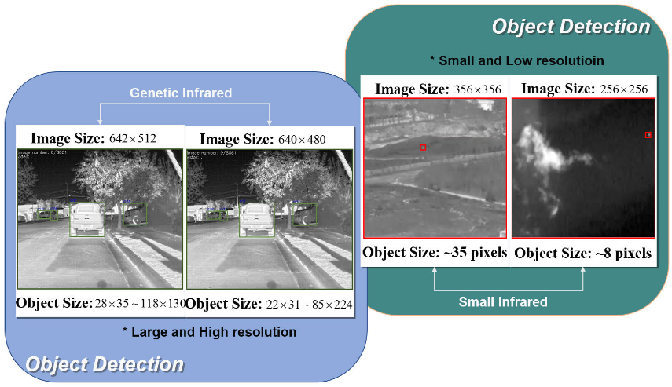

`图 1. 传统红外目标检测与红外小目标检测之间的视觉差异。`

​		早期常见的单帧红外小目标检测方法是基于模型的方法（model-based methods）。它们可以归纳为基于滤波的方法（filter-based methods）、基于人类视觉系统（human visual system）的方法和基于低秩（low-rank）的方法。其中，基于滤波的方法仅适用于单一且均匀的场景 [6]。基于人类视觉系统的方法非常适用于目标亮度相对较大、与周围背景呈现更明显差异的情况，例如红外图像块模型（infrared patch-image model，IPI）[7]、局部对比度机制（local contrast mechanism，LCM）[8] 和基于多尺度图像块的对比度度量（multiscale patch-based contrast measure，MPCM）[9]。基于低秩的方法，包括局部低秩 [10] 和非局部（non-local）低秩 [5]，显然适用于几乎所有类型的复杂且快速变化的背景，但在实践中需要借助 GPU 等进行加速，才能满足实时性要求。近年来，开发了许多新的基于模型的方法，例如通过对局部熵（local entropy）进行加权的多尺度灰度差加权图像熵（multiscale gray difference weighted image entropy，MGDWIE）[11]、基于曲面核和随机游走方法的新型局部对比度描述符（novel local contrast descriptor，NLCD）[12]、基于张量核范数部分和的非凸方法（PSTNN）[13]、称为重加权红外图像块张量（reweighted infrared patch-tensor，RIPT）模型的 IPI 模型推广 [14]，以及变换域滤波方法——非负约束变分模态分解（nonnegativity-constrained variational mode decomposition，NVMD）[15]，它们取得了更好的检测性能。然而，模型驱动（model-driven）方法容易受到杂波和噪声的影响，从而降低检测模型的鲁棒性（robustness）。它也经常无法在复杂背景中找到合适的模板或学习目标的局部对比度信息（contrast information），或者目标建模受到模型超参数的严重影响，从而导致泛化性能较差。

​		近年来，数据驱动（data-driven）的机器学习方法 [16]、[17]，特别是深度学习方法的迅速发展，使其快速成为检测红外小目标最广泛使用的方法。Wang 等人 [18] 将使用 ImageNet 大规模视觉识别挑战赛（ILSVRC）数据训练的检测模型迁移到红外小目标检测中。Nasser [19] 通过连接两个在 ImageNet 数据集上预训练的深度卷积神经网络（deep convolutional neural network，DCNN），提出了一种自动目标识别（automatic target recognition，ATR）框架。然而，如果我们直接迁移基于自然场景图像的预训练检测模型，或者使用典型的下采样（downsampling）机制直接训练 CNN，红外小目标的检测性能将受到严重限制。因此，研究人员提出了多种专门用于红外小目标检测的网络。Fan 等人 [20] 设计了一种基于 CNN 的架构，以学习适合提取目标和背景子图像的滤波器，从而提高红外弱小目标图像的检测性能。Liangkui 等人 [21] 使用七层网络，通过学习过采样（oversampling）生成的合成数据来检测红外小目标。Wang 等人 [22] 开发了一种称为 MNET 的红外小目标特征提取骨干网络。McIntosh 等人提出了目标杂波比（target-to-clutter ratio，TCR）检测网络（TCRNet）[23]，通过优化作为标准的目标杂波比（TCR）来强调红外小目标的表征。Hou 等人 [24] 通过整合手工设计的特征方法和卷积神经网络，共同学习红外小目标特征，设计了一种鲁棒的红外小目标检测网络（RISTDnet）。Zhao 等人 [25] 将检测问题建模为图像到图像的转换问题，开发了一种采用生成对抗网络（generative adversarial network，GAN）的红外小目标检测方法。Hsieh 等人 [26] 提出了一种基于分层梯度核的三层图像块模型的高速检测方法。为解决红外小目标图像中前景与背景高度不平衡的问题，Zhao 等人 [27] 通过加入图像的高层语义约束信息，开发了一种具有编码器—解码器（encoder-decoder）结构的红外小目标检测方法（TBC-Net）。

​		实际上，将红外小目标检测建模为语义分割（semantic segmentation）问题，而不是典型的目标检测问题，有助于更好地解决目标尺寸较小造成的模型检测性能损失。与一般分割网络（例如自然场景的语义分割 [28] 和医学图像中的器官分割 [29]）不同，目标形状需要被精细且清晰地分割。然而，由于成像机制不同，红外小目标的形态表现为最亮或最暗的区域，没有明显的形状先验。这是因为传感器记录的是目标在较远距离处发射的热辐射能量。因此，分割网络必须关注小目标的显著性和可区分性特征。Dai 等人 [30]、[31] 构建了一种自底向上的注意力机制（attention mechanism）模块，并将其嵌入 U-Net 或 FPN 网络结构中。与文献 [30]、[31] 类似，Li 等人 [32] 提出了密集嵌套交互模块（dense nested interactive module，DNIM），使用 U-Net 分割网络对上下文特征进行充分整合。然而，上述工作中的几乎所有网络都以具有典型下采样方案的各种分类骨干网络为基础，例如非对称上下文模块（asymmetric contextual modulation，ACM）[30] 和注意力局部对比度网络（attentional local contrast network，ALCNet）[31] 使用的 ResNet-20，以及 DNIM [32] 使用的 ResNet-18/34。这些分类骨干网络由 ImageNet 数据生成，受到特定数据分布和光谱的限制。此外，网络中的多次下采样会降低特征分辨率（feature resolution）并造成局部对比度信息丢失，这对红外小目标尤其不利。人们担忧，继续使用这些默认骨干网络无法解决红外小目标检测的根本问题。

​		为此，我们通过将红外小目标检测建模为语义分割问题，提出了一种简单而清晰的红外小目标检测框架，称为 U-Net in U-Net（UIU-Net）。它非常适用于目标尺寸小且数据量有限的红外目标检测。具体而言，它能够从头开始训练，同时改善全局和局部层级上的上下文表征（context representation）。首先，通过将残差 U 型块（ReSidual U-blocks，RSU）集成到深度监督网络中，设计了分辨率保持深度监督（RM-DS）网络，以生成深层多尺度和高分辨率特征（high-resolution features），而不是使用预训练的分类骨干网络。RM-DS 解决了特征分辨率与网络深度之间的矛盾。此外，随着网络加深，它还可以改善目标的全局上下文表征。图 2 比较了当图像分辨率降低为原来的 1/2 时，基于分类骨干网络和基于 RSU 的 U-Net 网络的深度。为了进一步突出局部层级的上下文表征，提出了交互式交叉注意力（IC-A）模块，并将其嵌入 RM-DS 网络。

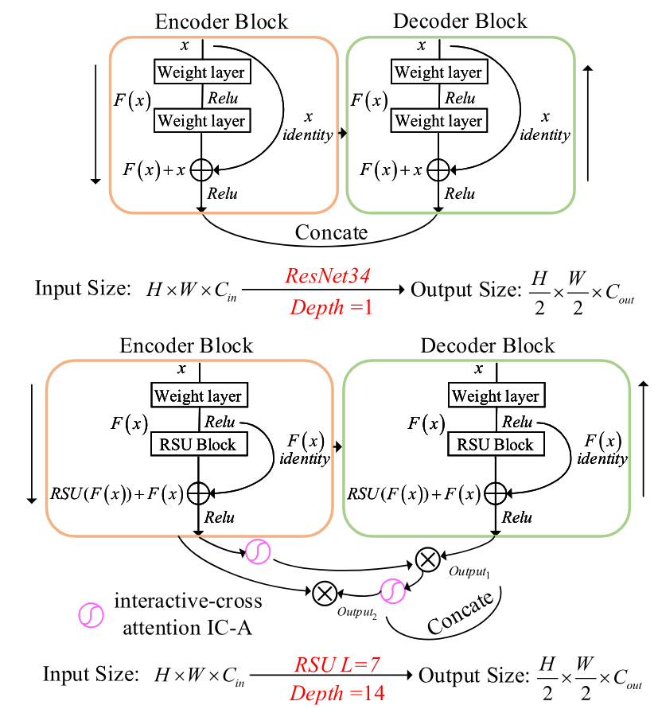

`图 2. 当图像分辨率降低为 1/2 时，基于分类骨干网络和基于 RSU 的 U-Net 网络的深度比较。`

IC-A 模块通过交互式地交叉编码低层细节和高层语义特征，替代 U-Net 中的跳跃层，从而捕获基于像素的目标之间的长距离依赖关系。UIU-Net 的实际输出是 RM-DS 网络多层输出的融合。具体而言，本文的贡献可以概括如下：

- 我们将红外小目标检测建模为语义分割问题，并提出了一种从头开始训练的交互式交叉注意力嵌套 U-Net 网络，称为 U-Net in U-Net（简称 UIU-Net）。
- 提出分辨率保持深度监督（RM-DS）网络，以学习深层多尺度特征（deep multi-scale features）并改善全局上下文表征。设计交互式交叉注意力（IC-A）模块，在低层与高层表征之间编码语义特征，以进一步增强局部上下文对比度。
- 我们在两个不同的红外单帧图像数据集，即 SRIST 数据和合成数据上评估所提出 UIU-Net 的检测性能，与几种最先进的检测方法相比取得了显著优势。此外，我们还在 ATR 地面/空中视频序列数据集上测试泛化性能，UIU-Net 同样表现出竞争力和优越性。

本文其余部分安排如下。第 II 节简要回顾目标分割和注意力机制方法。第 III 节详细介绍所提出 UIU-Net 的网络架构，包括分辨率保持深度监督模块和交互式交叉注意力模块。第 IV 节分析两个单帧图像数据集和一个视频序列数据集上的实验结果。第 V 节对未来进行展望。

## II. 相关工作（Related Work）

### A. 目标分割（Object Segmentation）

​		图像分割是一种涉及密集图像预测的像素级分类问题。卷积神经网络（convolutional neural network，CNN）的迅速发展使图像分割任务从图像块分类 [33]，发展到全卷积网络（fully convolutional network，FCN）[34]、编码器—解码器框架 [35]，再到空洞卷积（dilated convolution）框架 [36]。随后，出现了包括 ACM [30]、ALCNet [31] 和 DNIM [32] 在内的、基于语义分割的新型红外小目标检测网络。与基于模型和基于深度学习的检测方法相比，这些网络的检测性能得到了极大提高。然而，这些方法大多依赖采用典型下采样方案的分类骨干网络。即使一些研究者 [37]、[38] 更新了新型下采样方案，红外小目标的局部和全局对比度信息仍然被忽略。

与上述工作不同，我们设计了一种多尺度深度监督结构，以解决特征分辨率与网络深度之间的冲突，从而改善全局和局部上下文表征，并提高最终的检测性能。

### B. 注意力机制（Attention Mechanism）

​		注意力机制最早在计算机视觉领域提出。2014 年，谷歌旗下的 DeepMind 创建了一种用于图像分类的注意力机制，使神经网络在执行预测任务时更加关注相关的输入区域。随后，研究者还提出了多种注意力机制 [39]、[40]、[41]、[42]、[43]，并将其广泛应用于图像分类 [40]、[41]、语义分割 [40]、目标检测 [42] 等多个领域，取得了良好效果。这些嵌入通用网络（例如分类骨干网络）的注意力机制不适合红外小目标检测，因为小尺寸目标经常在深层语义特征图中消失。

​		与以往工作不同，所提出的交互式交叉注意力首先能够编码基于像素的局部上下文特征，以增强红外小目标的细节信息，而编码后的特征来自能够学习多尺度和全局特征的分辨率保持深度监督网络。通过这种整合，可以大幅提高红外小目标与背景的可区分性。

## III. 方法（Methods）

本节首先简要回顾用于语义分割的简单而有效的 U-Net 网络，然后详细讨论所提出的 UIU-Net。图 3 展示了 UIU-Net 的整体网络架构。UIU-Net 首先采用分辨率保持深度监督（RM-DS）网络，在改善全局上下文表征的同时学习深层多尺度特征，然后将这些特征输入交互式交叉注意力（IC-A）模块，以进一步编码目标的局部上下文信息。IC-A 模块还能够与 MD-DS 网络实现无缝连接。

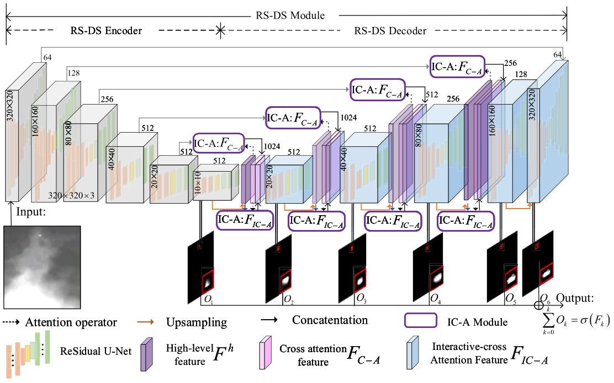

`图 3. 所提出的用于红外小目标检测的 UIU-Net 总体结构。它由两个主要模块组成：分辨率保持深度监督（RM-DS）模块和交互式交叉注意力（IC-A）模块。RM-DS 通过学习深层多尺度特征改善全局上下文表征。IC-A 对 RM-DS 特征进行编码，以进一步增强局部上下文表征。`

### A. 网络概述（Network Overview）

​		**1）U-Net 框架回顾：** 首先，我们简要回顾经典 U-Net，它最初为语义分割、尤其是医学图像分割而开发。U-Net 执行多尺度预测并提供更精细的分割特征。在编码器阶段，经过多次下采样的低分辨率特征图能够获得被分割目标的全局语义信息。解码器阶段的跳跃连接（skip connection）确保最终重建的特征图融合更多低层特征，同时混合多尺度特征。然而，多次下采样降低了特征分辨率和目标对比度，这对红外小目标检测产生了非常不利的影响。

​		**2）网络概述：** 为解决上述问题并确保红外小目标的检测性能，本文提出了一种可从头开始训练的交互式交叉注意力嵌套 U-Net 网络，称为 U-Net in U-Net（UIU-Net）。UIU-Net 不依赖经典分类骨干网络，非常适用于红外小目标检测。它首先使用分辨率保持深度监督模块，在改善全局特征表征的同时学习深层多尺度特征。这里的分辨率保持特指在编码器—解码器网络各阶段所学习的特征。随后，将各阶段学习到的特征输入交互式交叉注意力模块，该模块对目标的局部特征进行编码，以提高红外小目标的可区分能力。最后，通过最小化典型交叉熵损失（cross-entropy loss），对多个中间监督输出和最后一层进行加权与融合。

### B. 分辨率保持深度监督（RM-DS）模块

​		由于红外图像自身的成像条件，其对比度通常不高，导致目标与背景之间的可区分性非常低。再加上图像中目标尺寸较小，使用典型的基于深度学习的检测网络或基于骨干网络的分割网络难以精确定位红外小目标。本节介绍 RM-DS 网络，以克服上述困境。RM-DS 网络基于 U-Net 构建。它不仅利用最后一层，还利用多个中间层来获得完整且可区分的特征，从而得到更好的检测结果。RM-DS 网络的输出 $O$ 定义为：

$$
O=\sum_{k=0}^{K}\sigma(F_k), \tag{1}
$$

其中，$F_k$ 表示第 $k$ 层的特征，$O$ 是 RM-DS 网络的最终输出。$\sigma(\cdot)$ 表示 Sigmoid 激活函数（activation function）。

为了在网络深度和特征分辨率之间取得平衡，引入残差 U 型块（ReSidual U-blocks，RSU）模块 [44] 作为骨干网络。其详细结构如图 4 所示。RSU 模块是一种 U-Net。区别在于：1）RSU 模块以中间特征图（intermediate feature maps）而不是输入图像作为输入，以学习和编码深层多尺度特征；2）使用空洞卷积来改善各层深层特征的分辨率。对于浅层，只将最后一个卷积替换为空洞卷积（见图 4(a)）；然而，对于深层，所有卷积均被具有不同膨胀率（dilation rate）的空洞卷积替换（见图 4(b)），由于深层特征图尺寸较小，因此内存消耗较低；3）为了降低计算成本，在 RSU 模块中引入了池化操作，但为了减少特征损失，没有在附加的 RSU 模块中加入池化操作。RSU 骨干网络 $U$ 的特征定义为 $F_U=U(f(x))+f(x)$，其中 $f(x)$ 为中间特征图。

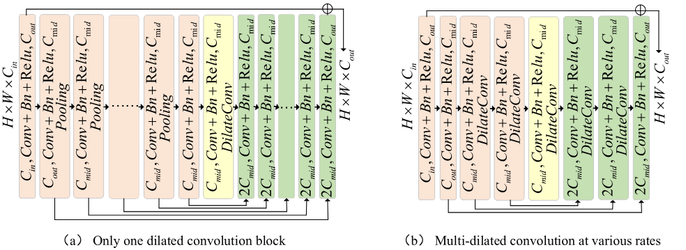

`图 4. 分辨率保持深度监督模块中残差 U 型块的两种模式示意图。（a）仅在最后一层使用一个空洞卷积。（b）在多个层中使用具有不同膨胀率的多个空洞卷积。`
$$
O=\sum_{k=0}^{K}\sigma(F_{U_k})=\sum_{k=0}^{K}\sigma\left(U_k(f(x))+f(x)\right), \tag{2}
$$

其中，$U_k(\cdot)$（$k=1,2,\cdots,K$）表示 $K$ 种基于空洞卷积的模式，包括仅将最后一个卷积替换为空洞卷积，以及将所有卷积替换为具有不同膨胀率的空洞卷积。具体使用哪一种取决于实际情况。

得益于这种设计，各阶段内部网络深度的增加不会影响特征分辨率，而各阶段深度的增长有助于整体网络深度的增加。同时，网络深度的增加增强了全局上下文表征。然而，仅依靠 MS-DS 模块无法更加精确地定位红外小目标，尤其是在复杂且不断变化的背景下。

### C. 交互式交叉注意力（IC-A）模块

本节设计一种交互式交叉注意力模块，以编码局部上下文表征并显著提高检测性能。图 5 展示了详细架构。该模块替代 U-Net 中原有的跳跃连接，保留来自解码器层的更多上下文信息。具体而言，低层细节特征和高层语义特征是交互式交叉注意力模块的编码对象。跨通道注意力（cross-channel attention）和交互式交叉空间注意力（interactive-cross spatial attention）是交互式交叉注意力模块的两个子输出。

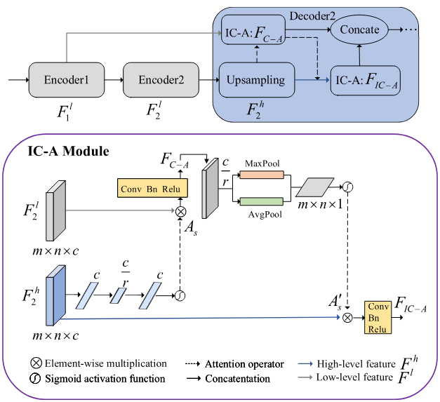

`图 5. 交互式交叉注意力模块的详细结构。`

高层语义特征的每个通道（channel）都可以用作特定的目标响应，并且它们与不同的语义响应（semantic response）相关联。通过利用它们之间的相互依赖关系，我们可以集中精力发现感兴趣的红外小目标。

我们将 $U=[u_1,u_2,\cdots,u_C]$ 定义为深层网络经过残差 U 型块 [44] 后的编码器高层特征，其中 $u_c=F_c^h\in\mathbb{R}^{W\times H}$ 是第 $c$ 个通道的特征，$C$ 是通道总数。对于这些特征，我们首先采用 AdaptiveAvgPool2d（简称 $F_{ad}$）遍历特征：

$$
z_c=F_{ad}(u_c)=\frac{1}{H\times W}\sum_{i=1}^{H}\sum_{j=1}^{W}u_c(i,j), \tag{3}
$$

其中，$z_c$（$c=1,2,\cdots,C$）表示第 $c$ 个通道。$H$、$W$ 是高层特征的尺寸。$u_c(i,j)$ 是第 $c$ 个通道中各位置的特征。

随后，使用激励操作（简称 $F_{ex}$）（$C\rightarrow C/r$、$C/r\rightarrow C$，$r=4$）对高层特征（$F^h$）进行重塑，以最小化网络参数数量。

$$
A_s=F_{ex}(z)=\sigma\left(B\left(W_2\delta\left(B(W_1z)\right)\right)\right), \tag{4}
$$

其中，$\delta(\cdot)$ 和 $B(\cdot)$ 分别为修正线性单元（ReLU）和批量归一化（BN）。$W_1\in\mathbb{R}^{\frac{C}{r}\times C}$ 和 $W_2\in\mathbb{R}^{C\times\frac{C}{r}}$ 分别表示 $C\rightarrow C/r$ 和 $C/r\rightarrow C$ 激励操作。

最后，跨通道特征是与低层特征进行加权求和得到的特征：

$$
F_{C-A}=A_s\otimes F^l=A_s\otimes\left[U^l(f(x))+f(x)\right], \tag{5}
$$

其中，$\otimes$ 表示逐元素相乘（element-wise multiplication），$F^l$ 表示编码器中的低层特征。

考虑到红外小目标检测不能忽略目标的局部细节信息，以增强目标与背景之间的可区分性，进一步设计了交互式交叉空间注意力。它首先对 $F_{C-A}$ 执行激励操作 $F_{ex}$（$C\rightarrow C/r$，$r=4$），然后使用平均池化（$P_{avg}$）和最大池化（$P_{max}$）操作将其聚合。

$$
A'_s=\delta\left(C^{3\times3}\left(P_{avg}(F_{C-A}^{1\times1});P_{max}(F_{C-A}^{1\times1})\right)\right), \tag{6}
$$

其中，$C^{3\times3}$ 和 $C^{1\times1}$ 分别表示卷积操作。$F_{C-A}^{1\times1}$ 表示经过 $1\times1$ 卷积后的 $F_{C-A}$。

交互式交叉空间注意力特征是与高层特征进行加权求和得到的特征：

$$
F_{IC-A}=A'_s\otimes F^h=A'_s\otimes\left[U^h(f(x))+f(x)\right], \tag{7}
$$

其中，$\otimes$ 表示逐元素相乘，$F^h$ 表示编码器中的高层特征。

最后，UIU-Net 的输出定义为：

$$
O=\sum_{k=0}^{K}\delta(f(U_k))=\sum_{k=0}^{K}\delta\left([F_{C-A}^{k},F_{IC-A}^{k}]\right). \tag{8}
$$

## IV. 实验（Experiments）

### A. 数据集描述（Dataset Description）

​		**1）单帧红外小目标检测（SIRST）数据 [30]：** SIRST 数据集¹ 是一个小型的、公开的单帧红外小目标检测数据集，通过从序列中选择图像构建，于 2020 年由亚利桑那大学公开。它包含从数百段不同场景的真实视频中选取的 427 张不同场景的代表性图像。这些图像使用短波、中波和 950 nm 波长采集。它们具有五种不同形式的标注，以支持检测任务和分割任务的模型。这一数据集中的大多数红外小目标非常暗，埋没在复杂背景中，并且存在大量杂波。此外，该数据集中只有 35% 的目标属于最亮像素。在实验中，我们从合成多场景红外小目标数据集（MSISTD）² 中随机添加 80 张代表性图像用于模型验证，并从 SIRST 中选取 20 张真实图像进行定量分析（quantitative analysis）。

¹ https://github.com/YimianDai/open-acm  
² https://github.com/Crescent-Ao/MSISTD

​		**2）合成红外小目标检测数据 [45]：** 合成数据集（synthetic dataset）³ 是一个大型、公开的合成单帧红外小目标检测数据集。它通过将真实红外小目标或二维高斯函数随机叠加到从互联网获取的高分辨率自然场景图像上构建。其中，真实红外小目标选自称为“AllSeqs”的 11 个真实序列和称为“Single”的 100 张独立红外图像。该合成数据集于 2020 年由南京理工大学和悉尼大学公开。目前，只有文献 [45] 中提到的配置 I 已公开并可获得。在这一部分数据集中，“Single”作为测试集，而“AllSeqs”和合成图像作为训练集。这一数据集中的大多数红外小目标埋没在复杂背景中，并且其标注略大于目标的实际位置。

³ https://github.com/wanghuanphd/MDvsFA_cGAN

​		**3）ATR 地面/空中背景红外检测与跟踪数据 [46]：** 地面/空中数据⁴ 是一个红外检测与跟踪数据集，包含一个或多个固定翼无人机目标，这些目标在尺寸、干扰、存储、运动性及其他属性方面存在差异。该数据集由国防科技大学电子科学学院 ATR 重点实验室公开。数据采集于 2017 年至 2019 年之间，图像是在 3–5 μm 波长下获得的，空间分辨率为 10–100 m。采集场景包括天空、地面和其他各种场景，总计 22 个数据片段、30 条轨迹、16,177 帧和 16,944 个目标。每个目标对应一个标注位置，每个数据片段对应一个标注文件。这一数据集中的红外目标埋没在复杂且不断变化的背景中，例如天空、地面以及空地交界区域等。

⁴ https://www.scidb.cn/en/detail?dataSetId=720626420933459968&version=V1&dataSetType=journal&tag=2&language=zh_CN

​		**4）实现细节：** 我们在 PyTorch 平台上使用 NVIDIA GeForce GTX 1080（8 GB 显存）对所提出的 UIU-Net 进行实验。在网络训练期间，每张图像通过图像缩放和裁剪，甚至颜色空间处理，被调整为 320×320。对于具有 3 个波段、大小为 320×320 像素的输入图像，UIU-Net 的浮点运算量（Flops）和参数量（Params）分别为 33.64G 和 50.54M。网络优化采用 Adam 优化器，批量大小（batch size）设为 3，训练轮数（epochs）为 500。

### B. 评价指标（Evaluation Metrics）

​		在本文中，我们将红外小目标检测建模为语义分割问题。通过计算三个常用指标来评价检测性能，即交并比（Intersection over Union，IoU）、归一化交并比（normalized Intersection over Union，nIoU）和受试者工作特征（receiver operating characteristic，ROC）曲线（curve）。一般来说，这三个指标的数值越高，意味着在红外小目标检测任务中的检测性能越好。

**1）交并比（Intersection Over Union，IoU）：** IoU 广泛应用于语义分割。其计算方式为像素真实值与预测值的交集除以它们的并集。

$$
IoU=\frac{A_{\mathrm{inter}}}{A_{\mathrm{all}}}=\frac{\displaystyle\sum_{i}^{N}\sum_{m}^{M}TP_m^i}{\displaystyle\sum_i^N\sum_m^M T_m^i+\sum_i^N\sum_m^M P_m^i-\sum_i^N\sum_m^M TP_m^i},\tag{9}
$$

其中，$M$ 是每张图像/每个样本的目标数量，$N$ 是测试集的样本总数。$A_{\mathrm{inter}}$ 和 $A_{\mathrm{all}}$ 分别表示测试集中所有真实目标与预测目标的交集和并集的求和结果。$T$、$P$ 和 $TP$ 分别表示参考标签（ground-truth）、预测结果以及真正例（true positive）像素数量。$TP_m^i$、$T_m^i$、$P_m^i$ 中的 $i$、$m$ 表示第 $i$ 个样本中的第 $m$ 个目标。

**2）归一化交并比（Normalized Intersection Over Union，nIoU）：** 通过目标及其周围像素计算的信杂比（signal-to-clutter ratio，SCR）广泛用于传统方法，但在基于深度学习的语义分割中是无限的。为了更好地平衡模型驱动和数据驱动方法，文献 [30] 引入归一化交并比（normalized intersection over union，nIoU）作为 IoU 的后续指标。其定义为：

$$
nIoU=\frac{1}{N}\sum_i^N\frac{TP[i]}{T[i]+P[i]-TP[i]},\tag{10}
$$

其中，$N$ 仍表示测试集中的样本总数。$\frac{TP[i]}{T[i]+P[i]-TP[i]}$ 表示每个样本的 IoU。$T$、$P$ 和 $TP$ 与公式（9）中的含义相同，$TP[i]$、$T[i]$、$P[i]$ 中的 $i$ 表示第 $i$ 个样本。

**3）受试者工作特征（ROC）曲线：** ROC 展示假正例（false positive）率（FPR）和真正例率（true positive rate，TPR）之间的变化趋势。与仅反映固定阈值下分割效果的 IoU 不同，它表明变化阈值下的整体效果。
$$
TPR_{thr}=\frac{TP_{thr}}{P_{thr}},\qquad FPR_{thr}=\frac{FP_{thr}}{P_{thr}},\tag{11}
$$

其中，$TP$、$P$ 与公式（9）和公式（10）中的含义相同。$FP$ 表示假正例像素数量，$thr$ 表示阈值变量。

### C. 消融研究（Ablation Study）

​		本节在两个红外小目标数据集上进行了两组消融实验（ablation experiments），以评估所提出 UIU-Net 的有效性。具体而言，我们研究了：1）不同骨干网络下 UIU-Net 的检测性能比较；2）UIU-Net 中各个模块的独立贡献。对于消融研究的每一部分，我们都使用相同的参数设置严格重新训练整个 UIU-Net。

`表 I. 嵌入 UIU-Net 的不同骨干网络的效果。最佳结果以粗体显示。`

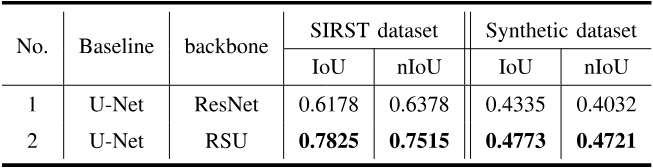

`表 II. 输入尺寸为 320×320 时 UIU-Net 中不同组成部分的效果。最佳结果以粗体显示。`

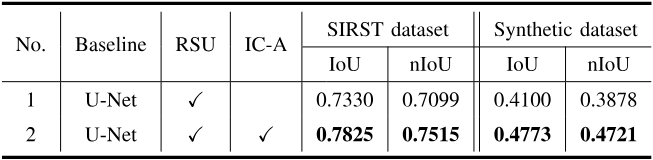

**1）不同骨干网络下 UIU-Net 的检测性能比较：** 我们在表 I 中比较了采用经典残差骨干网络和多尺度残差 U 型块模块的 U-Net 的 IoU 与 nIoU 值。结果表明，在 SIRST 数据集上，IoU 值从 0.6178 提高到 0.7825；在合成数据集上，从 0.4335 提高到 0.4773。对于 nIoU，SIRST 数据集提高了约 0.12，达到 0.7515；合成数据集提高了约 0.07，达到 0.4721。上述分析清楚地证明了多尺度残差骨干网络对红外小目标检测的有效性，并且其学习深层高分辨率特征的能力能够在很大程度上弥补微小目标丢失或特征表征不佳的问题。

**2）UIU-Net 中各个模块的独立贡献：** 我们在表 II 中比较了两种增量配置的 IoU 和 nIoU 值。对于增量模块（U-Net + RSU），在 SIRST 数据集上，IoU 值从 0.7330 提高到 0.7825；在合成数据集上，从 0.4100 提高到 0.4773。对于 nIoU，SIRST 数据集提高了约 0.05，达到 0.7515；合成数据集提高了约 0.09，达到 0.4721。上述分析清楚地证明了增量模块对所提出 UIU-Net 的有效性。同时，这也表明，将交互式交叉编码器整合到深层高分辨率和多尺度特征中是非常必要的。

### D. SIRST 数据上的结果与分析（Results and Analysis on the SIRST Data）

表 III 列出了九种红外检测方法的检测精度（detection accuracy），包括红外图像块模型（IPI）[7]、局部对比度度量（LCM）[8]、重加权红外图像块张量（RIPT）[14]、多尺度灰度差加权图像熵（MGDWIE）[11]、非负约束变分模态分解（NVMD）[15]、张量核范数部分和（PSTNN）[13]、新型局部对比度描述符（NLCD）[12]、非对称上下文调制（ACM）[30]、漏检（miss detection）与虚警（false alarm）条件生成对抗网络（MDvsFA-cGAN）[45]，以及轻量级卷积神经网络（TBC-Net）[27]，并使用两个常用指标 IoU 和 nIoU 进行衡量；图 6 则展示了四种示例方法的相应检测结果和参考标签。

`表 III. 在 SIRST 红外小目标数据集上，不同方法在 IoU 和 nIoU 值方面的定量比较。最佳结果以粗体显示。`

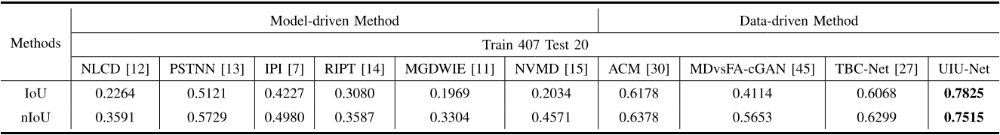

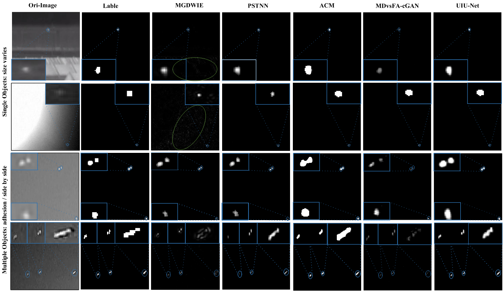

`图 6. SIRST 数据集上若干代表性方法的可视化示例。蓝色和绿色圆圈分别表示真正例目标和假正例目标。蓝色矩形框内是放大后的真正例目标，以便更清楚地区分不同方法的检测精度。`

**1）定量比较（quantitative comparison）：** 总体而言，得益于**特征表征能力**，使用数据驱动网络得到的检测结果明显优于基于模型的方法，所提出的数据驱动网络优于其他比较方法，在红外小目标检测中取得了最佳 IoU 和 nIoU 值。对于数据量少且真实的 SIRST 数据集，UIU-Net 学习了深层多尺度和高分辨率特征，并关注全局和局部对比度。这在一定程度上带来了更好的检测性能和更低的漏检率。ACM 和 TBC-Net 依赖在 ImageNet 数据集上训练的分类骨干网络，这使得网络主要关注 SIRST 中与 ImageNet 分布相同的目标，而不是 SIRST 数据本身，因此检测性能受到限制，也无法从根本上改善检测性能。MDvsFA-cGAN 模型通过对抗生成网络平衡了漏检率和虚警率。然而，MDvsFA-cGAN 模型较高的复杂性使其无法应用于 SIRST 的小规模数据，从而使 IoU 和 nIoU 值低于其他数据驱动方法。

​		与固定阈值下的 IoU 和 nIoU 值不同，我们还在图 7 中给出了上述方法在动态阈值下的 ROC 曲线。可以观察到，所提出的方法仍然表现最佳。更具体地说，由于数据质量低，IPI 仅在特定的坐标区间内显示。

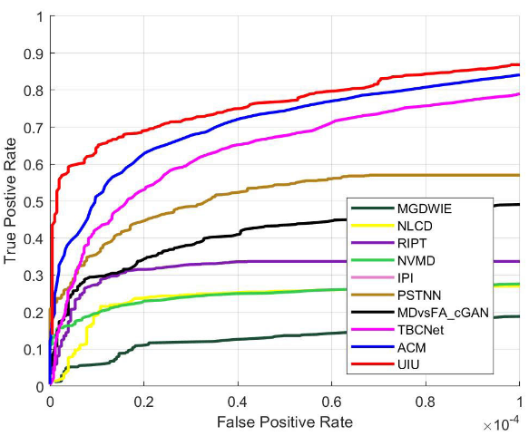

`图 7. SIRST 数据集的 ROC 曲线。值得注意的是，IPI 的 ROC 结果差到足以被显示出来。`

**2）可视化比较（visual comparison）：** 图 6 展示了 SIRST 数据集的一些可视化示例，包括单目标和多目标。显然，特征表达能力有限的模型驱动方法产生了较高的漏检率。其可视化效果表现为检测出的目标像素数少于参考标签。其他三种能够自动学习特征的数据驱动方法取得了更好的检测结果，这与表 III 中的定量结果一致。具体而言，所提出的方法获得了最优的可视化结果，尤其是对于紧密相连的多个目标（见图 6 第三行和第四行中的蓝色圆圈）。但对于 ACM 和 MDvsFA-cGAN，其可视化结果存在粘连或像素丢失（如图 6 第二列和第三列所示）。尤其是对于使用小数据集（SIRST）训练的 MDvsFA-cGAN，其可视化结果甚至比基于模型的 PSTNN 方法更差。

### E. 合成数据上的结果与分析（Results and Analysis on the Synthetic Data）

类似地，合成数据集上的定量检测性能列于表 IV，相应的可视化结果如图 8 所示。

`表 IV. 在合成数据集上，不同方法在 IoU 和 nIoU 值方面的定量比较。最佳结果以粗体显示。`

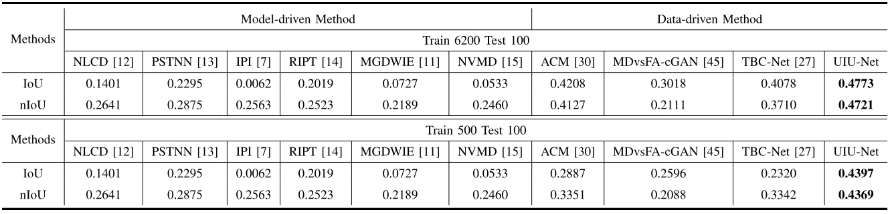

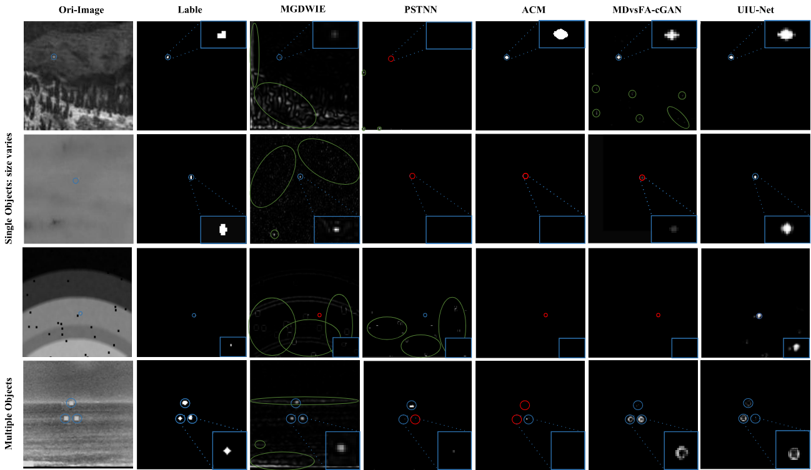

`图 8. 合成数据集上若干代表性方法的可视化示例。蓝色、绿色和红色圆圈分别表示真正例目标、假正例目标和漏检目标。蓝色矩形框内是放大后的特定目标，以便更清楚地区分不同方法的检测精度。`

此外，我们增加了一个实验，以验证 UIU-Net 是否过度依赖数据集大小。为回答这个问题，设计了两个子实验。具体而言：1）大规模红外训练数据集：在人工移除“较差”图像后，选择配置 I 中的 6,200 张图像进行训练。这里的“较差”图像指预处理后具有空值或负值的图像。2）小规模红外训练数据集：从 1）中随机选择 500 张图像，重新构建成小样本数据。与 SIRST 数据类似，最终检测输出是最优分割结果的最小外接矩形，比较方法使用的定量指标是 IoU、nIoU 和 ROC 曲线。

**1）定量比较：** 首先，我们给出了数据集之间的纵向比较。与以真实 SIRST 数据集作为训练数据相比，表 IV 中合成数据集的定量结果表现出更差的 IoU 和 nIoU 值。主要有两个原因：1）分辨率差距：合成数据集的分辨率为 128×128，低于 SIRST 数据集。较低的图像分辨率限制了特征区分能力和上下文表征能力。**2）参考标注（ground-truth annotations）**：合成数据中的目标标注范围被错误地扩大，而这种标注方式对基于像素的方法的定量评价尤其不友好。但 SIRST 数据中的参考标注与真实目标更加接近。

其次，我们展示了数据量比较。合成数据集中大规模样本与小规模样本的比例为 12:1。虽然所提出 UIU-Net 的 IoU 和 nIoU 降低了约 4%，但仍然是最优的。此外，包括 SIRST 和小规模合成数据在内的两个小规模数据集的结果表明，UIU-Net 对小规模数据具有鲁棒性。这也间接表明 UIU-Net 非常适合实际应用。

最后，上述比较方法的 ROC 曲线如图 10 所示，所提出的方法仍然表现最佳。不幸的是，由于背景复杂、目标多变以及图像质量不足，没有一种模型驱动方法能够在坐标范围内显示。在小样本数据集上欠拟合的 MDvsFA-cGAN，其检测性能同样很差。这强调了数据量和模型拟合在数据驱动方法中的重要性。

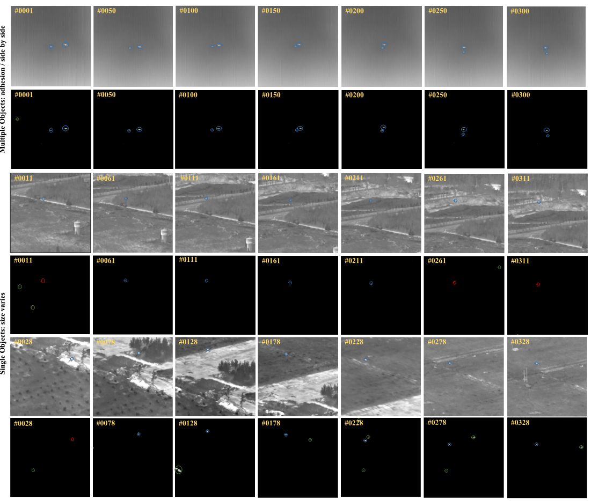

`图 9. UIU-Net 在 ATR 地面/空中数据集上的可视化结果。蓝色、绿色和红色圆圈分别表示正确检测、错误检测和漏检。`

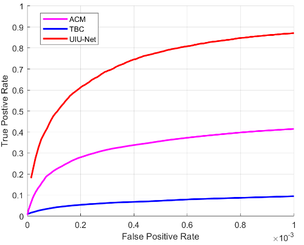

`图 10. 合成数据集的 ROC 曲线。值得注意的是，所有模型驱动方法和 MDvdFA_cGAN 的 ROC 结果差到足以被显示出来。`

**2）可视化比较：** 对于图 8 中的可视化结果，所提出的 UIU-Net 对蓝色矩形框中所指示目标的结果与参考标签具有最高的相似性。然而，如图 8 第四行所示，尽管保证了精度，一些图像仍存在漏检。对于其他数据驱动方法，与参考标签相比，ACM 输出的目标引入了错误边界。由于参考标签不准确，即使使用大规模样本，MDvsFA-cGAN 也无法充分平衡虚警率（false alarm rate）和漏警率（miss rate）（如图 8 第六列所示）。对于模型驱动方法，PSTNN 实现了粗略的目标定位（object localization），而 MGDWIE 具有更高的漏检率和误检率，并且精度更低。

### F. 泛化分析（Generalization Analysis）

本节使用在 SIRST 真实红外小目标上训练的检测模型，验证 UIU-Net 的泛化能力。主要包含两部分实验。

**1）合成数据：** 与第 IV-E 节相同，选取了 100 张测试图像来验证 UIU-Net 的泛化能力，如表 V 所示。结果表明，使用 408 张 SIRST 数据训练的 UIU-Net，其定量结果超过了使用 500 张合成数据训练的模型，尽管低于使用 6,200 张合成数据训练的结果。此外，无论使用 6,200 张还是 500 张训练数据，它都超过了表 IV 中的其他比较方法。

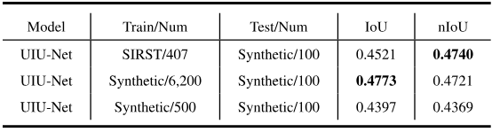

`表 V. 不同训练数据下 UIU-Net 的定量比较。最佳结果以粗体显示。`

**2）ATR 序列数据：** 由于公开的单帧红外小目标数据集较少，我们使用 ATR 序列数据作为测试数据，以验证 UIU-Net 的泛化能力。这引出了一个问题：所提出的 UIU-Net 在视频序列数据集上的表现如何？由于中心点标注的限制，我们选取 data2、data6 和 data7 片段进行可视化验证，如图 9 所示，每隔 50 帧展示一个检测结果。对于 data2，UIU-Net 具有良好的检测性能。除 #0001 外，所有可视化结果对于近距离、天空背景下交叉飞行的无人机都表现良好（见图 9 第 1—2 行）。由于地面背景复杂且未考虑时间性，在 data6 中，对于靠近原始地面背景飞行的无人机，漏检问题更加严重（见图 9 第 3—4 行）。与前两个数据片段相比，data7 的地面变化总是包含闪光元素，干扰无人机检测（见图 9 第 5—6 行）。

总之，在 SIRST 数据集上训练的 UIU-Net 模型，在三个视频数据片段的小目标检测中表现出优越的泛化性能。目前，显著性目标检测（salient object detection）领域也存在其他一些工作，例如基于对比度的滤波 [47]、上下文感知显著性 [48]、谱残差方法 [49] 等，它们同样能够在视频目标检测中实现较高的泛化能力。

​		目前，检测未知场景或未知目标仍然是一个具有挑战性且值得关注的研究问题。已有一些工作，例如背景减除（background subtraction） [50]、场景无关的端到端时空特征学习框架 [51]、元知识学习（meta-knowledge learning）和域适应（domain adaptation） [52]，在未见场景（unseen scenarios）中取得了较高的鲁棒性和泛化能力。实际上，图 9 所示实验是一个在未见视频数据集（ATR 地面/空中视频数据集）上进行目标检测的案例。更具体地说，ATR 数据集是一个红外检测与跟踪数据集，包含一个或多个固定翼无人机目标，这些目标在尺寸、干扰、存储、运动性及其他属性方面存在差异（与 SIRST 数据集相比）。这自然带来了更多需要检测的未见目标。此外，图像背景具有多样性，包括天空、地面等，因此也带来了更多未见场景（与 SIRST 数据集相比）。

## V. 结论（Conclusion）

本文提出了一种交互式交叉注意力嵌套 U-Net 网络，称为 UIU-Net。UIU-Net 在不降低目标分辨率的情况下增加网络深度，并且不依赖分类骨干网络，从而避免下采样过程中小目标信息的丢失。此外，通过引入交互式交叉注意力模块，可以在改善目标全局和局部上下文表征的同时，对深层多尺度特征进行编码。在 SIRST 和合成数据集上的定量实验，以及在 ATR 地面/空中数据集上的泛化研究，证明了 UIU-Net 的优越性和效率。UIU-Net 为红外小目标检测带来了新的视角，其鲁棒性和稳定性使其成为现实应用中的一种受欢迎选择。因此，未来工作将集中于微调网络，以提高目标检测精度和效率，特别是在复杂视频序列中。

随着传感器的改进，多源数据采集的可行性和普及程度不断提高。多源数据中的目标，例如可见光和红外数据中的目标，不仅具有不同的属性，还具有相互交叉和互补的信息。未来将研究基于深度学习的多源数据融合（multi-source data fusion）小目标检测 [53]、[54]，以提高目标检测性能。此外，我们还将关注影响模型适应不同场景能力的关键因素，并进一步提高模型对未知场景的泛化能力。

## 致谢（Acknowledgment）

作者感谢南京航空航天大学提供 SIRST 数据集、南京理工大学提供 Synthetic 数据集，以及国防科技大学提供地面/空中背景数据。

## 参考文献（References）

[1] T. R. Goodall, A. C. Bovik, and N. G. Paulter, “Tasking on natural statistics of infrared images,” IEEE Trans. Image Process., vol. 25, no. 1, pp. 65–79, Jan. 2016.

[2] X. Wu, W. Li, D. Hong, R. Tao, and Q. Du, “Deep learning for unmanned aerial vehicle-based object detection and tracking: A survey,” IEEE Geosci. Remote Sens. Mag., vol. 10, no. 1, pp. 91–124, Mar. 2022.

[3] S. K. Biswas and P. Milanfar, “Linear support tensor machine with LSK channels: Pedestrian detection in thermal infrared images,” IEEE Trans. Image Process., vol. 26, no. 9, pp. 4229–4242, Sep. 2017.

[4] P. Wang and X. Bai, “Thermal infrared pedestrian segmentation based on conditional GAN,” IEEE Trans. Image Process., vol. 28, no. 12, pp. 6007–6021, Dec. 2019.

[5] H. Zhu, H. Ni, S. Liu, G. Xu, and L. Deng, “TNLRS: Target-aware non-local low-rank modeling with saliency filtering regularization for infrared small target detection,” IEEE Trans. Image Process., vol. 29, pp. 9546–9558, 2020.

[6] T. W. Bae, F. Zhang, and I. S. Kweon, “Edge directional 2D LMS filter for infrared small target detection,” Infr. Phys. Technol., vol. 55, no. 1, pp. 137–145, Jan. 2012.

[7] C. Q. Gao, D. Meng, Y. Yang, Y. Wang, X. Zhou, and A. G. Hauptmann, “Infrared patch-image model for small target detection in a single image,” IEEE Trans. Image Process., vol. 22, no. 12, pp. 4996–5009, Dec. 2013.

[8] C. L. P. Chen, H. Li, Y. Wei, T. Xia, and Y. Y. Tang, “A local contrast method for small infrared target detection,” IEEE Trans. Geosci. Remote Sens., vol. 52, no. 1, pp. 574–581, Jan. 2014.

[9] Y. Wei, X. You, and H. Li, “Multiscale patch-based contrast measure for small infrared target detection,” Pattern Recognit., vol. 58, pp. 216–226, Oct. 2016.

[10] Y. He, M. Li, J. Zhang, and Q. An, “Small infrared target detection based on low-rank and sparse representation,” Infr. Phys. Technol., vol. 68, pp. 98–109, Jan. 2015.

[11] H. Deng, X. Sun, M. Liu, C. Ye, and X. Zhou, “Infrared small-target detection using multiscale gray difference weighted image entropy,” IEEE Trans. Aerosp. Electron. Syst., vol. 52, no. 1, pp. 60–72, Feb. 2016.

[12] Y. Qin, L. Bruzzone, C. Gao, and B. Li, “Infrared small target detection based on facet kernel and random walker,” IEEE Trans. Geosci. Remote Sens., vol. 57, no. 9, pp. 7104–7118, Sep. 2019.

[13] L. Zhang and Z. Peng, “Infrared small target detection based on partial sum of the tensor nuclear norm,” Remote Sens., vol. 11, no. 4, p. 382, Feb. 2019.

[14] Y. Dai and Y. Wu, “Reweighted infrared patch-tensor model with both nonlocal and local priors for single-frame small target detection,” IEEE J. Sel. Topics Appl. Earth Observ. Remote Sens., vol. 10, no. 8, pp. 3752–3767, Aug. 2017.

[15] X. Wang, Z. Peng, P. Zhang, and Y. He, “Infrared small target detection via nonnegativity-constrained variational mode decomposition,” IEEE Geosci. Remote Sens. Lett., vol. 14, no. 10, pp. 1700–1704, Oct. 2017.

[16] D. Hong, L. Gao, J. Yao, B. Zhang, A. Plaza, and J. Chanussot, “Graph convolutional networks for hyperspectral image classification,” IEEE Trans. Geosci. Remote Sens., vol. 59, no. 7, pp. 5966–5978, Jul. 2021.

[17] D. Hong et al., “More diverse means better: Multimodal deep learning meets remote-sensing imagery classification,” IEEE Trans. Geosci. Remote Sens., vol. 59, no. 5, pp. 4340–4354, Aug. 2021.

[18] W. Wang, H. Qin, W. Cheng, C. Wang, H. Leng, and H. Zhou, “Small target detection in infrared image using convolutional neural networks,” in Proc. SPIE, vol. 10462, 2017, Art. no. 1046250.

[19] N. M. Nasrabadi, “DeepTarget: An automatic target recognition using deep convolutional neural networks,” IEEE Trans. Aerosp. Electron. Syst., vol. 55, no. 6, pp. 2687–2697, Dec. 2019.

[20] Z. Fan, D. Bi, L. Xiong, S. Ma, L. He, and W. Ding, “Dim infrared image enhancement based on convolutional neural network,” Neurocomputing, vol. 272, pp. 396–404, Jan. 2018.

[21] L. Liangkui, W. Shaoyou, and T. Zhongxing, “Using deep learning to detect small targets in infrared oversampling images,” J. Syst. Eng. Electron., vol. 29, no. 5, pp. 947–952, Oct. 2018.

[22] K. Wang, S. Li, S. Niu, and K. Zhang, “Detection of infrared small targets using feature fusion convolutional network,” IEEE Access, vol. 7, pp. 146081–146092, 2019.

[23] B. McIntosh, S. Venkataramanan, and A. Mahalanobis, “Infrared target detection in cluttered environments by maximization of a target to clutter ratio (TCR) metric using a convolutional neural network,” IEEE Trans. Aerosp. Electron. Syst., vol. 57, no. 1, pp. 485–496, Feb. 2021.

[24] Q. Hou, Z. Wang, F. Tan, Y. Zhao, H. Zheng, and W. Zhang, “RISTDnet: Robust infrared small target detection network,” IEEE Geosci. Remote Sens. Lett., vol. 19, pp. 1–5, 2022.

[25] B. Zhao, C. Wang, Q. Fu, and Z. Han, “A novel pattern for infrared small target detection with generative adversarial network,” IEEE Trans. Geosci. Remote Sens., vol. 59, no. 5, pp. 4481–4492, May 2021.

[26] T.-H. Hsieh, C.-L. Chou, Y.-P. Lan, P.-H. Ting, and C.-T. Lin, “Fast and robust infrared image small target detection based on the convolution of layered gradient kernel,” IEEE Access, vol. 9, pp. 94889–94900, 2021.

[27] M. Zhao, L. Cheng, X. Yang, P. Feng, L. Liu, and N. Wu, “TBC-Net: A real-time detector for infrared small target detection using semantic constraint,” 2019, arXiv:2001.05852.

[28] R. Strudel, R. Garcia, I. Laptev, and C. Schmid, “Segmenter: Transformer for semantic segmentation,” in Proc. IEEE/CVF Int. Conf. Comput. Vis. (ICCV), Oct. 2021, pp. 7262–7272.

[29] D. Zhang, J. Zhang, Q. Zhang, J. Han, S. Zhang, and J. Han, “Automatic pancreas segmentation based on lightweight DCNN modules and spatial prior propagation,” Pattern Recognit., vol. 114, Jun. 2021, Art. no. 107762.

[30] Y. Dai, Y. Wu, F. Zhou, and K. Barnard, “Asymmetric contextual modulation for infrared small target detection,” in Proc. IEEE Winter Conf. Appl. Comput. Vis. (WACV), Jan. 2021, pp. 950–959.

[31] Y. Dai, Y. Wu, F. Zhou, and K. Barnard, “Attentional local contrast networks for infrared small target detection,” IEEE Trans. Geosci. Remote Sens., vol. 59, no. 11, pp. 9813–9824, Nov. 2021.

[32] B. Li et al., “Dense nested attention network for infrared small target detection,” 2021, arXiv:2106.00487.

[33] D. Hong, J. Yao, D. Meng, Z. Xu, and J. Chanussot, “Multimodal GANs: Toward crossmodal hyperspectral–multispectral image segmentation,” IEEE Trans. Geosci. Remote Sens., vol. 59, no. 6, pp. 5103–5113, Jun. 2021.

[34] J. Long, E. Shelhamer, and T. Darrell, “Fully convolutional networks for semantic segmentation,” in Proc. IEEE Conf. Comput. Vis. Pattern Recognit. (CVPR), Jun. 2015, pp. 3431–3440.

[35] V. Badrinarayanan, A. Kendall, and R. Cipolla, “SegNet: A deep convolutional encoder–decoder architecture for image segmentation,” IEEE Trans. Pattern Anal. Mach. Intell., vol. 39, no. 12, pp. 2481–2495, Dec. 2015.

[36] H. Wu, J. Zhang, K. Huang, K. Liang, and Y. Yu, “FastFCN: Rethinking dilated convolution in the backbone for semantic segmentation,” 2019, arXiv:1903.11816.

[37] Y. Li, Y. Chen, N. Wang, and Z.-X. Zhang, “Scale-aware trident networks for object detection,” in Proc. IEEE/CVF Int. Conf. Comput. Vis. (ICCV), Oct. 2019, pp. 6054–6063.

[38] B. Singh and L. S. Davis, “An analysis of scale invariance in object detection—SNIP,” in Proc. IEEE/CVF Conf. Comput. Vis. Pattern Recognit., Jun. 2018, pp. 3578–3587.

[39] A. Vaswani et al., “Attention is all you need,” in Proc. Adv. Neural Inf. Process. Syst., 2017, pp. 5998–6008.

[40] M.-H. Guo, Z.-N. Liu, T.-J. Mu, and S.-M. Hu, “Beyond self-attention: External attention using two linear layers for visual tasks,” 2021, arXiv:2105.02358.

[41] J. Hu, L. Shen, and G. Sun, “Squeeze-and-excitation networks,” in Proc. IEEE/CVF Conf. Comput. Vis. Pattern Recognit., Jun. 2018, pp. 7132–7141.

[42] S. Woo, J. Park, J.-Y. Lee, and I. S. Kweon, “CBAM: Convolutional block attention module,” in Proc. Eur. Conf. Comput. Vis. (ECCV), 2018, pp. 3–19.

[43] J. Park, S. Woo, J.-Y. Lee, and I. So Kweon, “BAM: Bottleneck attention module,” 2018, arXiv:1807.06514.

[44] X. Qin, Z. Zhang, C. Huang, M. Dehghan, O. R. Zaiane, and M. Jagersand, “U2-Net: Going deeper with nested U-structure for salient object detection,” Pattern Recognit., vol. 106, Oct. 2020, Art. no. 107404.

[45] H. Wang, L. Zhou, and L. Wang, “Miss detection vs. false alarm: Adversarial learning for small object segmentation in infrared images,” in Proc. IEEE/CVF Int. Conf. Comput. Vis. (ICCV), Oct. 2019, pp. 8509–8518.

[46] H. Bingwei et al., “A dataset for infrared detection and tracking of dim-small aircraft targets under ground/air background,” China Sci. Data, Online Version English Chinese, vol. 5, no. 3, p. 12, 2020.

[47] F. Perazzi, P. Krähenbühl, Y. Pritch, and A. Hornung, “Saliency filters: Contrast based filtering for salient region detection,” in Proc. IEEE Conf. Comput. Vis. Pattern Recognit., Jun. 2012, pp. 733–740.

[48] S. Goferman, L. Zelnik-Manor, and A. Tal, “Context-aware saliency detection,” in Proc. IEEE Comput. Soc. Conf. Comput. Vis. Pattern Recognit., Jun. 2010, pp. 2376–2383.

[49] X. Hou and L. Zhang, “Saliency detection: A spectral residual approach,” in Proc. IEEE Conf. Comput. Vis. Pattern Recognit., Jun. 2007, pp. 1–8.

[50] M. O. Tezcan, P. Ishwar, and J. Konrad, “BSUV-Net: A fully-convolutional neural network for background subtraction of unseen videos,” in Proc. IEEE Winter Conf. Appl. Comput. Vis. (WACV), Mar. 2020, pp. 2774–2783.

[51] M. Mandal, V. Dhar, A. Mishra, S. K. Vipparthi, and M. Abdel-Mottaleb, “3DCD: Scene independent end-to-end spatiotemporal feature learning framework for change detection in unseen videos,” IEEE Trans. Image Process., vol. 30, pp. 546–558, 2021.

[52] J. Zhang, X. Zhang, Y. Zhang, Y. Duan, Y. Li, and Z. Pan, “Meta-knowledge learning and domain adaptation for unseen background subtraction,” IEEE Trans. Image Process., vol. 30, pp. 9058–9068, 2021.

[53] H. Li, X.-J. Wu, and J. Kittler, “MDLatLRR: A novel decomposition method for infrared and visible image fusion,” IEEE Trans. Image Process., vol. 29, pp. 4733–4746, 2020.

[54] W. Liang, G. Wang, J. Lai, and X. Xie, “Homogeneous-to-heterogeneous: Unsupervised learning for RGB-infrared person re-identification,” IEEE Trans. Image Process., vol. 30, pp. 6392–6407, 2021.